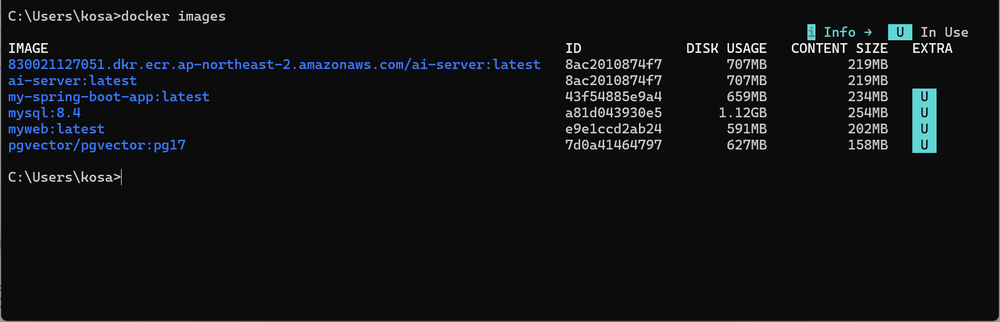

# 100일차

## AWS ECR 이미지 배포 실습과 SpaceLink 서비스 개선

📌 학습일 : 2026.11.26

📌 학습 내용 : AWS CLI와 Docker를 이용한 ECR 로그인·이미지 업로드·다운로드, Docker 권한 및 인증 오류 원인 분석, SpaceLink 주변 환경 분석과 배치 안정성 개선, 3D 일조량 지도 사전 로딩, LH 상가 공고문·호실 추출, 프론트엔드 API 프록시 연결 문제 확인

---

#### 1. AWS ECR에 로그인하고 Docker 이미지를 배포했다

ECR은 Docker 이미지를 보관하는 AWS 컨테이너 레지스트리다. 로컬에서 만든 이미지를 ECR에 올리거나 서버에서 내려받으려면, 먼저 이미지를 사용할 컴퓨터에서 AWS 인증을 받고 Docker 클라이언트를 해당 레지스트리에 로그인해야 한다.

실습에서는 AWS CLI를 설치하는 과정을 확인하고, AWS 계정의 ECR 인증 토큰을 Docker 로그인에 전달했다. 이후 ai-server 이미지를 빌드하고 ECR 저장소 주소와 태그를 붙여 푸시하는 흐름을 정리했다. 배포 서버에서는 같은 저장소와 태그를 사용해 이미지를 풀 받아 실행한다.

    aws ecr get-login-password --region ap-northeast-2 | docker login --username AWS --password-stdin 830021127051.dkr.ecr.ap-northeast-2.amazonaws.com
    docker build -t ai-server .
    docker tag ai-server:latest 830021127051.dkr.ecr.ap-northeast-2.amazonaws.com/ai-server:latest
    docker push 830021127051.dkr.ecr.ap-northeast-2.amazonaws.com/ai-server:latest
    docker pull 830021127051.dkr.ecr.ap-northeast-2.amazonaws.com/ai-server:latest

ECR 로그인은 이미지를 올리거나 내려받는 환경마다 따로 해야 한다. 내 PC에서 로그인했더라도 EC2의 인증 정보가 자동으로 생기지 않는다. sudo docker login을 했다면 인증 정보가 다른 사용자 기준으로 저장될 수 있으므로 sudo docker pull처럼 같은 실행 사용자로 이어서 작업해야 한다. 이미지 이름과 태그가 저장소에 실제로 올라가 있는지도 확인해야 한다.

#### 2. AWS CLI와 Docker에서 발생하는 오류를 원인별로 구분했다

'aws'은 내부 또는 외부 명령이 아닙니다라는 메시지는 AWS CLI가 설치되지 않았거나 실행 경로가 PATH에 등록되지 않았을 때 발생한다. 설치 후 새 터미널을 열고 aws --version으로 명령을 찾을 수 있는지 확인한다.

/var/run/docker.sock permission denied는 현재 사용자가 Docker 엔진에 접근할 권한이 없다는 뜻이다. Linux 환경에서는 sudo docker로 실행하거나 사용자에게 Docker 그룹 권한을 부여하는 방법이 있다. 단, 로그인 정보가 사용자별로 저장될 수 있으므로 로그인과 이미지 명령을 같은 사용자로 실행해야 한다.

no basic auth credentials는 이미지를 가져오는 환경에 ECR 인증 정보가 없다는 뜻이다. 이미지를 pull하는 컴퓨터에서 다시 로그인하고, Docker 명령을 실행하는 사용자와 로그인 사용자가 같은지 확인해야 한다. 결국 인증 오류를 해결하려면 레지스트리 주소·저장소 이름·태그·실행 사용자 네 가지를 함께 점검해야 한다.

#### 3. SpaceLink 주변 환경 분석과 배치 수집을 보강했다

오늘 GitHub에는 주변 소음원 수집과 소음 등급 산정, 악취 등급 산정 보강이 반영됐다. 대형 도로와 공연장 등 주변 소음 요인을 수집하고, 정화조·합류식 하수구·혼잡 지역 정보를 악취 분석에 활용한다. 제조업 업종 적합도에는 대형 도로 접근성을 고려하도록 했다.

환경 데이터를 한 번에 처리할 때 Oracle 메모리가 계속 쌓이던 문제를 줄이기 위해 침수·교통·악취·소음 작업을 100건 단위로 나눠 처리하도록 변경했다. 배치 패키지도 작업, 외부 API 클라이언트, 수집, 환경 분석 역할에 따라 정리했다. NoiseStep에서 발생한 람다 변수 캡처 컴파일 오류도 수정했다.

#### 4. 3D 일조량 지도와 공고 수집 기능을 개선했다

매물 상세에서 3D 지도를 열기 전에 지도와 주변 건물 데이터를 미리 불러오도록 개선했다. 선택한 건물과 주변 건물을 구분하고, 주변 건물 표시를 전환할 수 있게 했다. 건물 좌표가 정확한 건물 영역에 들어오지 않는 경우에는 가까운 건물을 선택하며 지형 높이도 반영하도록 보완했다.

LH 상가 공고문 PDF 수집과 호실 정보 추출 기능도 추가됐다. 공고문과 무관한 안내 자료는 제외하고 PDF 문서의 인코딩 처리를 보완했다. 일반공급의 청약통장·예치금·거주 조건 추출을 개선하고, 호실 및 공급 조건은 검증을 거쳐 관리자 승인 대기 상태로 저장하도록 구성했다. 관리자 검토 화면에는 제출서류 초안이 표시된다. 다만 실제 공고를 다시 수집해 추출 결과가 정상인지 확인하는 작업은 별도로 남아 있다.

#### 5. 사이트 화면과 API 연결 흐름을 확인했다

GitHub의 오늘 변경사항에는 홈 검색과 청약 캘린더 화면 정리, 찜·희망 조건·후보 비교 상태의 Zustand 저장소 전환, 고객 상담에서 사이트 이용 안내와 참고 FAQ·필터 링크·대화 복사 기능 개선도 포함됐다.

개발 중 프론트엔드에서 /api/main, /api/auth/me, 공고 일정 요청에 ECONNREFUSED가 발생한 원인도 확인했다. Vite 개발 서버는 /api 요청을 http://localhost:8080의 API 서버로 전달한다. 프론트엔드가 5173에서 실행 중이어도 API 서버가 꺼져 있으면 요청은 거부된다. 배치 서버 8081과 AI 서버 8082는 별도 역할이므로, 화면 API 오류를 해결하려면 API 서버 8080이 실행 중인지 확인해야 한다.

오늘은 컨테이너 이미지를 만드는 것만으로 배포가 끝나지 않는다는 점을 배웠다. 이미지를 사용하는 환경에서 ECR 인증을 완료하고, 권한과 저장소 주소, 태그를 맞춰야 push와 pull이 이어진다. 오류 메시지도 각각 CLI 설치, Docker 권한, 레지스트리 인증 문제로 나누어 보면 확인할 지점이 명확해진다.

SpaceLink 개발에서는 주변 환경 데이터와 추천 분석, 배치 처리, API, 화면이 한 흐름으로 연결되어야 기능이 실제로 동작한다는 점을 다시 확인했다. 특히 프론트엔드 서버가 켜져 있어도 API 서버가 실행되지 않으면 화면 데이터 요청은 실패한다. 앞으로도 컨테이너 배포와 서비스 개발 모두에서 실행 위치, 사용자 권한, 서버 간 연결 관계를 함께 점검해야겠다.

