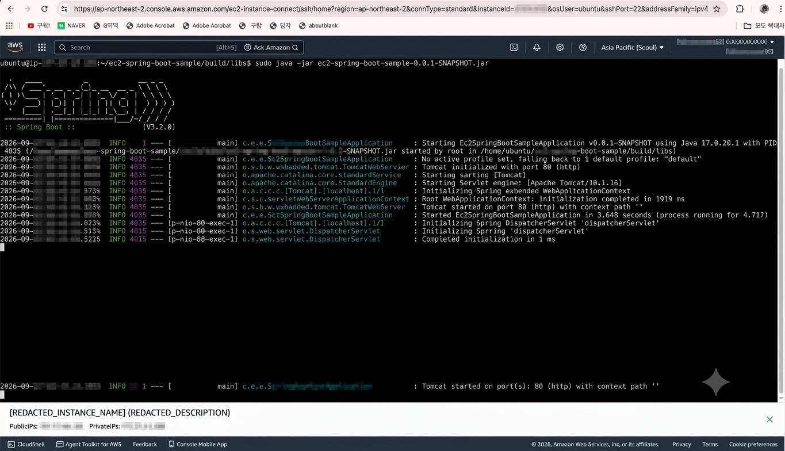

# 52일차

## 미니프로젝트 요구사항 분석 및 영화 예매 시스템 ERD 설계

📌 학습일 : 2026.09.28

📌 학습 내용 : Mini Project, Requirement Analysis, ERD, Database Design, Movie Reservation System, Entity Relationship, Reservation, Payment, Concurrency Control, External API

---

#### 1. 미니프로젝트 주제 및 방향 설정

- 영화 조회부터 예매, 결제, 모바일 티켓까지 이어지는 영화 예매 시스템을 미니프로젝트 주제로 설정
- 회원, 영화, 극장, 상영, 좌석, 예매, 결제, 취소표 대기, 알림 등의 기능을 하나의 서비스 흐름으로 구성
- 단순 영화 정보 조회뿐만 아니라 실제 예매 과정에서 발생할 수 있는 좌석 중복 예매와 결제 시간 제한 등의 문제까지 고려
- 서울 지역의 CGV, 롯데시네마, 메가박스를 대상으로 서비스 범위를 설정

#### 2. 요구사항 분석

- 회원가입·로그인, 소셜 로그인, 아이디 찾기, 비밀번호 재설정 등 회원 및 인증 기능 정의
- 영화 차트, 영화 목록·상세 정보, 관람평, 찜하기 등의 영화 기능 정의
- 극장 목록, 극장 정보, 상영 시간표 및 선호 극장 기능 정의
- 영화별·극장별 예매, 좌석 선택, 좌석 임시 점유, 결제 및 예매 취소 기능 정의
- 매진된 상영 회차의 취소표 대기 및 순차 알림 기능 정의
- 알림, 모바일 티켓, 마이페이지 등의 부가 기능 정의
- KOBIS, KMDb, 카카오 로컬, ODsay 등의 외부 API와 영화·극장 데이터를 연계하는 기능도 요구사항에 포함

#### 3. ERD 설계

영화 예매 서비스의 주요 기능을 데이터베이스 구조로 연결하여 ERD를 설계하였다.

- `users` : 회원 기본 정보 및 선호 영화관·좌석 정보
- `social_accounts` : 네이버·구글·카카오 소셜 계정 연동 정보
- `email_verifications` : 이메일 인증번호 관리
- `theaters` : 영화관 기본 정보
- `screens` : 영화관별 상영관 정보
- `seats` : 상영관별 좌석 정보
- `movies` : 영화 기본 정보 및 영화진흥위원회·KMDb 연계 정보
- `screenings` : 영화별 상영 회차와 가격·잔여 좌석 정보
- `screening_seats` : 상영 회차별 좌석 상태 관리
- `reservations` : 회원의 예매 정보와 예매 상태 관리
- `reservation_seats` : 예매에 포함된 좌석 정보
- `payments` : 예매별 결제 정보 및 결제 상태 관리
- `tickets` : 결제 완료 후 발급되는 모바일 티켓 정보
- `waitlists` : 매진 회차의 취소표 대기 정보
- `notifications` : 취소표 및 상영 전 알림 정보
- `reviews` : 영화 관람평 및 별점 정보
- `movie_likes` : 회원별 영화 찜 정보

#### 4. 예매·좌석 관계 설계

- `theaters → screens → seats` 구조로 영화관, 상영관, 좌석의 관계를 구성
- `movies → screenings → screening_seats` 구조로 영화별 상영 회차와 좌석 상태를 관리
- `reservations`와 `reservation_seats`를 분리하여 하나의 예매에 여러 좌석을 연결할 수 있도록 설계
- 결제 완료 시 `payments`, `tickets`와 예매 정보를 연결하여 예매부터 결제·티켓 발급까지의 흐름을 구성

#### 5. 동시성 및 좌석 중복 예매 고려

- 동일한 상영 회차에서 같은 좌석이 중복 예매되지 않도록 `screening_seats`에 `(screening_id, seat_id)` Unique 제약을 적용
- 좌석 상태를 `AVAILABLE`, `HELD`, `RESERVED`로 구분하여 선택 가능·임시 점유·예매 완료 상태를 관리
- 결제 대기 중인 좌석에는 `held_until`을 저장하여 제한 시간이 지나면 점유를 해제할 수 있도록 설계
- `version` 필드를 사용하여 동시에 같은 좌석을 예매하는 요청을 제어할 수 있도록 낙관적 락 구조를 반영

#### 6. 취소표 대기 및 알림 구조

- 매진된 상영 회차에 대해 `waitlists`를 이용하여 회원별 대기번호를 관리
- 예매 취소 또는 결제 시간 초과로 좌석이 반환되면 대기열을 확인하여 순서에 따라 알림을 보내도록 설계
- 알림을 받은 회원에게 일정 시간 동안 결제할 수 있는 제한 시간을 부여
- 제한 시간 내 결제가 완료되지 않으면 다음 대기자에게 기회를 넘길 수 있도록 상태와 시간 정보를 구성
- `notifications`를 통해 취소표 알림과 상영 30분 전 알림을 관리

#### 7. 외부 API 및 데이터 연계

- KOBIS API : 영화 목록·상세 정보와 누적 관객수 수집
- KMDb API : 영화 포스터와 줄거리 수집
- 카카오 로컬 API : 주소를 좌표로 변환하고 극장 위치 정보 활용
- 카카오맵 JavaScript SDK : 극장 위치를 지도에 표시
- ODsay LAB API : 선호 극장의 대중교통 이동시간 조회
- 다음 우편번호 서비스 : 회원 주소 검색
- Gmail SMTP : 아이디 찾기·비밀번호 재설정 등에 필요한 인증번호 이메일 발송
- 네이버·구글·카카오 OAuth 2.0 : 소셜 로그인 및 계정 연동

#### 8. 데이터베이스 설계 시 고려사항

- 회원 탈퇴와 관람평 삭제는 데이터를 바로 삭제하지 않고 상태 변경 또는 soft delete 방식으로 처리
- 영화 데이터는 KOBIS 영화 코드 등을 기준으로 중복 저장을 방지하도록 설계
- 영화 차트와 상영 시간표 등의 조회 성능을 고려하여 필요한 인덱스를 설계
- 외부 API 호출을 최소화하기 위해 영화 데이터와 이동시간 등의 결과를 저장하여 재사용하도록 구성
- 비밀번호는 BCrypt로 해싱하고 외부 API 키와 DB 비밀번호 등의 인증 정보는 환경 변수로 관리하는 방향으로 설계

#### 9. Troubleshooting

- 초기 기능 목록을 데이터베이스 테이블로 연결하는 과정에서 회원, 예매, 좌석, 결제 등의 관계를 명확하게 구분할 필요가 있었음
- 하나의 예매에 여러 좌석이 포함될 수 있는 구조를 고려하여 `reservations`와 `reservation_seats`를 분리
- 상영 회차별 좌석 상태를 별도로 관리하기 위해 기본 좌석 정보인 `seats`와 실제 예매 상태를 관리하는 `screening_seats`를 구분
- 단순한 테이블 구성뿐만 아니라 좌석 임시 점유, 동시 예매, 취소표 대기 등 실제 서비스에서 발생할 수 있는 상황까지 고려하여 ERD를 설계함

---

#### 10. 핵심 정리

- 미니프로젝트의 주제를 **영화 조회·예매·결제·티켓 발급이 가능한 영화 예매 시스템**으로 구체화함
- 요구사항을 회원, 영화, 극장, 예매, 결제, 취소표, 알림, 마이페이지 등의 기능 단위로 정리함
- 요구사항을 바탕으로 주요 엔티티와 테이블 간 관계를 정의하여 ERD를 설계함
- `screening_seats`와 낙관적 락을 활용하여 **동시 예매 상황에서 좌석 중복을 방지하는 구조**를 고려함
- 취소표 대기열과 알림 기능을 별도 테이블로 설계하여 예매 취소 이후의 서비스 흐름까지 데이터 구조에 반영함
- 외부 API와 데이터 수집, 성능·보안·동시성 등의 비기능 요구사항도 함께 고려하며 프로젝트 설계를 시작함

---

  

