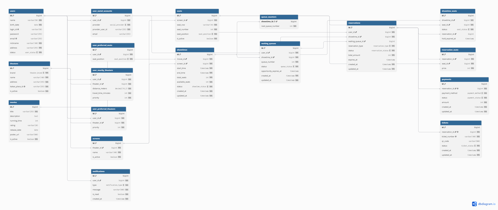

# 53일차

## 미니프로젝트 요구사항 정의서 작성 및 영화 예매 시스템 ERD 수정

📌 학습일 : 2026.09.29

📌 학습 내용 : Mini Project, Requirement Specification, ERD Refactoring, Smart Reservation, Waiting Queue, Queue Counter, Conditional Update, FOR UPDATE, Mock Payment, Scheduler, Redis Migration

---

#### 1. 미니프로젝트 주제 및 방향 설정

- 기술 스택을 **Spring Boot + React + MySQL**로 확정
- 선호 극장·선호 좌석 위치를 기준으로 좌석을 자동 선택하는 **스마트 예매**를 핵심 기능으로 설정
- 외부 영화 API 대신 영화·극장·상영 데이터를 **SQL 시드로 직접 관리**하도록 범위 조정
- 실제 PG 연동 없이 **모의결제(MOCK)** 로 결제 흐름 구현
- 모든 페이지 하단에 포트폴리오용 모의 사이트이며 3사와 무관하다는 면책 문구 표시

#### 2. 요구사항 분석

- 요구사항을 엑셀 **요구사항 정의서**로 정리 (구분 / ID / 기능명 / 상세 요구사항 / 우선순위 / 관련 테이블 / 비고)
  - 기능 요구사항 **73개**, 비기능 요구사항 **15개**, 외부 API 시트 별도 구성
- 요구사항마다 관련 테이블을 지정하여 **요구사항과 ERD를 교차 검증**
- 회원가입 검증 규칙 구체화
  - 아이디 : 영문+숫자 4\~12자 / 비밀번호 : 영문·숫자·특수문자 8\~20자 / 닉네임 : 한글·영문·숫자 2\~10자
  - 이름 + 생년월일이 같으면 동일인으로 보고 중복 가입 차단
  - 프론트 검증과 별도로 백엔드에서도 재검증
- 소셜 계정은 본인 확인 없이 기존 계정과 자동 병합하지 않도록 정의
- **거주 지역 → 주변 극장 계산 → 선호 극장 추천(최대 3개) → 스마트 예매** 흐름 정의
- 이메일 인증(아이디 찾기·비밀번호 재설정), 상영 30분 전 알림은 제외하고 관람평·찜하기는 추후 기능으로 보류

#### 3. ERD 설계

요구사항 정의서와 비교하며 ERD를 수정하였다.

| 구분 | 변경 전 | 변경 후 |
| --- | --- | --- |
| 상영 회차 | `screenings` | `showtimes` |
| 회차별 좌석 | `screening_seats` | `showtime_seats` |
| 취소표 대기 | `waitlists` | `waiting_queues` + `queue_counters` |
| 소셜 계정 | `social_accounts` | `user_social_accounts` |
| 선호 정보 | `users`에 포함 | `user_preferred_theaters`, `user_preferred_seats`, `user_nearby_theaters`로 분리 |
| 좌석 점유 | `HELD` / `held_until` | `HOLDING` / `hold_expired_at` |
| 동시성 제어 | `version` (낙관적 락) | Unique + 조건부 갱신 |
| 가격 | 상영 회차에 저장 | `application.yml` + `reservation_seats.price` |
| 제외 | - | `email_verifications`, `reviews`, `movie_likes` |

- `users` : `birth_date`(관람 등급 확인), `address`(지역만 저장), `status`(ACTIVE / INACTIVE / WITHDRAWN)
- `user_nearby_theaters` : 극장별 거리·이동시간·우선순위 저장
- `theaters` : 좌표 대신 `kakao_place_id`만 저장
- `movies` : 외부 API 연계 정보 제거 후 직접 관리
- `reservations` : `reservation_type`, `waiting_queue_id`, `expires_at`
- `payments` / `tickets` : 예매 1건당 결제 1건, 티켓 1장

#### 4. 예매·좌석 관계 설계

- 좌석 위치를 `seat_position` ENUM 하나로 관리
  - 측면·중앙 × 앞·중간·뒤 = `SIDE_FRONT` ~ `MIDDLE_REAR` 6개 구역
  - `seats`와 `user_preferred_seats`의 위치를 비교하여 스마트 예매 좌석 자동 선택
  - 2명 이상이면 같은 행의 연속 좌석을 우선 선택
- `reservation_type`(`SMART` / `NORMAL`)으로 예매 방식 구분
- 예매 상태를 `PENDING`, `CONFIRMED`, `CANCELLED`, `EXPIRED`로 구분
- `reservation_seats.price`에 **예매 당시 가격**을 저장하여 가격 정책이 바뀌어도 기존 금액 유지
- 결제 실패 후 재시도 시 새 행을 만들지 않고 기존 결제 행의 상태를 갱신

#### 5. 동시성 및 좌석 중복 예매 고려

- 낙관적 락 대신 **`AVAILABLE` 상태일 때만 선점하는 조건부 갱신**으로 변경
- 결제 단계 진입 시 좌석을 **5분간 `HOLDING`** 처리
- `showtimes.available_seats`는 좌석 상태 변경과 **같은 트랜잭션**에서 변경
- `(screen_id, start_time)` Unique는 같은 시작 시각만 막으므로 상영 시간 겹침은 코드에서 확인
- 선점 만료, 예매 만료, 대기 기회 만료, 상영 상태 변경은 **스케줄러**로 1분 이내 처리
- k6 / nGrinder 부하 테스트로 **중복 예매 0건** 검증 목표 설정

#### 6. 취소표 대기 및 알림 구조

- 대기번호 발급을 `queue_counters`로 분리하고 **트랜잭션 + `FOR UPDATE`** 로 중복 방지
- 대기 신청 1건 = 좌석 1개 기준이며 같은 회원의 중복 신청 허용
- 대기 상태를 `WAITING`, `NOTIFIED`, `HOLDING`, `COMPLETED`, `EXPIRED`, `CANCELLED`로 구분
- 차례가 된 회원에게 **5분**의 예매 기회를 주고 반환 좌석을 `HOLDING` 처리
- `reservations.waiting_queue_id` Unique로 **대기번호 1건당 예매 1건** 보장
- 상영 시작 시각이 되면 남은 대기를 모두 만료 처리
- 알림 유형을 `SEAT_HOLD_STARTED`, `QUEUE_TURN`, `RESERVATION_COMPLETED`, `RESERVATION_CANCELLED`, `PAYMENT_FAILED`로 정의

#### 7. 외부 API 및 데이터 연계

- KOBIS·KMDb API 제외 → 영화 데이터는 SQL 시드로 등록
- Gmail SMTP 제외 → 이메일 인증 기능 제외
- 다음 우편번호 서비스 대신 **카카오 로컬 API / 카카오맵**으로 거주 지역 검색
- 대중교통 이동시간은 **카카오 대중교통 길찾기 또는 ODsay** 중 선택
- 상영 시간표는 공개 API가 없어 시드 스크립트로 생성
- 외부 API 장애 시 타임아웃 후 대체 동작 제공 (이동시간 대신 거리만 표시 등)

#### 8. 데이터베이스 설계 시 고려사항

- 상영 예정인 예매가 있으면 회원 탈퇴 제한
- 예매 취소는 상태 변경으로 처리하고 `reservation_seats` 기록은 삭제하지 않음
- 인기순·예매율순 차트는 사이트의 확정 예매 데이터로 집계하고 성능 문제 시 캐시 적용
- 주변 극장 계산 결과는 저장하여 재사용하고 거주 지역 변경 시에만 재계산
- 선호 극장 최대 개수, 중복 가입 확인 등은 애플리케이션에서 검증
- 좌석 선점과 대기번호 발급을 서비스 계층에서 분리하여 **Redis(TTL, INCR·ZSET) 전환**에 대비
- 거주 지역, 생년월일 등 개인정보는 본인만 조회하고 로그·URL에 노출하지 않음

#### 9. Troubleshooting

- 요구사항마다 관련 테이블을 적으면서 **요구사항과 ERD가 맞지 않는 부분**을 발견
  - 선호 정보가 `users` 안에 있어 우선순위와 여러 개 선택 표현이 어려움 → 별도 테이블로 분리
  - 대기번호를 직접 계산하면 동시 신청 시 중복 가능 → `queue_counters` + `FOR UPDATE`로 분리
  - 모든 상영의 가격이 동일한데 회차마다 저장 → 설정값으로 옮기고 예매 당시 가격만 기록
  - 대기열로 생성된 예매인지 구분 불가 → `reservations.waiting_queue_id` 추가
- 외부 API 의존도가 높아 개발 범위가 커지는 문제 → 시드 데이터 중심으로 범위 축소
- 팀 내 확정이 필요한 항목 정리
  - 아이디 대소문자 구분, `nickname` Unique 여부, 서울 외 지역 허용 여부
  - 극장 좌표 저장 여부, 예매 취소 마감 시간, 탈퇴 후 재가입 허용 여부
  - 알림 이동 대상 컬럼 추가 여부, 브랜드 로고 사용 여부

---

#### 10. 핵심 정리

- 기능 73개, 비기능 15개로 구성된 **요구사항 정의서**를 작성하고 요구사항별 관련 테이블을 매핑함
- 요구사항과 ERD를 교차 검증하여 **테이블 이름 변경, 선호 정보 분리, 대기번호 카운터 추가** 등 ERD를 수정함
- 선호 극장·선호 좌석 위치를 활용한 **스마트 예매** 구조를 설계함
- 동시성 제어를 **Unique 제약 + 조건부 갱신**으로 바꾸고 대기번호는 **`FOR UPDATE`** 로 발급하도록 정리함
- 외부 영화 API와 이메일 인증을 제외하고 **시드 데이터와 모의결제**로 구현 범위를 조정함

---

  

어제 설계한 ERD를 바탕으로 요구사항 정의서를 작성하면서, 요구사항 하나하나에 관련 테이블을 적어 보니 설계 단계에서는 보이지 않던 빈틈이 많이 드러났다.
 선호 정보처럼 한 테이블에 넣었던 데이터를 분리하거나, 대기번호처럼 동시 요청에서 문제가 생길 수 있는 부분을 별도 테이블로 나누면서 요구사항과 ERD를 함께 맞춰 가는 과정이 중요하다는 것을 배웠다.

처음에는 외부 API와 기능을 최대한 많이 넣으려고 했지만, 구현 범위와 일정을 고려해 꼭 필요한 기능에 집중하도록 범위를 조정하는 것도 설계의 일부라는 것을 느꼈다.
 아직 팀 내에서 확정해야 할 정책들이 남아 있어 개발을 시작하기 전에 이 부분들을 먼저 정리해야 할 것 같다.
