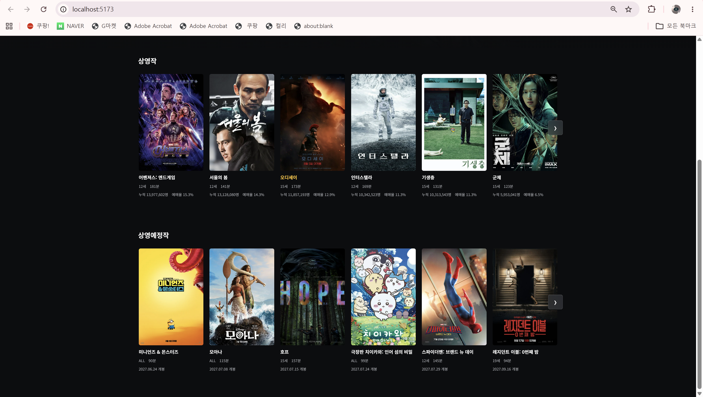

# 59일차

## 미니프로젝트 상영예정작 개봉일 변경 및 부하 테스트 계획 수립

📌 학습일 : 2026.10.07

📌 학습 내용 : ApplicationRunner, @Scheduled, git log -L, git grep, Idempotency, Foreign Key Cascade, Mockito never(), Gradle Test, Redis, Cache, Distributed Lock, Pessimistic Lock, Smoke Test, Load Test, Spike Test, Stress Test, Soak Test, Threshold, Line Chart, k6 Web Dashboard, Grafana, Ramping Arrival Rate, Spring Configuration Metadata

---

#### 1. 상영중 전환과 상영 시간표 생성 방식 확인

- **상영예정 → 상영중 전환은 자동**이었음
  - `MainService.getMainChart()`가 메인 화면을 조회할 때마다 **오늘 날짜(한국 시간)와 개봉일을 비교**

| 조건 | 상태 |
| --- | --- |
| 개봉일이 오늘이거나 그 전 | 상영중 |
| 개봉일이 오늘보다 뒤 | 상영예정 |

  - 상태를 DB에 저장하는 방식이 아니라서 **날짜만 지나면 다음 조회부터 바로 바뀜**
  - `app.reference-date`에 날짜를 넣으면 그 날짜로 고정되므로 주의

- **상영 시간표는 날짜가 지나도 자동으로 생기지 않았음**
  - `ShowtimeScheduleSeedService`는 두 경우에만 실행됨

| 실행 시점 | 방식 |
| --- | --- |
| 서버가 시작될 때 | `ApplicationRunner` |
| 관리자 기능 실행 시 | `prepare-schedule` |

  - 한 번 실행하면 **오늘부터 3일치**를 만들고, 이미 회차가 있는 날짜는 다시 만들지 않음
  - 매일 자동으로 도는 작업(`@Scheduled`)이 없어서, **서버를 재시작하거나 관리자 기능을 실행해야** 새 날짜 시간표가 생김

- **하루 상영작 10편을 고르는 기준이 바뀌어 있었음**
  - `lineupOf()`의 정렬 기준이 커밋에 따라 달라짐

| 커밋 | 정렬 기준 | 결과 |
| --- | --- | --- |
| 처음 (`8cf5639`) | 개봉일 최신순 | 새 영화가 개봉하면 가장 오래된 영화가 빠짐 |
| 이후 (`a5872ee`) | 누적관객수 많은 순 | 새 영화가 개봉해도 관객수 시드가 작으면 시간표에 아예 못 들어갈 수 있음 |

  - → 기능이 내가 기억하는 대로 동작한다고 가정하지 말고, **`git log -L`로 해당 코드의 변경 기록**을 확인해야 함

---

#### 2. 상영예정작 개봉일을 TMDB 개봉일 + 1년으로 변경

- **기존 방식** : `MovieImportService.applyConfiguredDefaults()`가 개봉일이 가장 늦은 10편(오디세이 `1368337` 제외)을 **10/11~10/17로 고정**
  - 날짜가 지나면 상영예정작이 상영중으로 넘어가 버리는 문제가 있었음

- **고민한 문제 : 서버를 재시작할 때마다 1년씩 밀리는 문제**
  - 이 메서드는 `tmdb.auto-import=true` 때문에 **서버가 시작될 때마다 실행**됨
  - DB에는 개봉일 칸이 하나뿐이라, 한 번 바꾸면 **TMDB 원래 개봉일이 남지 않음**
  - 단순히 `plusYears(1)`만 쓰면 재시작할 때마다 2027 → 2028 → …로 계속 밀림

- **해결 방법**

| 단계 | 내용 |
| --- | --- |
| 1 | 이번 실행에서 TMDB에서 **새로 받아온 영화 목록(`newIds`)** 을 따로 모음 |
| 2 | 상영예정 10편 중 **그 목록에 있는 영화만** TMDB 개봉일 + 1년으로 변경 |
| 3 | 이미 DB에 있는 영화는 건드리지 않아 **재시작해도 날짜가 다시 밀리지 않음** |

- **진행 순서**
  1. 관리자 페이지(`#/admin/data`)의 **"영화 전부 삭제"** 로 로컬 영화 데이터 삭제
     - 영화를 지우면 상영회차, 예매, 결제, 대기열 등 **17개 테이블이 외래 키 순서대로** 같이 지워짐
     - Workbench에서 SQL로 직접 지우는 것보다 **미리보기와 확인 단계가 있는 관리자 기능이 안전**함
  2. `MovieImportService`에서 필요한 줄만 수정 (7줄 추가, 5줄 삭제)
  3. 코드를 다시 받아오기 전에는 **서버를 재시작하면 안 됨** → 재시작하면 바로 예전 코드로 영화를 다시 받아옴

- **놓쳤던 점 : 팀원 테스트가 CI에서 실패할 상황이었음**
  - `MovieImportTests`가 "상영예정작 = 2026-10-11"을 확인하고 있었는데, 코드만 커밋한 뒤에 알게 됨
  - 테스트 두 줄을 추가로 수정

| 수정 | 내용 |
| --- | --- |
| 날짜 확인 | 상영예정작 날짜가 원래 날짜(2026-12-01) 그대로인지 확인 |
| 저장 확인 | 다시 저장하지 않는지 `never()`로 확인 |

  - 로컬에서 `gradlew test --tests MovieImportTests`로 통과 확인
  - → 동작을 바꾸면 **그 동작을 확인하는 테스트를 먼저 찾아봐야** 함 (이번에는 `git grep "2026, 10, 11"`로 찾을 수 있었음)

---

#### 3. k6와 Redis의 역할 구분

- k6와 Redis로 각각 테스트해서 그래프로 비교하려고 했지만, **Redis는 테스트 도구가 아님**

| 구분 | k6 | Redis |
| --- | --- | --- |
| 정체 | 부하 테스트 도구 | 메모리에 데이터를 저장하는 빠른 저장소 |
| 하는 일 | 가상 사용자로 요청을 보내 속도·실패율을 **측정** | 캐시, 좌석 잠금, 대기열 등으로 서버를 **빠르게 만듦** |
| 프로젝트에서 | 모든 테스트를 실행하는 도구 | 개선 수단 (적용 전/후 비교 대상) |

- 올바른 구조 : **k6로 측정 → Redis 적용 → 같은 k6 테스트로 다시 측정 → 전후 비교**

---

#### 4. 테스트 대상을 고르는 기준

- 실무에서는 아래 네 가지 중 하나라도 해당하면 테스트 대상으로 잡음

| 기준 | 질문 | 예시 |
| --- | --- | --- |
| 많이 호출되는가 | 사용자 대부분이 거치는 화면인가 | 메인, 영화 목록, 시간표 |
| 한꺼번에 몰리는가 | 특정 시각에 사람이 폭주하는가 | 예매 오픈 시 로그인, 좌석 조회 |
| 동시에 해도 결과가 맞는가 | 여러 명이 같은 걸 건드리면 데이터가 꼬일 수 있는가 | 같은 좌석 동시 예매 |
| 무거운가 | DB 조회나 계산이 많은가 | 스마트예매 좌석 탐색, 좌석 배치도 |

- 우리 프로젝트에 적용

| 기능 | Redis 비교 가치 | 이유 |
| --- | --- | --- |
| 로그인 | 낮음 | 병목이 BCrypt(CPU)라 Redis로 빨라지지 않음 → 현재 처리량 측정까지만 |
| 좌석 선점 | 높음 | 지금은 DB 비관적 락(`PESSIMISTIC_WRITE`), Redis 분산 락과 비교 가능, **중복 예매 0건** 확인 |
| 시간표·좌석 배치도 조회 | 높음 | 많이 호출되고 무거워서 Redis 캐시 효과가 가장 잘 보임 |
| 메인 차트 | 보통 | 이미 10ms 수준이라 차이가 작게 나옴 |
| 스마트예매·대기열 | 높음 | Redis 대기열(가상 대기실) 적용 효과 확인 가능 |

- 좌석 선점과 시간표 조회는 팀원 담당 코드라 Redis 적용 전에 **팀 협의**가 필요함

---

#### 5. 테스트 종류와 합격 기준

- 같은 기능이라도 목적에 따라 테스트 방식이 다름 (어제 한 동시 로그인은 스파이크 테스트)

| 종류 | 방식 | 알 수 있는 것 |
| --- | --- | --- |
| 스모크 | 1명, 짧게 | 스크립트가 맞는지 |
| 로드 | 예상 인원을 몇 분 유지 | 평소에 안정적인지 |
| 스파이크 | 순간적으로 몰림 | 예매 오픈 같은 폭주를 버티는지 |
| 스트레스 | 인원을 계속 늘림 | 어디서 무너지는지 (한계점) |
| 소크 | 적당한 인원을 오래 유지 | 시간이 지나며 느려지거나 메모리가 새는지 |

- 테스트 전에 **"이 정도면 통과"** 기준을 먼저 정하고 k6 `thresholds`에 넣어 자동으로 ✓/✗ 판정

| 구분 | p95 응답 시간 | 실패율 | 추가 조건 |
| --- | --- | --- | --- |
| 조회 | 500ms 미만 | 1% 미만 | |
| 로그인 | 1~3초 미만 | 1% 미만 | |
| 좌석 선점 | 1초 미만 | 의도된 실패 외 0% | 중복 예매 0건 (DB로 확인) |

---

#### 6. 결과를 그래프로 비교하는 방법

| 구분 | k6 웹 대시보드 HTML 보고서 | 엑셀 그래프 | Grafana |
| --- | --- | --- | --- |
| 보여주는 것 | 테스트 1번 안에서 **시간에 따른 변화** | 여러 번 테스트한 **결과끼리 비교** | 시간별 변화와 여러 테스트 비교를 한 화면에서 |
| 가로축 | 시간 | 조건 (인원, Redis 전/후) | 시간 |
| 만드는 법 | 실행 시 설정만 켜면 자동 생성 | 결과를 표로 옮겨 차트 삽입 | 결과 저장용 DB와 대시보드 설정 필요 |
| 쓰임 | 개인 프로젝트·빠른 공유 | 보고서·발표 자료 | 회사에서 가장 많이 사용 |

- 포트폴리오에는 **엑셀 비교 그래프를 메인**으로, 대표 테스트의 **HTML 보고서 캡처**를 보조로 사용하기로 결정
- 그래프는 **선그래프**로 결정 : 인원이 순서대로 늘어날 때의 변화 흐름을 보여주기 좋음
  - 가로축 동시 사용자(100 → 500 → 1000 → 2000 → 5000), 선 2개(Redis 적용 전/후)
  - p95, 처리량, 실패율은 단위가 달라 **지표마다 표와 그래프를 따로** 만듦
  - 첫 열을 `100`이 아닌 **`100명`처럼 글자로** 적어야 엑셀이 그 열을 선으로 그리지 않음
  - 엑셀 : 표 선택 → **삽입 → 꺾은선형 → 표식이 있는 꺾은선형** → 차트 제목과 축 제목 추가
- 어제 5000명 60초 결과는 일시적 정체가 섞여 있어, 그래프에 넣기 전에 재측정이 필요함

---

#### 7. 실패가 나왔을 때 부하를 늘리는 순서

- 실패가 뜨면 **통과할 때까지 조건을 느슨하게 바꾸는 것이 아니라, 그 단계에서 멈추고 원인을 분석**해야 함
- 테스트할 때는 **한 번에 한 가지만** 바꿈

| 구분 | 인원 늘려가기 | 몰리는 시간(SPREAD) 늘려가기 |
| --- | --- | --- |
| 고정하는 것 | 몰리는 방식 | 인원 |
| 답하는 질문 | 우리 서버는 몇 명까지 버티나 (한계점) | 이 인원을 처리하려면 얼마나 분산돼야 하나 |
| 실무 | 기본 방식 (스트레스 테스트) | 보조 분석용 |

- SPREAD는 "사용자가 실제로 어떻게 몰리는가"라는 **상황 설정**이라, 통과시키려고 늘리면 현실과 다른 조건에서 통과한 것이 됨
  - 어제 SPREAD를 바꿔본 것은 **로그인 처리량(초당 약 110건)을 알아내기 위한 분석 과정**으로는 의미가 있었음
- 표준 진행 순서
  1. 시나리오를 먼저 정해 SPREAD 고정 (예: 예매 오픈 시 10초 안에 몰림)
  2. 인원을 단계적으로 늘림 (100 → 500 → 1000 → 2000 → 5000)
  3. 기준을 처음 넘는 단계에서 멈춤 → 한계점 기록
  4. 원인 분석 (CPU, DB, 연결 거부 등)
  5. 개선 (Redis 적용, 설정 조정, 코드 개선)
  6. **똑같은 조건으로** 다시 측정 → 한계점이 올라간 만큼이 개선 효과
- "몇 명" 대신 **초당 요청 수**를 단계적으로 늘리는 `ramping-arrival-rate` 방식도 있음 → 처리량이 더 이상 따라오지 못하는 지점을 바로 확인 가능

---

#### 8. application.properties의 `scope` 빨간 표시

- IntelliJ 문제 창에 `프로퍼티 'scope' ... 내에 색인 액세스가 필요합니다` 오류가 계속 표시됨
- `scope`는 Spring 내부에서 **여러 값을 담는 목록(Set)** 이라, IntelliJ 검사기는 번호를 붙여 쓰는 방식만 정답으로 봄

| 방식 | 예시 | Spring 실행 | IntelliJ 검사기 |
| --- | --- | --- | --- |
| 쉼표로 이어 쓰기 (현재) | `scope=profile,email` | 정상 동작 | 빨간 표시 |
| 번호 붙여 쓰기 | `scope[0]=profile`, `scope[1]=email` | 정상 동작 | 표시 없음 |

- Spring은 쉼표 방식을 자동으로 목록으로 바꿔주고, `.properties` 파일은 컴파일되지 않아 **빌드·실행·CI에 영향이 없음**
- 팀 공용 파일이라 직접 수정하지 않고 그대로 두기로 함
  - 표시가 거슬리면 **Settings → Editor → Inspections**에서 내 IntelliJ만 검사를 끌 수 있음
  - 파일을 번호 방식으로 바꾸려면 배포 담당 팀원과 상의 후 진행

---

#### 9. 확인 결과

- 메인 화면 조회 시 개봉일과 오늘 날짜를 비교해 상영중·상영예정이 자동으로 나뉘는 구조임을 확인
- `git log -L`로 `lineupOf()`의 정렬 기준이 개봉일 최신순에서 누적관객수 순으로 바뀐 커밋을 확인
- 개봉일 변경 후 `gradlew test --tests MovieImportTests`로 수정한 테스트 통과 확인
- `scope` 빨간 표시가 있어도 서버가 정상 실행되고 소셜 로그인이 동작하는 것을 확인

---

#### 10. Troubleshooting

- 날짜가 지나도 새 날짜 시간표가 생기지 않음 → `ShowtimeScheduleSeedService`는 서버 시작과 관리자 기능에서만 실행되고 `@Scheduled`가 없음 → 서버 재시작 또는 `prepare-schedule` 실행
- 새로 개봉한 영화가 시간표에 안 들어갈 수 있음 → `lineupOf()` 정렬 기준이 누적관객수 순으로 바뀌어 있었음 → `git log -L`로 변경 기록 확인
- 개봉일에 `plusYears(1)`만 쓰면 재시작할 때마다 1년씩 밀림 → 서버 시작마다 import가 실행되고 원래 개봉일이 남지 않음 → 이번 실행에서 새로 받아온 영화(`newIds`)만 변경
- 개봉일 로직 변경 후 `MovieImportTests`가 CI에서 실패할 상황 → 테스트가 "상영예정작 = 2026-10-11"을 확인하고 있었음 → `git grep`으로 찾아 테스트 수정 후 `gradlew test --tests MovieImportTests`로 확인
- `프로퍼티 'scope' ... 색인 액세스가 필요합니다` → IntelliJ 검사기가 쉼표 방식의 목록 값을 이해하지 못한 경고 → 실행에 문제없어 그대로 두고, 필요하면 내 IntelliJ에서만 검사 끄기

---

#### 11. 핵심 정리

- 상태를 DB에 저장하지 않고 **조회할 때마다 계산**하면 날짜가 지나도 자동으로 바뀌지만, 시간표처럼 **생성해야 하는 데이터는 실행 시점**을 따로 확인해야 함
- 기능이 기억대로 동작한다고 가정하지 말고, **`git log -L`로 코드의 변경 기록**을 확인해야 함
- 서버 시작마다 실행되는 코드는 **여러 번 실행돼도 결과가 같도록(멱등성)** 설계해야 함
- 동작을 바꾸면 **그 동작을 확인하는 테스트를 먼저 찾아서** 함께 수정해야 CI 실패를 막을 수 있음
- 대량 데이터 삭제는 SQL 직접 실행보다 **미리보기와 확인 단계가 있는 관리자 기능**이 안전함
- Redis는 테스트 도구가 아니라 **개선 수단**이며, k6로 적용 전/후를 같은 조건에서 측정해야 효과를 보여줄 수 있음
- 테스트 대상은 **많이 호출되는가, 한꺼번에 몰리는가, 동시에 해도 결과가 맞는가, 무거운가**를 기준으로 고르고, 합격 기준을 **테스트 전에 먼저 정함**
- 실패하면 조건을 느슨하게 바꾸지 말고 **멈춰서 원인을 분석**한 뒤 같은 조건으로 다시 측정함
- IDE의 빨간 표시가 모두 실제 오류는 아니므로, **실행에 영향이 있는지** 먼저 확인하고 공용 파일은 함부로 고치지 않음

---

  

상영예정영화를 개봉일을 1년 뒤로 바꾸는 작업에서는 서버를 재시작할 때마다 날짜가 계속 밀릴 수 있다는 점을 미리 고민해 새로 받아온 영화만 바꾸도록 했지만, 그 동작을 확인하는 팀원의 테스트를 놓쳐 커밋 후에 수정해야 했다. 앞으로는 동작을 바꾸기 전에 관련 테스트를 먼저 찾아보는 습관을 들이려고 한다.

부하 테스트 계획을 세우면서 Redis는 테스트 도구가 아니라 서버를 개선하는 수단이고, 측정은 k6로 같은 조건에서 전후를 비교해야 한다는 것을 알게 되었다. 실패가 나왔을 때 통과할 때까지 조건을 바꾸는 것은 시험 범위를 줄이는 것과 같다는 설명이 인상 깊었고, 실패 지점에서 멈추고 원인을 찾은 뒤 같은 조건으로 다시 측정해야 개선 효과를 증명할 수 있다는 흐름을 이해하게 되었다.
 다음에는 좌석 선점 동시성 테스트를 Redis 적용 전 상태로 먼저 측정하고, 대기번호가 발급되지 않는 원인을 확인해 담당 팀원에게 전달할 예정이다.
