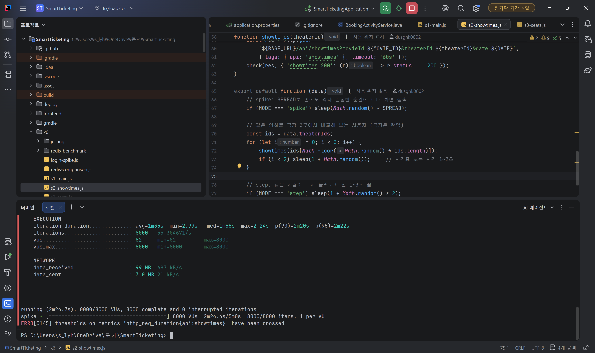

# 60일차

## 미니프로젝트 Redis 적용 전 부하 테스트 진행 및 ERD·발표 자료 정리

📌 학습일 : 2026.10.08

📌 학습 내용 : k6, per-vu-iterations, ramping-vus, SPREAD, summary-export, thresholds, abortOnFail, p95, Median, Throughput, Spike Test, Stress Test, Tomcat max-connections, accept-count, HikariCP, Connection Pool, Ephemeral Port, TIME_WAIT, GitHub Actions, DBML, dbdiagram.io, ERD, simple-icons

---

#### 1. 테스트 방식 정리 : 계단식과 스파이크

- 실무에서는 **계단식(부하·스트레스 테스트)** 을 가장 많이 하고, 티켓 오픈처럼 **정해진 시각에 몰리는 서비스는 스파이크 테스트를 따로** 함
- 우리 프로젝트는 영화 예매라 **두 방식을 같이 쓰되 무게를 나누기로** 결정

| 구분 | 메인 : 스파이크 반복 | 보조 : 계단식 |
| --- | --- | --- |
| k6 방식 | `per-vu-iterations` (사용자당 1번 동작) | `ramping-vus` |
| 인원 | 500 / 1000 / 2000 / 3000 / 4000 / 5000 / 6000 / 7000 / 8000명, 실행마다 따로 | 1번 실행 안에서 500 → 5000명 |
| 시간 | SPREAD초 안에 각자 랜덤하게 시작 | 단계마다 15초 올리고 1분 유지 |
| 보여주는 것 | 예매 오픈처럼 몰릴 때 Redis 차이 | 버틸 수 있는 최대 동시 사용자 |

- 같은 조건에서 **단계별 2번** 측정하고, p95 차이가 20%를 넘으면 3번째를 돌려 **중앙값**을 대표값으로 사용
- 사전 점검(Smoke, SPREAD 정하기, 최대 인원 확인)은 결과 파일 저장과 엑셀 기록에서 제외

---

#### 2. 시나리오별 SPREAD 정하기

- SPREAD는 "Redis 적용 전 기준으로 **확실히 느려지지만 전부 실패하지는 않는 값**"으로 정함
- 요청이 가벼운 시나리오는 짧게, 무거운 시나리오는 길게 조정

| 시나리오 | 요청 1번에 읽는 양 | SPREAD | 이유 |
| --- | --- | --- | --- |
| S1 메인·공통 조회 | 영화 20편 | 2초 | 20초·5초에서는 부하가 거의 없었음 |
| S2 시간표 조회 | 회차 11개 + 좌석 1,320개 | 60초 | 30초면 8000명에서 시간 초과로 대량 실패 예상 |
| S3 좌석 배치도 조회 | 좌석 120개 | 5초 | 8000명에서 p95 3.49초, 실패 0건 |

---

#### 3. Redis 적용 전 로컬 측정 결과

- 이 노트북(i9-12900H, 32GB)에서 서버와 k6를 같이 실행, 캐시 OFF 상태

| 시나리오 | 성능이 꺾이는 지점 | 최대 처리량 (초당) | 8000명 p95 |
| --- | --- | --- | --- |
| S1 메인·공통 조회 | 3000 → 4000명 | 약 2,600건 | 약 2.06초 |
| S2 시간표 조회 | 4000 → 5000명 | 약 224건 | 약 20초 |
| S3 좌석 배치도 조회 | 2000 → 3000명 | 약 1,280건 | 약 4.05초 |

- 계단식 5000명은 세 시나리오 모두 **실패 0건**이었지만, S2는 p95가 **약 21.5초**까지 올라감
- 한 번에 읽는 좌석이 많을수록 처리량이 크게 줄어듦 → S2·S3가 **Redis 캐시 효과가 가장 크게 날 후보**
- API별로 보면 `/api/movies`와 `/api/main`이 가장 느렸고, 팀원 Redis 계획의 "공통 조회" 대상과 일치

---

#### 4. 병목 원인 찾기

- **CPU가 아니었음** : S2 측정 중 기록해 보니 전체 CPU 약 60%, 서버 약 40%에서 멈춤
- **DB 커넥션 풀(Hikari 기본 10개)** 대기로 추정
  - 연결 10개 ÷ 요청 1건당 약 45ms ≈ **초당 222건**으로, 실제 처리량과 거의 같음
- **연결 거부(`actively refused`)** 는 Tomcat 설정 한계

| 설정 | 기본값 | 증상 |
| --- | --- | --- |
| `server.tomcat.max-connections` | 8192 | 넘는 사용자는 연결 자체를 못 함 |
| `server.tomcat.accept-count` | 100 | 순간적으로 몰리면 간헐적 연결 거부 |
| `spring.datasource.hikari.maximum-pool-size` | 10 | 처리량 정체, 응답 대기 증가 |

- 10000명으로 확인해 보니 **성공이 정확히 8,192명** → Tomcat 최대 연결 수와 일치
- 그래서 최대 인원을 **8000명**으로 정함 (Redis와 무관한 서버 기본 설정 한계는 비교에서 분리)
- 로컬 실행 설정에 넣었다고 생각했던 `-Dserver.tomcat.accept-count=1000`은 **실제로는 VM 옵션에 없었음** → 지금까지 측정은 기본값 100으로 진행된 것

---

#### 5. Windows 환경에서 부하 테스트할 때 주의점

- "Windows는 800명이 한도"라는 이야기가 있었지만, 실제로 8000명까지 측정됐고 실패 지점은 Tomcat 설정(8192)과 일치함
- 대신 Windows에는 **연결 포트 한도**가 있음

| 항목 | 이 노트북 |
| --- | --- |
| 동적 포트 범위 | 49152~65535 (16,384개) |
| 닫힌 연결이 포트를 붙잡는 시간(TIME_WAIT) | 기본값 (약 2분) |

- 8000명 실행 후 바로 다시 8000명을 돌리면 이전 포트가 다 안 풀려 한도에 가까워짐 → **실행 사이 쉬는 시간을 90초로 늘림**
- 로컬 Windows 결과는 **같은 노트북 안에서 Redis 전후를 비교하는 용도**로만 쓰고, 최종 기준은 AWS(Linux) 결과로 잡음

---

#### 6. 결과 기록 방식

| 구분 | JSON (`--summary-export`) | 엑셀 |
| --- | --- | --- |
| 내용 | k6가 남기는 원본 기록 | 비교에 필요한 숫자만 모은 표 |
| 위치 | 저장소 밖 `k6-results/` | 저장소 밖 (팀 공유는 드라이브·노션) |
| 용도 | 백업, 다시 확인 | 비교, 그래프, 공유 |

- 엑셀을 Git에 올리면 변경 내용이 안 보이고, 동시에 수정하면 합칠 수 없고, `~$` 임시 파일이 같이 잡혀서 **저장소에 넣지 않기로** 함
- 엑셀은 "측정 환경" (커밋 번호, CPU·메모리, k6 실행 위치, 캐시 모드, Tomcat 설정)과 "측정 결과", 시나리오별 "요약" 시트로 구성
- 요약 시트는 `MEDIAN` 수식으로 회차별 결과를 참조해서, 결과 시트를 고치면 자동으로 바뀌게 함

---

#### 7. 팀원 도구와 구분하기

- `local.cmd`, Actions `Switch AWS cache configuration` : Redis 캐시를 **같은 빌드에서 켜고 끄는 도구** (Redis 담당 팀원)
- `benchmark-smart.cmd` : 1명 기준 스마트예매 응답 속도 측정 도구
  - 스마트예매 성능 개선 커밋(`23d68ae`) **전후를 비교하려고 만든 것**이라, 이미 개선 코드가 들어간 지금 "개선 전"으로 실행하면 이름과 실제 코드가 맞지 않음 → 적용 전 측정에서 제외
- Redis 적용 전 측정에는 로컬 Redis와 WSL이 필요 없음 (캐시 기본값 OFF, QR 검증은 테스트 시나리오에 없음)

---

#### 8. ERD 다시 그리기

- 최신 `main` 엔티티 25개를 읽어 **DBML 코드**로 정리하고 dbdiagram.io에서 ERD 생성
- 처음에는 생성이 안 됐음

| 원인 | 수정 |
| --- | --- |
| Enum 값을 한 줄에 몰아 씀 | 한 줄에 값 하나씩 |
| TableGroup 이름이 한글 | 영어 이름으로 변경 |

- 처음 설계(18개)와 비교하니 **테이블 28개로 10개 증가**
  - 스마트예매를 위한 **예매 요청 그룹** 도입 (`booking_request_groups`)
  - 취소표 대기를 **좌석 구역별 순번**으로 변경, 희망 좌석 저장
  - 중복 요청 방지(`booking_operations`)와 사용자 단위 잠금 테이블 추가
  - 영화관 좌표, 회차별 가격, 연속 좌석 판단 컬럼 추가

---

#### 9. 발표 자료 제작

- 기획 정리 → 팀 역할 분담 반영 → 슬라이드 제작 순서로 진행
- 기술 스택과 협업 도구는 **simple-icons 로고**로 표시하고, 세부 기술은 묶어서 간략하게 표시
- 디자인은 사이트와 같은 **검정 배경 + 노란 포인트**로 맞춤
- 슬라이드 순서를 사용자 흐름에 맞게 재정리
  - 소개 → 사용자 흐름 → 파트별 기능 (회원 → 영화·극장 → 예매) → 기술 스택·협업 → ERD와 데이터 흐름 → 성능·트러블슈팅 → 시연 → Q&A
- ERD는 거의 슬라이드 전체 크기로 키우고, 영역별 테이블·예매 흐름·취소표 대기 흐름 설명 슬라이드를 추가

---

#### 10. 확인 결과

- S1·S2·S3 계단식 2회, 스파이크 9단계 2회(차이 큰 단계는 3회) 측정 완료
- 10000명 실행에서 성공 8,192명으로 Tomcat 최대 연결 수 한계 확인
- 측정 중 CPU 약 60%로 CPU가 아닌 DB 커넥션 풀이 병목인 것을 확인
- k6 스크립트 3개(`s1-main.js`, `s2-showtimes.js`, `s3-seats.js`) 작성 후 커밋
- 수정한 DBML로 dbdiagram.io에서 ERD 생성 확인

---

#### 11. Troubleshooting

- SPREAD 20초·5초에서 부하가 거의 없음 → 가벼운 요청이라 분산 시간이 길면 서버가 여유로움 → S1은 2초로 줄여서 확정
- S2에서 실패는 없는데 p95가 20초 이상 → 처리량이 초당 약 224건에서 멈춤 → CPU 여유 상태라 DB 커넥션 풀 대기로 추정
- 10000명에서 연결 거부와 60초 시간 초과 → Tomcat 최대 연결 수(8192) 초과 → 최대 인원을 8000명으로 조정
- 5000명·8000명에서 간헐적 연결 거부 → Tomcat 대기열(accept-count 100) 초과, VM 옵션이 실제로는 비어 있었음 → Redis와 무관한 한계로 따로 기록
- dbdiagram.io에서 ERD가 생성되지 않음 → Enum 한 줄 작성, 한글 TableGroup 이름 → 문법에 맞게 수정
- 엑셀 직접 수정 후 데이터 시작 줄이 바뀜 → 예시 줄 삭제로 위치가 한 칸 당겨짐 → 머리글 위치를 찾아 다시 정렬하고 요약 시트 참조 수정

---

#### 12. 핵심 정리

- 테스트 방식은 **목적에 따라** 고름 : 순간 집중은 스파이크, 한계점은 계단식
- SPREAD는 시나리오마다 다르게 정하되, 정한 뒤에는 **Redis 전후 모두 같은 값**으로 고정해야 비교가 됨
- 같은 조건도 실행마다 흔들리므로 **여러 번 측정하고 중앙값**을 씀
- 실패가 나오면 **어디서 막혔는지(CPU, DB 커넥션, Tomcat 연결 수, 포트)** 를 구분해야 하고, Redis로 해결되지 않는 한계는 따로 설명해야 함
- 설정을 "넣었다"고 기억해도 **실제 실행 설정을 확인**해야 함
- 측정 결과 원본은 저장소 밖에 보관하고, 비교용 엑셀은 Git이 아닌 공유 도구로 관리함
- 같은 이름의 도구라도 **어떤 코드 시점을 기준으로 만든 것인지** 확인하고 써야 함

---

  

Redis 적용 전 기준을 잡기 위해 메인, 시간표, 좌석 배치도 조회를 각각 측정했는데, 같은 5000명이라도 시나리오마다 버티는 정도가 크게 달랐다. 특히 시간표 조회는 실패는 없었지만 응답이 20초 넘게 걸렸고, CPU에는 여유가 있는데 처리량이 초당 약 224건에서 멈추는 것을 보며 병목이 DB 연결 쪽이라는 것을 알게 되었다. 10000명에서 성공한 사용자가 정확히 8192명인 것을 보고 Tomcat 기본 설정 한계를 숫자로 확인할 수 있었던 것도 인상 깊었다.

또 VM 옵션에 넣었다고 생각했던 설정이 실제로는 비어 있었고, 개선 전 측정용 도구가 이미 개선된 코드 기준이라 쓸 수 없다는 것도 확인하면서, 기억이 아니라 실제 설정과 코드 시점을 먼저 확인해야 한다는 것을 다시 느꼈다.
 다음에는 남은 시나리오(로그인, 대기·후보 상태 조회, 스마트예매, 동일 좌석 선점)를 측정하고, 팀원이 Redis를 적용하면 같은 조건으로 다시 측정해 전후를 비교할 예정이다.