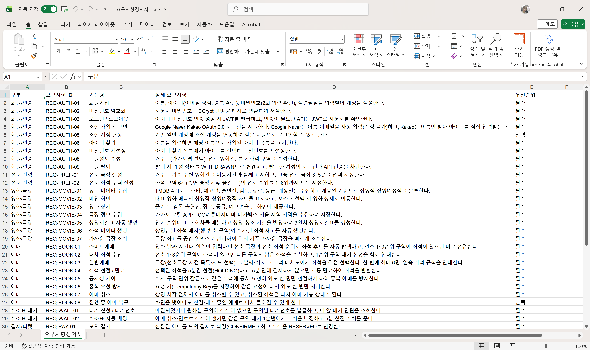

# 61일차

## 미니프로젝트 발표 자료와 산출물 문서 정리

📌 학습일 : 2026.10.10

📌 학습 내용 : 발표 구성, 시연 시나리오, ERD 재검토, Outbox, 공간 인덱스, 요구사항정의서, UI 스토리보드, 테이블 정의서, 시퀀스 흐름 정의서, API 명세서, 화면설계서, Idempotency-Key, HashRouter

---

#### 1. 발표 자료 구성 다시 잡기

- 팀 발표 순서표에 맞춰 슬라이드를 **담당자·주제 순서**로 다시 배치함
- 발표 순서표에 주제는 있는데 슬라이드가 없던 부분은 기본틀을 새로 만들고, 겹치는 슬라이드는 바로 지우지 않고 **삭제 후보로만 표시**한 뒤 직접 판단해서 정리함

| 섹션 | 내용 |
| --- | --- |
| 01 ~ 04 | 프로젝트 소개, 기술 스택·협업, 이용 흐름, 데이터베이스 설계 |
| 05 예매·대기 설계 | 예매 흐름, 좌석 동시성과 잠금 범위 개선, 취소표 배정과 Outbox, 접속 대기실 |
| 06 대기순번·티켓 | 대기순번·QR 티켓, 대기순번 조회 비용 개선, 해시 라우팅 |
| 07 ~ 08 | 성능 검증(Redis 전후 비교), 결과·시연 |

- Redis 비교는 **한 페이지에 그래프 2개**(p95 응답시간, 처리량)씩 넣는 레이아웃으로 바꾸고, 적용 전 수치만 먼저 채움
- 목차의 섹션 이름과 각 페이지 상단 소제목(`05 / 예매·대기 설계`)을 **같은 문구로 통일**하고, 페이지 번호를 실제 순서에 맞춤
- 새 슬라이드 내용은 기억이 아니라 **커밋 메시지와 코드**로 확인해서 작성함
  - 잠금 범위 : 회차 단위 → **회차·구역 단위**, 확보할 좌석만 잠근 뒤 다시 확인
  - 취소표 배정 : 취소와 **같은 트랜잭션에 Outbox 이벤트**를 기록하고 워커가 처리, 실패 시 재시도
  - 대기순번 조회 : 매번 DB `COUNT` → **Redis 정렬 집합 `ZCOUNT`**, 버전이 안 맞으면 DB로 대신 조회
  - 해시 라우팅 : QR 접속·새로고침 시 404 → `HashRouter`로 `/#/ticket/verify/...`

---

#### 2. 시연 영상 시나리오

- 영상 1개로 합치고, QR 스캔 장면만 휴대폰 화면을 PC 화면 위에 작게 올리기로 함 (두 영상을 따로 띄우면 재생 시점이 어긋남)

| 순서 | 장면 |
| --- | --- |
| 1 | 메인 → 회원가입 → 선호 설정 → 아이디·비밀번호 찾기 → 로그인 |
| 2 | 스마트예매 : 조건 입력 → 1~3순위 구역 5분 선점 → 모의결제 |
| 3 | 일반예매 : 선호극장·지점 목록·지도로 극장 변경 → 좌석 직접 선택 |
| 4 | 1~3순위 구역이 모두 찼을 때 → 다른 좌석 추천 + **1순위 구역 대기번호 발급** |
| 5 | 관리자 강제 취소로 취소표 발생 → 순번 알림 → 5분 선점 → 결제 |
| 6 | QR 티켓 → 휴대폰 스캔 → 사용 처리 → 회원 탈퇴 |

- 실패하면 다시 준비가 오래 걸리는 대기·취소 장면을 **가장 먼저** 촬영하고, 되돌릴 수 없는 탈퇴는 마지막에 촬영
- 개인정보가 보이는 소셜 가입 장면은 빼고, 거주지는 공공 장소로 선택

---

#### 3. ERD 변경 사항 검토

- 이전 ERD(DBML)와 최신 `main`의 엔티티를 비교해서 바뀐 부분만 반영

| 구분 | 변경 내용 |
| --- | --- |
| 새 테이블 | `booking_outbox_events`, `booking_outbox_streams` (Outbox), `theater_locations` (공간 인덱스, 트리거로 자동 동기화) |
| 컬럼 추가 | `payments.toss_order_id`, `payments.toss_payment_key` |
| Enum | `payment_method`에 `TOSS` 추가, Outbox용 Enum 2개 추가 |
| 인덱스 | 영화·극장 목록, 회차, 대기열 조회용 인덱스 추가 |

- 테이블 **28 → 31개**, Enum **17 → 19개**, 영역은 기존 7개 유지
- 서버 시작 로그의 `[DB 구조] 테이블 총 31개`와 개수가 일치하는 것으로 확인

---

#### 4. 산출물 문서 정리

- 지난 프로젝트 문서 양식을 그대로 쓰고, 내용은 **현재 코드 기준**으로 새로 작성함
- 요구사항정의서 원본은 다른 프로젝트(Oracle, Qdrant, 게시판) 내용이라 전체를 다시 작성

| 문서 | 내용 | 기준 |
| --- | --- | --- |
| 요구사항정의서 | 46개 (기능 37 + 비기능 9) | API, 엔티티, 커밋 내역 |
| UI 스토리보드 | 화면 19개 | 프론트 라우트, 화면 컴포넌트 |
| 테이블 정의서 | 31개 테이블, 217개 컬럼 | 최신 ERD |
| 시퀀스 흐름 정의서 | 핵심 기능 7개, 47단계 | 실제 클래스·메서드 이름 |
| API 명세서 | 75개 | 컨트롤러, 요청 DTO, `SecurityConfig` |
| 화면설계서 | 표지·개정 이력·화면 목록 + 화면 14장 | 실제 화면 캡처 |

- 응답 코드도 코드에서 직접 확인함 (회원가입·로그인 200, 로그아웃·탈퇴 204, 선점·결제·대기 신청 201)
- 예매·결제·대기 POST 요청에는 `Idempotency-Key`가 필수라 명세서에 형식(소문자 영숫자·하이픈 16~64자)까지 적음
- 화면설계서는 발표 PPT와 같은 디자인이라 어색해서, **흰 배경 + 정보표 + 화면 레이아웃 + Description** 구성의 실무 문서 형태로 다시 만듦
  - 번호는 버튼을 가리지 않도록 **빨간 네모 박스로 영역을 감싸고, 작은 번호를 박스 바깥**에 표시
  - 실제로 없는 화면(접속 대기실 페이지)은 빼고, 스마트예매는 조건 입력과 대기·선점 화면 2장으로 나눔

---

#### 5. 핵심 정리

- 문서와 발표 내용은 기억이 아니라 **코드·커밋·실제 화면**을 근거로 써야 틀리지 않음
- 산출물 문서끼리 **ID를 맞추면**(요구사항 ID → 화면설계서, 테이블 정의서 → ERD) 서로 추적이 쉬워짐
- 발표 자료는 목차와 페이지 소제목을 같은 문구로 맞춰야 듣는 사람이 흐름을 따라가기 쉬움
- 지울지 말지 애매한 슬라이드나 파일은 바로 지우지 않고 **후보로 표시한 뒤 직접 확인**함

---

  

오늘은 발표 자료와 산출물 문서를 마무리하는 데 대부분의 시간을 썼다. 발표 순서표에 맞춰 슬라이드를 다시 나누면서 잠금 범위, Outbox, 대기순번 조회처럼 팀원이 맡은 부분도 커밋 메시지와 코드를 직접 읽어 정리했는데, 덕분에 예매 흐름 전체가 어떻게 연결되는지 더 정확히 이해할 수 있었다. 지난 프로젝트 양식으로 요구사항정의서부터 화면설계서까지 만들면서, 문서끼리 ID를 맞춰 두면 한 기능을 여러 문서에서 따라갈 수 있다는 것도 알게 되었다.
 다음에는 Redis 적용 후 같은 조건으로 부하 테스트를 다시 측정해 비교 그래프를 채우고, 배포 환경에서 QR 사용 처리 화면을 캡처해 화면설계서와 시연 영상을 완성할 예정이다.
