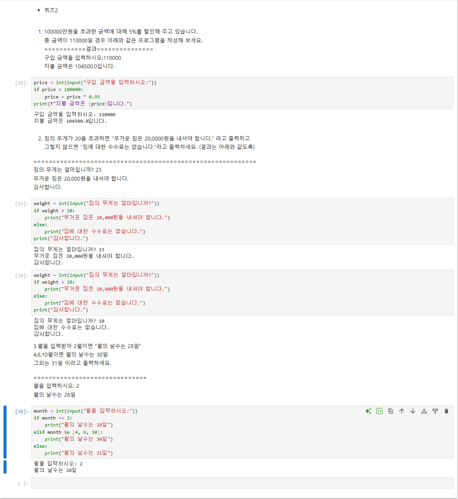

# 62일차

## 파이썬 자료형(튜플·딕셔너리·집합·불)과 if문

📌 학습일 : 2026.10.12

📌 학습 내용 : 튜플, 딕셔너리, 집합, 불 자료형, 변수와 메모리 주소, 얕은 복사, if / elif / else, 비교·논리 연산자, in / not in, pass

---

#### 1. 튜플 자료형

- `()`로 만들고, 요소가 1개일 때는 **`(1,)`처럼 쉼표가 꼭 필요**함, 괄호를 생략한 `1, 2, 3`도 튜플
- 리스트와 달리 **값을 바꾸거나 지울 수 없음**

| 동작 | 결과 |
| --- | --- |
| `del t1[0]` | `TypeError: 'tuple' object doesn't support item deletion` |
| `t1[0] = 'c'` | `TypeError: 'tuple' object does not support item assignment` |
| 인덱싱 `t1[0]`, 슬라이싱 `t1[2:]` | 가능 |
| 더하기 `t1 + t2`, 곱하기 `t2 * 3`, `len(t1)` | 가능 (새 튜플이 만들어짐) |

- 튜플에 값을 추가하려면 **리스트로 바꿔서 추가한 뒤 다시 튜플로** 바꿈

```python
myT = (10, 20, 30)
myL = list(myT)
myL.append(40)
myT = tuple(myL)   # (10, 20, 30, 40)
```

---

#### 2. 딕셔너리 자료형

- `{key: value}` 쌍으로 저장하고, **key로 값을 찾음** (인덱스 번호로 찾지 않음)
- `a[key] = value`로 추가·수정, `del a[key]`로 삭제
- key는 고유해야 해서 `{1:'a', 1:'b'}`처럼 중복되면 **마지막 값만 남음** → `{1: 'b'}`

| 함수 | 설명 |
| --- | --- |
| `keys()` | key 목록 (`dict_keys`), for문으로 하나씩 꺼낼 수 있음 |
| `values()` | value 목록 (`dict_values`) |
| `items()` | (key, value) 튜플 목록 |
| `get(key)` | key로 값 가져오기 |
| `clear()` | 모든 요소 삭제 |
| `key in dic` | key가 있는지 `True` / `False`로 확인 |

- 퀴즈 : `student` 딕셔너리를 만들고 연락처 추가, 학과 수정, 학과 값만 가져오기, 모든 key 반환까지 실습

```python
student = {'학번': 1000, '이름': '이코사', '학과': '인공지능학과'}
student['연락처'] = '010-123-4567'   # 추가
student['학과'] = '전자공학과'        # 수정
student.get('학과')                  # '전자공학과'
student.keys()                       # dict_keys(['학번', '이름', '학과', '연락처'])
```

---

#### 3. 집합 자료형

- `set()`으로 만들고, **중복을 허용하지 않고 순서가 없음** → `set('Hello')`는 `{'H', 'e', 'l', 'o'}`
- 순서가 없어 인덱싱이 안 되므로, 필요하면 `list()`로 바꿔서 사용
- 리스트의 **중복 값 제거**에 자주 씀 : `list(set(a))`

| 연산 | 기호 | 함수 |
| --- | --- | --- |
| 교집합 | `s1 & s2` | `s1.intersection(s2)` |
| 합집합 | `s1 \| s2` | `s1.union(s2)` |
| 차집합 | `s1 - s2` | `s1.difference(s2)` |

| 함수 | 설명 |
| --- | --- |
| `add(4)` | 값 1개 추가 |
| `update([4, 5, 6])` | 값 여러 개 추가 |
| `remove(2)` | 값 제거 (없는 값이면 오류) |
| `discard(4)` | 값 제거 (**없는 값이어도 오류 없음**) |
| `clear()` | 모든 값 제거 |

---

#### 4. 불 자료형과 변수

- `True` / `False`, 비교 연산 결과도 불 값 (`1 == 1` → `True`)
- 빈 값(`[]`, `""`, `0` 등)은 **거짓**으로 취급 → `while a: a.pop()`처럼 리스트가 빌 때까지 반복 가능
- `b = a`는 값을 복사하는 게 아니라 **같은 리스트(같은 메모리 주소)를 가리킴** → `id(a)`와 `id(b)`가 같고, `a`를 바꾸면 `b`도 바뀜
- 따로 복사하려면 `b = a[:]` 또는 `from copy import copy` 후 `b = copy(a)`

---

#### 5. if문

- 조건이 참이면 `if` 블록, 거짓이면 `else` 블록 실행 (블록은 **들여쓰기**로 구분)
- 조건이 여러 개면 `elif`, 아무것도 안 하려면 `pass`

| 구분 | 내용 |
| --- | --- |
| 비교 연산자 | `<`, `>`, `==`, `!=`, `>=`, `<=` |
| 논리 연산자 | `and`, `or`, `not` |
| 포함 여부 | `x in 리스트/튜플/문자열`, `x not in ...` |

- 퀴즈 1 : 입력한 정수가 짝수인지 홀수인지 → `num % 2 == 0`
- 퀴즈 2 실습

| 문제 | 조건 | 핵심 코드 |
| --- | --- | --- |
| 할인 금액 | 100,000원 초과 시 5% 할인 | `if price > 100000: price = price * 0.95` |
| 짐 수수료 | 무게 20 초과 시 20,000원 | `if weight > 20:` ~ `else:` 후 공통으로 "감사합니다." 출력 |
| 월의 날수 | 2월 28일, 4·6·10월 30일, 그 외 31일 | `if` → `elif month in [4, 6, 10]` → `else` |

- `input()`은 **문자열을 반환**하므로 숫자로 비교하려면 `int(input())`으로 바꿔야 함

---

#### 6. 핵심 정리

- 바꾸면 안 되는 값은 **튜플**, key로 찾는 값은 **딕셔너리**, 중복 제거·집합 연산은 **집합**
- `b = a`는 복사가 아니라 **같은 객체를 함께 가리키는 것**이라 `[:]`나 `copy()`로 따로 복사해야 함
- 함수는 **괄호까지 붙여야 실행**됨 → `dic.clear`, `s1.clear`처럼 괄호를 빼면 아무것도 지워지지 않음
- if문은 들여쓰기로 블록을 나누고, 여러 값 중 하나인지 확인할 때는 `or`를 여러 번 쓰는 대신 **`in`**을 쓰면 간단함

---

<p align="center">
  
</p>

오늘은 튜플·딕셔너리·집합·불 자료형을 정리하고 if문으로 퀴즈를 풀었다. 할인 금액 문제에서는 조건에 맞을 때만 `price`를 다시 계산하고 `print`는 if문 밖에 두어, 할인 여부와 상관없이 지불 금액이 한 번만 출력되게 했다. 짐 수수료 문제도 "감사합니다."를 if / else 밖에 두니 어느 쪽이든 마지막에 공통으로 출력되어, 들여쓰기 위치에 따라 실행 범위가 달라진다는 것을 직접 확인할 수 있었다. 월의 날수 문제에서는 `month == 4 or month == 6 or ...`처럼 길게 쓰지 않고 `elif month in [4, 6, 10]`으로 줄였는데, 오전에 배운 `in` 연산자를 바로 활용할 수 있어서 좋았다. 실습 중에 `dic.clear`, `s1.clear`처럼 괄호를 빼먹어 값이 그대로 남아 있었던 것도 함수 호출에는 `()`가 꼭 필요하다는 걸 다시 느끼게 해 주었다.
</br>다음에는 while문과 for문을 배우면서 오늘 만든 조건문을 반복문과 함께 활용해 보고, 입력값이 숫자가 아닐 때의 예외 처리도 연습해 볼 예정이다.
