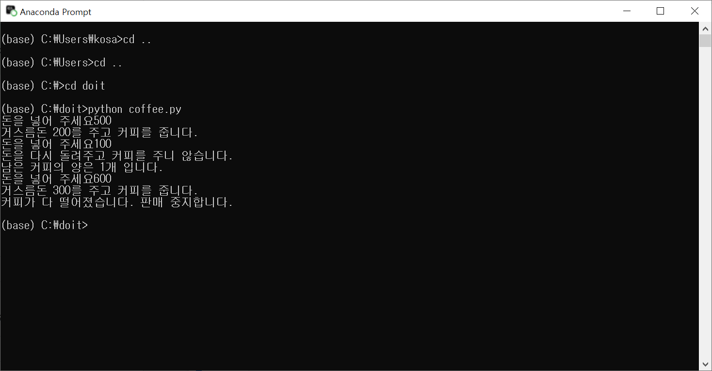
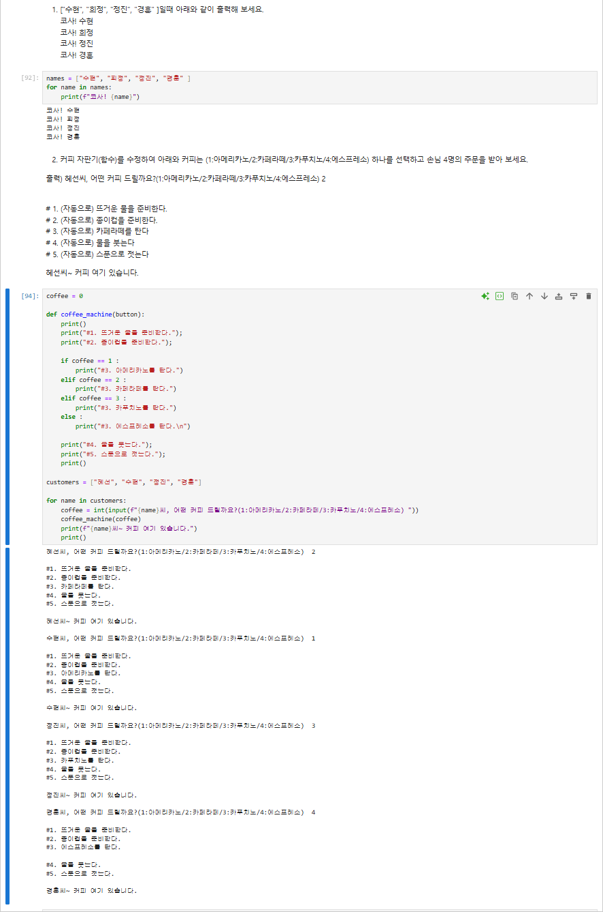

# 63일차

## 파이썬 제어문, 함수, 파일 입출력과 클래스

📌 학습일 : 2026.10.13

📌 학습 내용 : while문, break, continue, for문, range, 중첩 for문, 리스트 컴프리헨션, 함수, *args, **kwargs, 매개변수 초깃값, global, lambda, 파일 읽고 쓰기, with문, 클래스, 생성자, 상속, 메서드 오버라이딩

---

#### 1. while문

```python
변수명 = 0
while 변수명 < 반복횟수:
    변수명 = 변수명 + 1
    print(f"{변수명}번 실행했습니다.")
```

조건이 참인 동안 블록 안의 문장을 반복해서 실행한다.

조건에 쓰는 변수를 블록 안에서 바꾸지 않으면 반복이 끝나지 않으므로 값을 변경하는 문장이 꼭 필요하다.

#### 2. break와 continue

```python
while True:
    값 = int(input("값을 입력하세요"))
    if 종료조건:
        break
```

```python
변수명 = 0
while 변수명 < 10:
    변수명 = 변수명 + 1
    if 변수명 % 2 == 0:
        continue
    print(변수명)
```

`break`는 반복문을 바로 빠져나오고, `continue`는 아래 문장을 건너뛰고 다음 반복으로 넘어간다.

`while True`처럼 항상 참인 조건은 무한 루프가 되므로 `break`로 빠져나올 조건을 함께 작성한다.

#### 3. .py 파일 실행

```bash
cd 파일이있는폴더
python 파일명.py
```

Jupyter Notebook 셀에서 먼저 작성해 실행해 본 자판기 코드를 `.py` 파일로 저장하고, Anaconda Prompt에서 `python 파일명.py`로도 실행했다.

같은 코드를 Jupyter Notebook에서는 셀 단위로, Anaconda Prompt에서는 파일 단위로 실행할 수 있다.

#### 4. for문

```python
리스트명 = ['값1', '값2', '값3']
for 변수명 in 리스트명:
    print(변수명)
```

```python
리스트명 = [(1, 2), (3, 4), (5, 6)]
for (첫번째, 두번째) in 리스트명:
    print(첫번째 + 두번째)
```

리스트, 튜플, 문자열의 요소를 앞에서부터 하나씩 꺼내 변수에 넣고 블록을 실행한다.

요소가 튜플이면 `(변수1, 변수2)` 형태로 값을 나누어 받을 수 있다.

#### 5. range 함수

```python
합계 = 0
for 변수명 in range(시작값, 끝값, 증가값):
    합계 = 합계 + 변수명
print(합계)
```

`range(시작값, 끝값)`은 시작값부터 **끝값 미만**까지의 숫자를 만든다. 그래서 1~10을 쓰려면 `range(1, 11)`로 작성한다.

증가값을 지정하면 `range(501, 1001, 2)`처럼 홀수만, `range(0, 100, 7)`처럼 7의 배수만 꺼낼 수 있다.

`range(len(리스트명))`을 쓰면 인덱스 번호로 반복할 수 있다.

#### 6. 중첩 for문

```python
for 바깥변수 in range(2, 10):
    for 안쪽변수 in range(1, 10):
        print(바깥변수 * 안쪽변수, end=" ")
    print('')
```

for문 안에 for문을 넣어 구구단처럼 2차원 형태의 결과를 출력할 수 있다.

`end=" "`를 쓰면 줄을 바꾸지 않고 옆으로 이어서 출력한다.

#### 7. 리스트 컴프리헨션

```python
결과리스트 = [표현식 for 변수명 in 리스트명]
결과리스트 = [표현식 for 변수명 in 리스트명 if 조건]
```

for문과 `append()`로 여러 줄에 쓰던 코드를 한 줄로 줄여서 새 리스트를 만들 수 있다.

`if` 조건을 붙이면 조건에 맞는 요소만 골라 리스트를 만든다.

#### 8. 함수의 4가지 형태

```python
def 함수명(매개변수1, 매개변수2):
    return 반환값
```

| 형태 | 예 | 특징 |
| --- | --- | --- |
| 입력값 O, 반환값 O | `def add(a, b): return a + b` | 일반적인 함수 |
| 입력값 X, 반환값 O | `def say(): return 'Hi'` | 호출만 해도 값을 돌려줌 |
| 입력값 O, 반환값 X | `def add(a, b): print(a + b)` | 결과를 변수에 담으면 `None` |
| 입력값 X, 반환값 X | `def say(): print('Hi')` | 문장만 실행 |

`return`이 없는 함수는 출력만 할 뿐 값을 돌려주지 않으므로, 변수에 담으면 `None`이 들어간다.

`sub(a=7, b=3)`처럼 매개변수 이름을 지정해서 값을 전달할 수도 있다.

#### 9. 여러 개의 입력값 받기

```python
def 함수명(*args):
    결과 = 0
    for 값 in args:
        결과 = 결과 + 값
    return 결과
```

```python
def 함수명(**kwargs):
    print(kwargs)
```

`*args`는 입력값 개수와 상관없이 모두 **튜플**로 받고, `**kwargs`는 `이름=값` 형태로 받아 **딕셔너리**로 만든다.

`add_mul('add', 1, 2, 3)`처럼 일반 매개변수와 `*args`를 함께 사용해 첫 번째 값에 따라 더하기·곱하기를 나눌 수 있다.

#### 10. 매개변수 초깃값

```python
def 함수명(매개변수1, 매개변수2, 매개변수3=기본값):
    실행문장
```

값을 전달하지 않으면 초깃값이 사용된다.

초깃값이 있는 매개변수는 **맨 뒤에** 두어야 하며, 앞에 두면 `SyntaxError: parameter without a default follows parameter with a default`가 발생한다.

#### 11. 변수의 효력 범위

```python
# 1. return 사용
def 함수명(변수명):
    변수명 = 변수명 + 1
    return 변수명

변수명 = 함수명(변수명)
```

```python
# 2. global 사용
def 함수명():
    global 변수명
    변수명 = 변수명 + 1
```

함수 안에서 만든 변수는 함수 안에서만 쓰이므로, 함수 안에서 값을 바꿔도 바깥 변수는 그대로다.

바깥 변수 값을 바꾸려면 `return`으로 돌려받아 다시 저장하거나 `global`을 사용한다.

#### 12. lambda

```python
함수명 = lambda 매개변수1, 매개변수2: 표현식
```

`def`로 만드는 간단한 함수를 한 줄로 작성할 수 있다.

#### 13. 파일 쓰기와 읽기

```python
f = open("경로\\파일명.txt", '모드')
f.write(내용)
f.close()
```

| 모드 | 설명 |
| --- | --- |
| `w` | 쓰기 (기존 내용을 지우고 새로 씀) |
| `r` | 읽기 |
| `a` | 추가 (기존 내용 뒤에 이어서 씀) |

| 읽기 함수 | 설명 |
| --- | --- |
| `readline()` | 한 줄씩 읽음, 더 읽을 줄이 없으면 빈 문자열 → `if not line: break` |
| `readlines()` | 모든 줄을 리스트로 읽음, `strip()`으로 줄바꿈 제거 |
| `read()` | 파일 전체를 문자열로 읽음 |

경로에서 `\`는 특수 문자로 해석될 수 있어서 `\\`로 적는다.

#### 14. with문과 파일 내용 분석

```python
with open("경로\\파일명.txt", 'r') as 파일변수:
    내용 = 파일변수.read()
    단어목록 = 내용.split(" ")
    줄목록 = 내용.split("\n")

print("총 글자의 수:", len(내용))
print("총 단어의 수:", len(단어목록))
print("총 줄의 수:", len(줄목록))
```

`with`문을 사용하면 블록이 끝날 때 파일이 자동으로 닫혀서 `close()`를 따로 쓰지 않아도 된다.

`split()`으로 내용을 나눈 뒤 `len()`으로 글자·단어·줄의 개수를 셀 수 있다.

#### 15. 클래스와 객체

```python
class 클래스명:
    def 메서드명(self, 매개변수1, 매개변수2):
        self.속성1 = 매개변수1
        self.속성2 = 매개변수2

객체명 = 클래스명()
객체명.메서드명(값1, 값2)
```

함수와 global 변수로 계산기를 만들면 계산기가 늘어날 때마다 변수와 함수를 하나씩 더 만들어야 한다.

클래스로 만들면 `cal1 = Calculator()`, `cal2 = Calculator()`처럼 객체를 여러 개 만들어도 **각자 결괏값을 따로** 가진다.

`self`는 메서드를 호출한 객체 자신을 가리키며, `self.속성`에 값을 저장해 객체마다 다른 값을 유지한다.

#### 16. 생성자

```python
class 클래스명:
    def __init__(self, 매개변수1, 매개변수2):
        self.속성1 = 매개변수1
        self.속성2 = 매개변수2

객체명 = 클래스명(값1, 값2)
```

`__init__`은 객체를 만들 때 자동으로 실행되는 생성자다.

`setdata()`를 따로 호출하지 않고 객체를 만들면서 바로 초깃값을 넣을 수 있어, 값을 넣기 전에 메서드를 호출해 오류가 나는 상황을 막을 수 있다.

#### 17. 상속과 메서드 오버라이딩

```python
class 자식클래스명(부모클래스명):
    def 새메서드명(self):
        return 결과
```

```python
class 자식클래스명(부모클래스명):
    def 부모와같은메서드명(self):
        if 조건:
            return 0
        else:
            return 결과
```

상속을 하면 부모 클래스의 기능을 그대로 쓰면서 `pow()`처럼 새 기능을 추가할 수 있다.

부모와 같은 이름의 메서드를 다시 만들면 자식 클래스의 메서드가 대신 실행되며, 이를 메서드 오버라이딩이라고 한다.

`SafeFourCal`에서 `div()`를 오버라이딩해 0으로 나눌 때 오류 대신 0을 반환하도록 바꾸었다.

#### 18. 커피 자판기 함수 퀴즈

```python
def 함수명(버튼):
    print("#1. 뜨거운 물을 준비한다.")
    print("#2. 종이컵을 준비한다.")
    if 버튼 == 1:
        print("#3. 아메리카노를 탄다.")
    elif 버튼 == 2:
        print("#3. 카페라떼를 탄다.")
    print("#4. 물을 붓는다.")
    print("#5. 스푼으로 젓는다.")

손님목록 = ["이름1", "이름2", "이름3", "이름4"]
for 이름 in 손님목록:
    선택 = int(input(f"{이름}씨, 어떤 커피 드릴까요? "))
    함수명(선택)
    print(f"{이름}씨~ 커피 여기 있습니다.")
```

반복되는 커피 만드는 과정을 함수로 묶고, 손님 목록을 for문으로 돌려 4명의 주문을 차례대로 받았다.

#### 핵심 정리

- `while`문은 조건이 참인 동안 반복하고, `break`로 빠져나오며 `continue`로 다음 반복으로 넘어간다.
- `for`문은 리스트·튜플·문자열의 요소를 하나씩 꺼내 반복한다.
- `range(시작값, 끝값, 증가값)`은 끝값 **미만**까지의 숫자를 만든다.
- 리스트 컴프리헨션으로 for문과 `append()`를 한 줄로 줄일 수 있다.
- `return`이 없는 함수의 결과를 변수에 담으면 `None`이 된다.
- `*args`는 튜플, `**kwargs`는 딕셔너리로 입력값을 받는다.
- 초깃값이 있는 매개변수는 맨 뒤에 둔다.
- 함수 안의 변수는 함수 안에서만 쓰이며, 바깥 값을 바꾸려면 `return`이나 `global`을 사용한다.
- 파일은 `w`, `r`, `a` 모드로 열고, `with`문을 쓰면 자동으로 닫힌다.
- 클래스로 만든 객체는 각자 자신의 속성 값을 따로 가진다.
- `__init__` 생성자로 객체를 만들 때 초깃값을 넣을 수 있다.
- 상속으로 기능을 추가하고, 메서드 오버라이딩으로 기존 기능을 바꿀 수 있다.

---

<p align="center">
  
</p>

<p align="center">
  
</p>

오늘은 Jupyter Notebook에서 제어문, 함수, 파일 입출력, 클래스를 셀마다 실행하며 실습했고, 자판기 코드는 `coffee.py` 파일로 저장해 Anaconda Prompt에서 `python coffee.py`로도 실행해 보았다. 500원을 넣으면 거스름돈 200원과 커피가 나오고, 100원을 넣으면 돈을 돌려주고, 커피가 다 떨어지면 `break`로 판매가 멈추는 흐름을 보면서 `while True`와 `break`를 어떻게 함께 써야 하는지 확실히 알 수 있었다.
커피 자판기 퀴즈에서는 커피를 만드는 과정을 함수로 묶고 손님 목록을 for문으로 돌려 4명의 주문을 받았다. 결과는 잘 나왔지만 다시 보니 함수 안에서 매개변수 `button`이 아니라 바깥의 `coffee` 변수로 비교하고 있었다. 지금은 함수를 호출하기 전에 `coffee`에 값이 들어가 있어서 우연히 맞게 동작한 것이라, 오후에 배운 변수의 효력 범위와 연결해 보면 함수 안에서는 전달받은 매개변수를 쓰는 것이 맞다는 걸 느꼈다. 또 에스프레소를 고르면 `else`의 `\n` 때문에 3번과 4번 사이에 빈 줄이 하나 더 생기는 것도 출력 결과를 꼼꼼히 봐야 찾을 수 있는 부분이었다.
하루에 제어문, 함수, 파일 입출력, 클래스까지 많이 배웠지만, 계산기를 함수와 global 변수로 만들다가 클래스로 바꾸는 과정을 따라가 보니 왜 클래스가 필요한지 자연스럽게 이해할 수 있었다.
