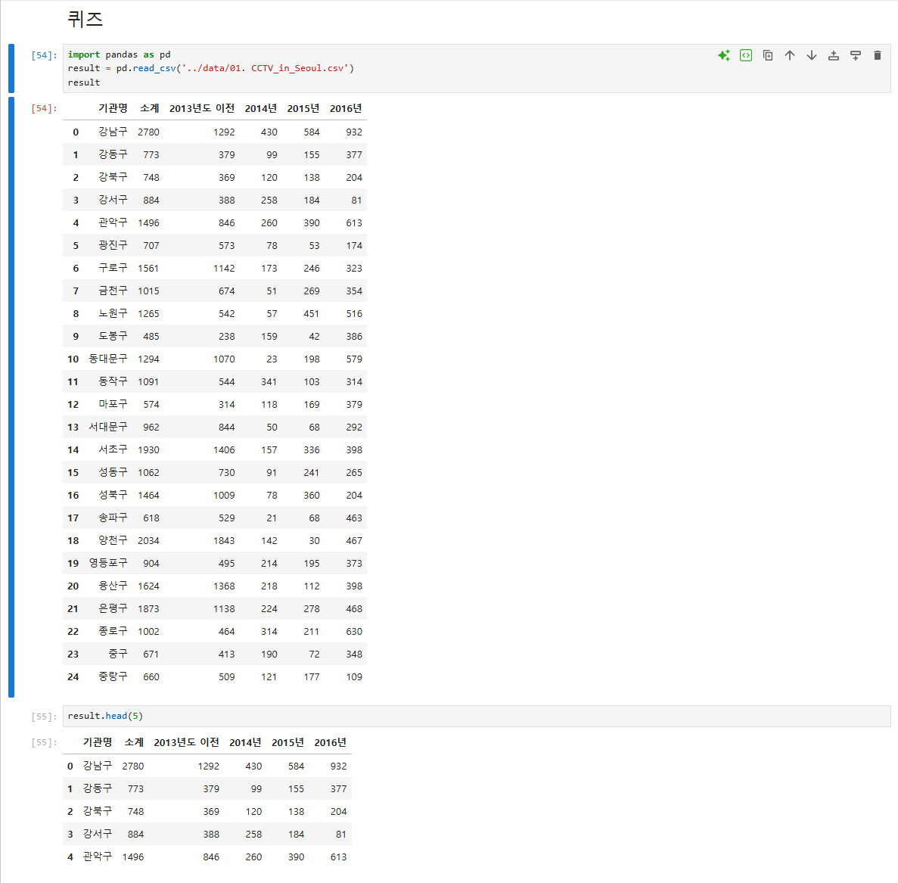
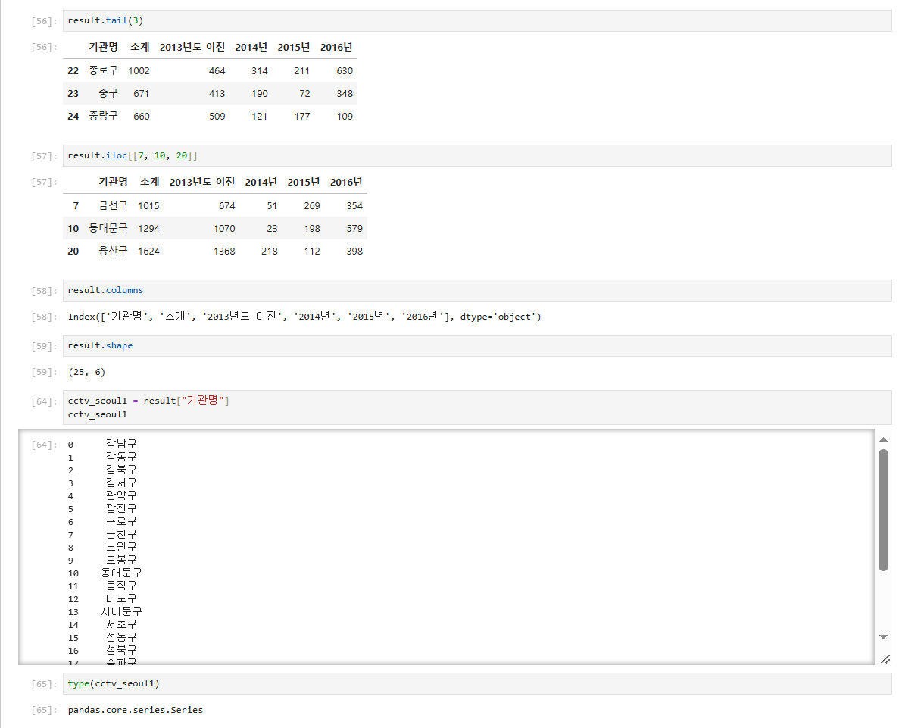
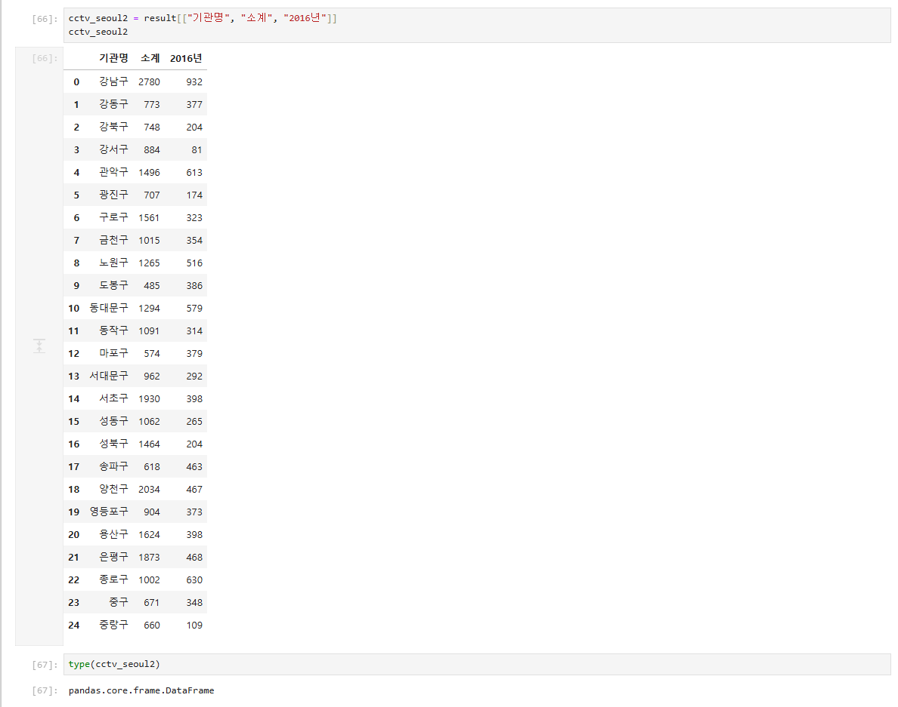

# 64일차

## 파이썬 모듈, 예외 처리, 내장 함수와 판다스 기초

📌 학습일 : 2026.10.14

📌 학습 내용 : 모듈, import, from import, \_\_name\_\_, 예외 처리, try-except-else-finally, enumerate, divmod, eval, zip, pip, Faker, pandas, DataFrame, Series, loc, iloc, groupby, to_datetime, drop, pickle, csv, tsv

---

#### 1. 모듈 만들고 불러오기

```python
# 모듈명.py
def 함수명1(a, b):
    return a + b

def 함수명2(a, b):
    return a - b
```

```python
import 모듈명
모듈명.함수명1(값1, 값2)

from 모듈명 import 함수명1
함수명1(값1, 값2)

from 모듈명 import 함수명1, 함수명2
from 모듈명 import *
```

함수나 변수, 클래스를 모아 둔 `.py` 파일을 모듈이라고 하며, 다른 파일이나 파이썬 셸에서 `import`로 불러와 사용할 수 있다.

`import 모듈명`으로 불러오면 `모듈명.함수명()` 형태로 호출하고, `from 모듈명 import 함수명`으로 불러오면 모듈명 없이 함수명만으로 호출할 수 있다.

`*`를 쓰면 모듈의 모든 함수를 한 번에 불러올 수 있다.

#### 2. if \_\_name\_\_ == "\_\_main\_\_"

```python
# 모듈명.py
def 함수명(a, b):
    return a + b

if __name__ == "__main__":
    print(함수명(1, 4))
```

파일을 직접 실행하면 `__name__`에 `"__main__"`이 들어가 if문 안의 테스트 코드가 실행된다.

다른 파일에서 `import`하면 `__name__`에 모듈 이름이 들어가므로 테스트 코드는 실행되지 않는다.

#### 3. 모듈의 변수와 클래스 사용

```python
# 모듈명.py
변수명 = 값

class 클래스명:
    def 메서드명(self, 매개변수):
        return 변수명 * (매개변수 ** 2)

def 함수명(a, b):
    return a + b
```

```python
import 모듈명
print(모듈명.변수명)

객체명 = 모듈명.클래스명()
print(객체명.메서드명(값))

print(모듈명.함수명(모듈명.변수명, 값))
```

모듈 안의 변수, 클래스, 함수 모두 `모듈명.이름` 형태로 사용할 수 있다.

함수를 클래스 안에 들여쓰기하면 클래스의 메서드가 되어 `모듈명.함수명`으로 찾을 수 없으므로, 모듈 함수는 들여쓰기 없이 맨 왼쪽에 작성해야 한다.

모듈을 수정했다면 파이썬 셸을 `exit()`로 종료하고 다시 실행해야 수정한 내용이 반영된다.

#### 4. 오류의 종류

| 오류 | 발생 상황 |
| --- | --- |
| `FileNotFoundError` | 없는 파일을 읽기 모드로 열 때 |
| `ZeroDivisionError` | 0으로 나눌 때 |
| `IndexError` | 리스트에 없는 인덱스로 접근할 때 |

#### 5. try-except

```python
try:
    실행문장
except 오류종류 as 변수명:
    print(변수명)
```

```python
try:
    실행문장
except (오류종류1, 오류종류2) as 변수명:
    print(변수명)
```

`try` 블록에서 오류가 발생하면 프로그램이 멈추지 않고 `except` 블록이 실행된다.

`as 변수명`을 쓰면 `division by zero`, `list index out of range`처럼 오류 메시지를 확인할 수 있다.

`except`를 여러 개 작성해 오류 종류별로 처리를 나누거나, 괄호로 묶어 한 번에 처리할 수 있다.

`try` 블록에서 오류가 발생하면 그 아래 문장은 실행되지 않고 바로 `except`로 넘어간다.

#### 6. try-finally와 try-else

```python
try:
    실행문장
except 오류종류:
    오류처리문장
finally:
    항상실행문장
```

```python
try:
    변수명 = int(input('값을 입력하세요:'))
except:
    print('입력이 정확하지 않습니다.')
else:
    오류가없을때실행문장
```

`finally`는 오류 발생 여부와 상관없이 항상 실행되므로 파일 닫기처럼 마지막에 꼭 해야 할 작업에 사용한다.

`else`는 `try`에서 오류가 발생하지 않았을 때만 실행되어, 입력값이 숫자가 아닐 때는 안내 메시지를 출력하고 숫자일 때만 다음 조건을 검사할 수 있다.

#### 7. 내장 함수

```python
for 인덱스, 값 in enumerate(리스트명):
    print(인덱스, 값)
```

| 함수 | 설명 | 예 |
| --- | --- | --- |
| `enumerate()` | 인덱스와 값을 함께 반환 | `0 body`, `1 foo`, `2 bar` |
| `divmod(a, b)` | 몫과 나머지를 튜플로 반환 | `divmod(7, 3)` → `(2, 1)` |
| `eval()` | 문자열로 된 식을 실행한 결과를 반환 | `eval('1+2')` → `3` |
| `zip()` | 같은 위치의 요소끼리 묶음 | `list(zip([1, 2, 3], [4, 5, 6]))` → `[(1, 4), (2, 5), (3, 6)]` |

#### 8. 외부 패키지 설치와 Faker

```bash
pip install 패키지명
```

```python
from faker import Faker

변수명 = Faker('ko-KR')
변수명.name()
변수명.address()

테스트데이터 = [(변수명.name(), 변수명.address()) for i in range(개수)]
```

`pip install`로 파이썬에 기본으로 들어 있지 않은 외부 패키지를 설치할 수 있다.

Faker는 이름, 주소 같은 가짜 데이터를 만들어 주며, `'ko-KR'`을 지정하면 한글 이름과 주소가 생성된다.

리스트 컴프리헨션과 함께 쓰면 테스트용 데이터를 원하는 개수만큼 한 번에 만들 수 있다.

#### 9. 판다스로 데이터 불러오기

```python
import pandas as pd

데이터프레임명 = pd.read_csv('경로/파일명.csv')
데이터프레임명 = pd.read_csv('경로/파일명.tsv', sep='\t')
```

| 속성·메서드 | 설명 |
| --- | --- |
| `shape` | (행 개수, 열 개수) |
| `columns` | 열 이름 목록 |
| `dtypes` | 열별 자료형 |
| `info()` | 행 개수, 열 이름, 결측값이 아닌 개수, 자료형을 한 번에 확인 |
| `head(n)` | 앞에서 n개 행 (기본 5개) |
| `tail(n)` | 뒤에서 n개 행 (기본 5개) |

`read_csv()`로 csv 파일을 불러오고, tsv 파일은 `sep='\t'`로 구분자를 탭으로 지정한다.

#### 10. 열 단위 데이터 추출

```python
시리즈명 = 데이터프레임명['열이름']
데이터프레임명2 = 데이터프레임명[['열이름1', '열이름2', '열이름3']]
```

대괄호 1개로 열 하나를 추출하면 **Series**, 대괄호 2개로 열 이름을 리스트로 전달하면 **DataFrame**이 된다.

열이 하나여도 `[['열이름']]`처럼 대괄호 2개를 쓰면 DataFrame으로 추출된다.

#### 11. loc와 iloc

```python
데이터프레임명.loc[행이름]
데이터프레임명.loc[[행이름1, 행이름2]]
데이터프레임명.loc[:, ['열이름1', '열이름2']]
데이터프레임명.loc[시작행:끝행, ['열이름1', '열이름2']]
```

```python
데이터프레임명.iloc[행번호]
데이터프레임명.iloc[-1]
데이터프레임명.iloc[:, [열번호1, 열번호2, -1]]
데이터프레임명.iloc[:, 시작:끝:증가]
```

| 구분 | 기준 | -1 사용 |
| --- | --- | --- |
| `loc` | 행·열 **이름** (인덱스) | 오류 발생 |
| `iloc` | 행·열 **위치 번호** | 마지막 행 추출 가능 |

`loc`에 열 번호를 넣거나 `iloc`에 열 이름을 넣으면 오류가 발생한다.

`list(range())`나 슬라이싱 `0:6:2`를 이용해 원하는 열만 골라서 추출할 수 있다.

`loc[42, 'country']`, `iloc[42, 0]`처럼 행과 열을 함께 지정하면 특정 값 하나를 꺼낼 수 있다.

#### 12. 그룹화와 그래프

```python
데이터프레임명.groupby('기준열')['계산열'].mean()
데이터프레임명.groupby(['기준열1', '기준열2'])[['계산열1', '계산열2']].mean()
그룹결과.reset_index()

데이터프레임명.groupby('기준열')['열이름'].nunique()
데이터프레임명.groupby('기준열')['열이름'].value_counts()

그룹결과.plot()
```

`groupby()`로 연도별, 대륙별처럼 기준 열의 값이 같은 데이터끼리 묶어 평균을 구할 수 있다.

기준 열을 여러 개 쓰면 인덱스가 여러 단계로 만들어지며, `reset_index()`로 일반 데이터프레임 형태로 바꿀 수 있다.

`nunique()`는 중복을 뺀 개수, `value_counts()`는 값별 빈도수를 구하며, `plot()`으로 그룹화한 결과를 그래프로 그릴 수 있다.

#### 13. 조건 추출과 날짜 처리

```python
데이터프레임명[데이터프레임명['열이름'] > 데이터프레임명['열이름'].mean()]

날짜시리즈 = pd.to_datetime(데이터프레임명['열이름'], format='%Y-%m-%d')
데이터프레임명['새열이름'] = 날짜시리즈
데이터프레임명['기간열'] = 데이터프레임명['종료일열'] - 데이터프레임명['시작일열']
```

대괄호 안에 조건식을 넣으면 조건에 맞는 행만 추출할 수 있다.

문자열(`object`)로 저장된 날짜는 `to_datetime()`으로 datetime 자료형으로 바꿔야 날짜끼리 빼서 기간을 계산할 수 있다.

`데이터프레임명['새열이름'] = 값` 형태로 새 열을 추가할 수 있다.

#### 14. 열 삭제와 파일 저장

```python
새데이터프레임명 = 데이터프레임명.drop(['열이름'], axis=1)

시리즈명.to_pickle('경로/파일명.pickle')
pd.read_pickle('경로/파일명.pickle')

데이터프레임명.to_csv('경로/파일명.csv')
데이터프레임명.to_csv('경로/파일명.tsv', sep='\t')
데이터프레임명.to_csv('경로/파일명.csv', index=False)
```

`drop()`에서 `axis=0`은 행, `axis=1`은 열을 의미한다.

pickle은 데이터를 바이너리 형태로 저장해 용량이 작고 그대로 다시 불러올 수 있다.

`to_csv()`로 csv, tsv 파일로 저장할 수 있으며, `index=False`를 지정하면 행 번호를 빼고 저장한다.

#### 15. 서울시 CCTV 데이터 퀴즈

```python
import pandas as pd
결과 = pd.read_csv('../data/파일명.csv')

결과.head(5)
결과.tail(3)
결과.iloc[[행번호1, 행번호2, 행번호3]]
결과.columns
결과.shape

시리즈명 = 결과['열이름']
데이터프레임명 = 결과[['열이름1', '열이름2', '열이름3']]
type(시리즈명)
type(데이터프레임명)
```

서울시 구별 CCTV 데이터를 불러와 앞·뒤 행, 특정 행, 열 이름, 크기를 확인했다.

`기관명` 열 하나만 추출하면 Series, `기관명`, `소계`, `2016년` 세 열을 추출하면 DataFrame이 되는 것을 `type()`으로 확인했다.

#### 핵심 정리

- 모듈은 함수, 변수, 클래스를 모아 둔 `.py` 파일이며 `import`나 `from import`로 불러온다.
- `if __name__ == "__main__"` 안의 코드는 파일을 직접 실행할 때만 실행된다.
- 모듈 함수는 클래스 안이 아니라 맨 왼쪽에 작성해야 `모듈명.함수명`으로 사용할 수 있다.
- `try-except`로 오류가 발생해도 프로그램이 멈추지 않게 처리할 수 있다.
- `finally`는 항상 실행되고, `else`는 오류가 없을 때만 실행된다.
- `enumerate`, `divmod`, `eval`, `zip` 같은 내장 함수로 코드를 간단히 작성할 수 있다.
- `pip install`로 외부 패키지를 설치하고, Faker로 테스트 데이터를 만들 수 있다.
- 판다스의 `read_csv()`로 데이터를 불러오고, `shape`, `columns`, `info()`, `head()`, `tail()`로 구조를 확인한다.
- 대괄호 1개로 열을 추출하면 Series, 2개로 추출하면 DataFrame이다.
- `loc`는 이름 기준, `iloc`는 위치 번호 기준으로 데이터를 추출한다.
- `groupby()`로 데이터를 묶어 평균, 개수, 빈도수를 구할 수 있다.
- `to_datetime()`으로 날짜를 변환하고, `drop()`으로 열을 삭제하며, pickle·csv·tsv로 저장할 수 있다.

---

<p align="center">
  
</p>

<p align="center">
  
</p>

<p align="center">
  
</p>

`read_csv()`로 불러온 데이터를 `head(5)`, `tail(3)`으로 앞뒤만 확인하고, `iloc[[7, 10, 20]]`으로 금천구, 동대문구, 용산구처럼 원하는 행만 골라 보니, 데이터 전체를 다 보지 않아도 필요한 부분만 빠르게 확인할 수 있다는 점이 편리했다. `columns`와 `shape`로 열 이름과 25행 6열이라는 크기를 먼저 확인하는 것도 데이터를 다루기 전에 구조를 파악하는 기본 순서라는 걸 알게 되었다.
가장 기억에 남는 부분은 `result["기관명"]`과 `result[["기관명", "소계", "2016년"]]`의 차이였다. 대괄호 하나 차이인데 `type()`으로 확인해 보니 앞은 Series, 뒤는 DataFrame으로 나왔고, 출력 모양도 한 줄 목록과 표 형태로 달랐다. 겉보기에는 비슷한 코드라도 결과 자료형이 다르면 이후에 쓸 수 있는 기능도 달라지기 때문에, 결과를 `type()`으로 직접 확인하는 습관이 필요하다고 느꼈다.
모듈과 예외 처리, 판다스까지 배운 양이 많았지만, 앞에서 배운 리스트 인덱싱과 슬라이싱, range가 `loc`, `iloc`에서도 그대로 쓰여서 새로운 내용도 이해하기 수월했다.
