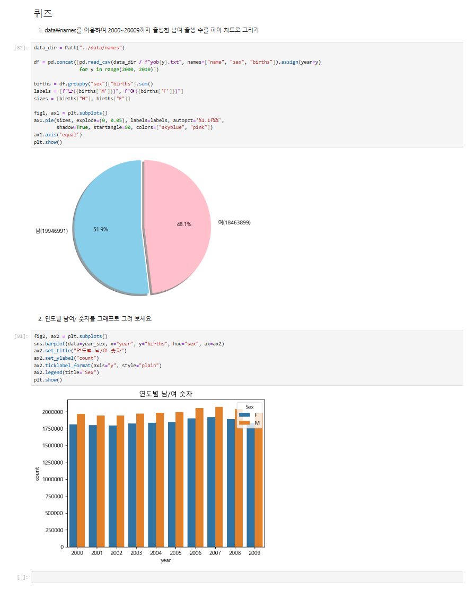

# 65일차

## matplotlib·seaborn 데이터 시각화와 서울시 주유 가격 데이터 분석

📌 학습일 : 2026.10.15

📌 학습 내용 : 앤스콤 데이터, matplotlib, figure, add_subplot, subplots, 히스토그램, 산점도, 박스 그래프, map, apply, seaborn, histplot, kdeplot, rugplot, displot, countplot, scatterplot, regplot, lmplot, barplot, pie, Path, glob, read_excel, rename, str.split, replace, to_numeric, dropna, agg

---

#### 1. 앤스콤 데이터와 기술통계

```python
import seaborn as sns
데이터명 = sns.load_dataset("anscombe")

데이터명.groupby('기준열')[['열이름1', '열이름2']].mean()
```

앤스콤 데이터는 4개의 데이터셋이 평균, 분산, 상관관계, 회귀선이 모두 같은 데이터이다.

통계값만 보면 4개가 같아 보이지만 그래프로 그려 보면 경향이 전혀 다르기 때문에, 요약한 숫자만으로는 데이터의 본질을 놓칠 수 있다.

#### 2. matplotlib 기본 그래프

```python
import matplotlib.pyplot as plt

plt.plot(x데이터, y데이터)
plt.plot(x데이터, y데이터, 'o')
plt.plot(x데이터, y데이터, 'o', c='색', ms=크기, mec='테두리색', mew=테두리두께, mfc='채우기색')
plt.show()
```

`plt.plot()`에 x, y 데이터를 전달하고 `plt.show()`를 호출하면 선 그래프가 그려진다.

마지막 인수로 `'o'`, `'^'`를 전달하면 점 모양 그래프가 되고, `c`, `ms`, `mec`, `mew`, `mfc`로 점의 색과 크기, 테두리를 바꿀 수 있다.

#### 3. 그림 영역과 하위 그래프

```python
fig = plt.figure()
axes1 = fig.add_subplot(행, 열, 위치번호)
axes2 = fig.add_subplot(행, 열, 위치번호)

axes1.plot(x데이터, y데이터, 'o')
axes1.set_title("그래프제목")

fig.suptitle("전체제목")
fig.set_tight_layout(True)
plt.show()
```

`plt.figure()`로 전체 그래프의 기본 틀을 만들고, `add_subplot(행, 열, 위치번호)`로 격자에 그래프를 하나씩 추가한다.

그래프는 왼쪽에서 오른쪽으로 채워지고, 한 행이 차면 다음 행에 그려진다.

`set_title()`은 각 그래프 제목, `suptitle()`은 전체 제목이며, `set_tight_layout(True)`로 그래프 사이 간격을 확보할 수 있다.

#### 4. 일변량·이변량 그래프 (matplotlib)

```python
fig = plt.figure()
axes1 = fig.add_subplot(1, 1, 1)

axes1.hist(data=데이터명, x='열이름', bins=구간수)
axes1.scatter(데이터명['열이름1'], 데이터명['열이름2'])
axes1.boxplot(x=[그룹1데이터, 그룹2데이터], labels=['그룹1', '그룹2'])

axes1.set_xlabel('x축이름')
axes1.set_ylabel('y축이름')
plt.show()
```

| 구분 | 그래프 | 용도 |
| --- | --- | --- |
| 일변량 (변수 1개) | 히스토그램 `hist()` | 값의 분포를 구간별로 확인 |
| 이변량 (변수 2개) | 산점도 `scatter()` | 연속 변수 사이의 관계 확인 |
| 이변량 (변수 2개) | 박스 그래프 `boxplot()` | 이산 변수와 연속 변수 사이의 관계 확인 |

이산형 변수는 Female, Male처럼 명확하게 구분되는 값이고, 연속형 변수는 팁 금액처럼 명확하게 셀 수 없는 값이다.

#### 5. 변수가 여러 개인 그래프와 map, apply

```python
색상딕셔너리 = {"값1": "#f1a340", "값2": "#998ec3"}

axes1.scatter(data=데이터명,
              x='열이름1',
              y='열이름2',
              s=데이터명['크기열']**2*10,
              c=데이터명['색상열'].map(색상딕셔너리),
              alpha=0.5)
```

```python
def 함수명(값):
    if 값 == '기준값':
        return 0
    else:
        return 1

데이터명['새열이름'] = 데이터명['열이름'].apply(함수명)
```

산점도에서 `s`로 점 크기, `c`로 점 색, `alpha`로 투명도를 지정해 변수 여러 개를 한 그래프에 표현할 수 있다.

`map()`은 딕셔너리의 키와 일치하는 값을 딕셔너리의 값으로 바꾸며, 키와 일치하지 않는 값은 `NaN`이 된다.

`apply()`는 열의 값마다 함수를 적용해 새로운 값을 만든다.

색상 코드는 `#` 뒤에 16진수(0~9, a~f)만 쓸 수 있어 숫자 1 대신 영어 l을 쓰면 오류가 발생한다.

#### 6. seaborn 일변량 그래프

```python
그래프명, ax = plt.subplots()

sns.histplot(data=데이터명, x='열이름', ax=ax)
sns.kdeplot(data=데이터명, x='열이름', ax=ax)
sns.rugplot(data=데이터명, x='열이름', ax=ax)

sns.displot(data=데이터명, x='열이름', kde=True, rug=False)

ax.set_title('제목')
plt.show()
```

`plt.subplots()`는 그림 영역과 하위 그래프 객체를 한 번에 만들고, seaborn 함수에 `ax=ax`로 그릴 위치를 지정한다.

| 함수 | 그래프 |
| --- | --- |
| `histplot()` | 히스토그램 |
| `kdeplot()` | 밀도 분포 그래프 |
| `rugplot()` | 변수 분포를 1차원 선으로 표시 |
| `displot()` | 히스토그램, 밀도, 러그 그래프를 한 번에 표시 (`kde`, `rug`를 True / False로 지정) |

#### 7. seaborn 막대·이변량 그래프

```python
sns.countplot(data=데이터명, x='열이름', palette='팔레트명', ax=ax)
sns.countplot(data=데이터명, y='열이름', palette='팔레트명', ax=ax)

sns.scatterplot(data=데이터명, x='열이름1', y='열이름2', ax=ax)
sns.regplot(data=데이터명, x='열이름1', y='열이름2', ax=ax)
sns.lmplot(data=데이터명, x='열이름1', y='열이름2', hue='구분열')
```

`countplot()`은 이산 변수의 값별 **행 개수**를 막대로 표현하며, `y`에 열을 지정하면 가로 막대가 된다.

`palette`로 `Set2`, `viridis`, `husl`, `Spectral` 같은 색 조합을 지정할 수 있다.

`regplot()`은 산점도에 회귀선을 함께 그리고, `lmplot()`은 `hue`로 지정한 그룹별로 회귀선을 나누어 그린다.

#### 8. 여러 엑셀 파일 한 번에 불러오기

```python
from pathlib import Path

data_dir = Path("../data")
파일목록 = sorted(data_dir.glob("파일이름패턴*xls"))

데이터목록 = [pd.read_excel(파일, header=2) for 파일 in 파일목록]
원본데이터 = pd.concat(데이터목록, ignore_index=True)
```

`Path().glob()`으로 이름 패턴이 같은 파일 목록을 가져오고, 리스트 컴프리헨션으로 엑셀 파일을 모두 읽어 `pd.concat()`으로 합친다.

`.xls` 파일을 읽으려면 `pip install xlrd`로 패키지를 설치해야 하며, `header=2`로 제목 행 위치를 지정한다.

`ignore_index=True`를 쓰면 합친 뒤 행 번호가 0부터 새로 매겨진다.

#### 9. 필요한 열 선택과 열 이름 변경

```python
데이터명 = (
    원본데이터
    .loc[:, ["열이름1", "열이름2", "열이름3"]]
    .rename(columns={"기존이름1": "새이름1", "기존이름2": "새이름2"}))
```

`loc`로 필요한 열만 고르고 `rename()`으로 열 이름을 바꾼다.

괄호로 감싸면 메서드를 줄마다 나누어 이어서 쓸 수 있다.

#### 10. 문자열에서 값 추출과 수정

```python
데이터명 = 데이터명.assign(
    새열이름 = 데이터명["주소열"].astype(str).str.split().str[1])

데이터명["새열이름"].unique()

수정딕셔너리 = {"잘못된값1": "올바른값1", "잘못된값2": "올바른값2"}
데이터명 = 데이터명.assign(새열이름 = 데이터명["새열이름"].replace(수정딕셔너리))
```

`str.split()`으로 주소를 공백 기준으로 나누고 `str[1]`로 두 번째 값인 구 이름을 추출한다.

`unique()`로 추출한 값을 확인하면 주소 형식이 달라 `서울특별시`, `특별시`처럼 잘못 추출된 값을 찾을 수 있고, `replace()`에 딕셔너리를 전달해 올바른 값으로 바꾼다.

#### 11. 가격 데이터 정리

```python
데이터명 = (
    데이터명.assign(가격열 = pd.to_numeric(데이터명["가격열"].replace("-", np.nan), errors="coerce"))
    .dropna(subset=["가격열"])
    .reset_index(drop=True))
```

가격이 없는 주유소는 `-`로 저장되어 있어 숫자로 계산할 수 없으므로 `np.nan`으로 바꾼다.

`to_numeric()`에 `errors="coerce"`를 지정하면 숫자로 바꿀 수 없는 값은 오류 대신 `NaN`이 된다.

`dropna(subset=[...])`로 가격이 `NaN`인 행을 삭제하고, `reset_index(drop=True)`로 행 번호를 다시 매긴다.

#### 12. 한글 폰트 설정

```python
from matplotlib import font_manager, rc

plt.rcParams["axes.unicode_minus"] = False

font_path = Path("C:/Windows/Fonts/malgun.ttf")
if font_path.exists():
    font_name = font_manager.FontProperties(fname=str(font_path)).get_name()
    rc("font", family=font_name)
```

한글 폰트를 설정하지 않으면 그래프의 한글이 □□□로 깨지므로 맑은 고딕 폰트를 지정한다.

`axes.unicode_minus`를 False로 설정하면 마이너스 기호가 깨지지 않는다.

#### 13. 주유 가격 시각화와 정렬

```python
plt.figure(figsize=(가로, 세로))
sns.boxplot(data=데이터명, x="구분열", y="값열", hue="그룹열", palette="Set3")
sns.stripplot(data=데이터명, x="구분열", y="값열", color="0.4", size=3, alpha=0.6)
plt.xticks(rotation=45)
plt.show()

데이터명.sort_values(by="값열", ascending=False).head(10)
```

박스 그래프로 셀프 여부, 상표별 휘발유 가격 분포를 비교하고, `stripplot()`을 겹쳐 실제 주유소 하나하나의 가격을 점으로 표시했다.

`xticks(rotation=45)`로 x축 글자가 겹치지 않게 기울일 수 있다.

`sort_values()`의 `ascending`으로 가격이 비싼 순서, 싼 순서의 주유소를 확인했다.

#### 14. 구별 평균 가격과 저장

```python
구별데이터 = (
    데이터명.groupby("구", as_index=False)
    .agg(새열이름1=("값열", "mean"), 새열이름2=("이름열", "count"))
    .sort_values("새열이름1", ascending=False))

sns.barplot(data=구별데이터, x="구", y="새열이름1", hue="구")

output_dir = Path("../output")
output_dir.mkdir(exist_ok=True)
데이터명.to_csv(output_dir / "파일명.csv", index=False, encoding="utf-8-sig")
```

`agg()`를 사용하면 `새열이름=("열이름", "계산방법")` 형태로 평균과 개수를 한 번에 구하고 열 이름도 지정할 수 있다.

`mkdir(exist_ok=True)`는 폴더가 이미 있어도 오류 없이 넘어간다.

`encoding="utf-8-sig"`로 저장하면 엑셀에서 csv 파일을 열어도 한글이 깨지지 않는다.

#### 15. 원형 그래프 

```python
data_dir = Path("../data/names")

df = pd.concat([pd.read_csv(data_dir / f"yob{y}.txt", names=["name", "sex", "births"]).assign(year=y)
                for y in range(시작연도, 끝연도 + 1)])
```

```python
합계 = df.groupby("기준열")["값열"].sum()
labels = [f"이름1({합계['값1']})", f"이름2({합계['값2']})"]

fig1, ax1 = plt.subplots()
ax1.pie(값목록, explode=(0, 0.05), labels=labels, autopct='%1.1f%%',
        shadow=True, startangle=90, colors=["색1", "색2"])
ax1.axis('equal')
plt.show()
```

```python
연도별합계 = df.groupby(["year", "sex"], as_index=False)["births"].sum()

fig2, ax2 = plt.subplots()
sns.barplot(data=연도별합계, x="year", y="births", hue="sex", ax=ax2)
ax2.ticklabel_format(axis="y", style="plain")
ax2.legend(title="Sex")
plt.show()
```

연도별 파일에는 연도 정보가 없어서 `assign(year=y)`로 파일을 읽으면서 연도 열을 추가했다.

`assign()`은 원본을 바꾸지 않고 새 열이 추가된 데이터프레임을 돌려주므로, 리스트 컴프리헨션 안에서 `read_csv()` 뒤에 바로 이어 쓸 수 있다.

파이 차트 라벨은 f-string으로 `남(19946991)`처럼 출생 수를 함께 표시했다.

`ticklabel_format(style="plain")`을 지정하면 y축이 `1e6` 같은 지수 표기 대신 일반 숫자로 표시된다.

#### 핵심 정리

- 통계값이 같아도 그래프로 그려 보면 데이터의 경향이 다를 수 있다.
- `plt.figure()`와 `add_subplot()`, 또는 `plt.subplots()`로 그림 영역과 하위 그래프를 만든다.
- 히스토그램은 일변량, 산점도와 박스 그래프는 이변량 데이터를 표현한다.
- `map()`은 딕셔너리로 값을 바꾸고, `apply()`는 값마다 함수를 적용한다.
- seaborn은 `data`, `x`, `y`, `hue`만 지정해도 그래프를 간단하게 그릴 수 있다.
- `countplot()`은 행 개수, `barplot()`은 지정한 값(기본은 평균)을 막대로 그린다.
- `Path().glob()`과 `pd.concat()`으로 여러 파일을 한 번에 불러와 합칠 수 있다.
- `rename()`, `str.split()`, `replace()`, `to_numeric()`, `dropna()`로 원본 데이터를 분석할 수 있는 형태로 정리한다.
- `groupby()`와 `agg()`로 그룹별 평균과 개수를 한 번에 구할 수 있다.
- 한글 그래프는 폰트를 설정해야 깨지지 않고, csv는 `utf-8-sig`로 저장해야 엑셀에서 한글이 깨지지 않는다.

---

<p align="center">
  
</p>

미국 출생 이름 데이터로 퀴즈를 풀면서 2000~2009년 파일 10개를 리스트 컴프리헨션과 `pd.concat()`으로 한 번에 불러왔다. 파일 안에는 이름, 성별, 출생 수만 있고 연도 정보가 없어서 처음에는 연도별로 묶을 방법이 막막했는데, `assign(year=y)`로 파일 이름에 쓰인 연도를 열로 붙이면 된다는 걸 알게 되었다. `assign()`이 원본을 바꾸지 않고 새 데이터프레임을 돌려주기 때문에 `read_csv()` 뒤에 바로 이어 쓸 수 있다는 점도 새로 배운 부분이었다.
파이 차트는 `groupby("sex")["births"].sum()`으로 남녀 출생 수를 구한 뒤 f-string으로 라벨에 숫자를 넣어 `남(19946991)`, `여(18463899)`처럼 비율과 실제 숫자를 함께 보여 주도록 만들었다.
가장 기억에 남는 부분은 2번 연도별 그래프였다. 처음에는 `countplot()`으로 그렸더니 y축이 2만 정도로 나오고 여자 막대가 더 높게 나왔는데, 예시 결과는 y축이 200만 정도이고 남자 막대가 더 높았다. 원인을 찾아보니 `countplot()`은 출생 수를 더하는 것이 아니라 행, 즉 이름의 개수를 세는 그래프였다. 연도·성별로 `births`를 먼저 더한 뒤 `barplot()`으로 그리니 예시와 같은 그래프가 나왔다. 그래프 모양이 그럴듯해 보여도 무엇을 기준으로 그린 값인지 확인하지 않으면 전혀 다른 의미의 그래프가 될 수 있다는 것을 느꼈다.
