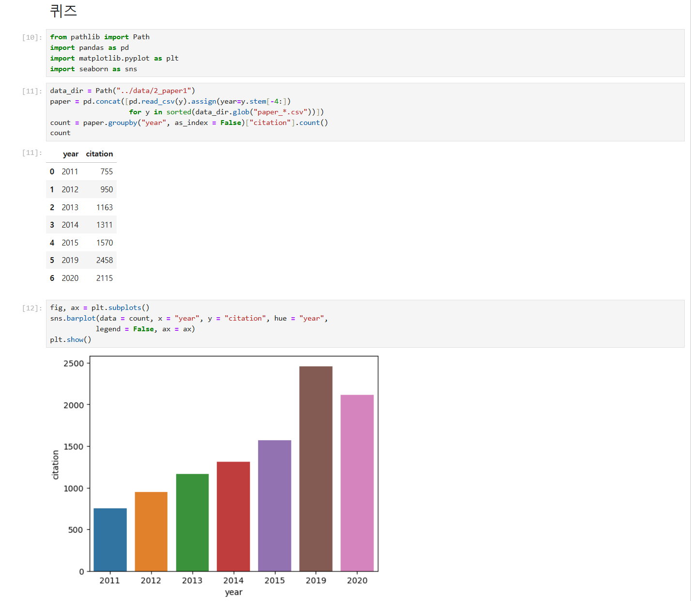
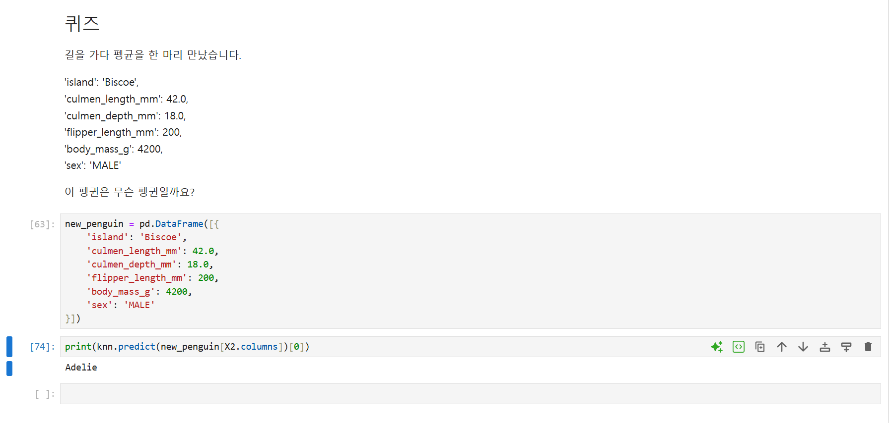

# 66일차

## folium 지도 시각화와 kNN을 이용한 펭귄 종류 분류

📌 학습일 : 2026.10.16

📌 학습 내용 : folium, Map, Marker, Icon, popup, tooltip, CircleMarker, RegularPolygonMarker, MiniMap, MarkerCluster, Choropleth, GeoJSON, pivot_table, 결측치 처리, drop, dropna, 원-핫 인코딩, get_dummies, train_test_split, kNN, KNeighborsClassifier, fit, predict, score, pairplot, jointplot

---

#### 1. folium 기본 지도와 마커

```python
import folium

지도명 = folium.Map(location=[위도, 경도], zoom_start=확대단계)

folium.Marker(
    location=[위도, 경도],
    popup='클릭시표시할내용',
    icon=folium.Icon(color='색', icon='아이콘이름')
).add_to(지도명)

지도명
```

`folium.Map()`에 중심 좌표(위도, 경도)와 `zoom_start`를 지정해 지도를 만든다. `zoom_start` 값이 클수록 더 확대된 지도가 나온다.

`folium.Marker()`로 원하는 위치에 마커를 찍고 `add_to(지도명)`으로 지도에 추가한다.

`folium.Icon()`의 `color`, `icon`으로 마커 색과 모양(`cloud`, `star`, `info-sign` 등)을 바꿀 수 있고, `popup`은 마커를 클릭했을 때 보여 줄 내용이다.

셀 마지막 줄에 지도 변수 이름을 쓰면 주피터에서 지도가 화면에 표시된다.

#### 2. 다양한 모양의 마커

```python
folium.CircleMarker(
    location=[위도, 경도],
    popup='내용',
    radius=크기,
    color='테두리색',
    fill_color='내부색'
).add_to(지도명)

folium.RegularPolygonMarker(
    [위도, 경도],
    popup='내용',
    fill_color='색',
    number_of_sides=변의수,
    radius=크기
).add_to(지도명)
```

`CircleMarker()`는 원 모양 마커로, `radius`로 크기, `color`와 `fill_color`로 테두리와 내부 색을 지정한다.

`RegularPolygonMarker()`는 정다각형 마커로, `number_of_sides`에 3을 넣으면 삼각형, 4를 넣으면 사각형이 된다.

#### 3. 미니맵과 마커 클러스터

```python
from folium import plugins

minimap = plugins.MiniMap()

지도명 = folium.Map(location=[데이터['위도'].mean(), 데이터['경도'].mean()], zoom_start=11)
지도명.add_child(minimap)

marker_cluster = plugins.MarkerCluster().add_to(지도명)

for n in 데이터.index:
    name = "대여소명 : " + 데이터.loc[n, '이름열'] + " / 거치대 수 : " + str(데이터.loc[n, '숫자열'])
    folium.Marker([데이터['위도'][n], 데이터['경도'][n]], tooltip=name).add_to(marker_cluster)
```

서울시 공공자전거(따릉이) 대여소 데이터의 위도·경도 평균을 지도 중심으로 잡고, for문으로 모든 대여소에 마커를 찍었다.

`MiniMap()`은 지도 구석에 현재 위치를 보여 주는 작은 지도를 추가하며, `add_child()`로 지도에 붙여야 화면에 나타난다.

`MarkerCluster()`는 가까운 마커를 숫자로 묶어 보여 주고, 확대하면 개별 마커로 나뉘어 마커가 많아도 지도가 복잡해지지 않는다.

`tooltip`은 마우스를 올렸을 때, `popup`은 클릭했을 때 내용이 표시된다. 숫자는 `str()`로 바꿔야 문자열과 이어 붙일 수 있다.

#### 4. Choropleth 지도

```python
import json

구별합계 = pd.pivot_table(데이터, index=['기준열'], values=['값열'], aggfunc='sum')

geo_str = json.load(open('경로/파일명.json', encoding='utf-8'))

choropleth = folium.Choropleth(geo_data=geo_str,
                               data=구별합계['값열'],
                               fill_opacity=0.5,
                               key_on='feature.id').add_to(지도명)
choropleth.geojson.add_child(folium.features.GeoJsonTooltip(['name']))
```

`pivot_table()`로 구별 거치대 수 합계를 구하고, 구 경계 정보가 담긴 GeoJSON 파일을 `json.load()`로 불러온다.

`Choropleth()`는 지역별 값의 크기에 따라 색의 진하기를 다르게 칠하는 지도이며, `key_on='feature.id'`로 GeoJSON의 구 이름과 데이터의 구 이름을 연결한다.

`GeoJsonTooltip(['name'])`을 추가하면 마우스를 올렸을 때 구 이름이 표시된다.

`aggfunc=np.sum`은 앞으로 지원되지 않는다는 경고가 나와서 문자열 `'sum'`으로 바꿔 쓰는 것이 좋다.

#### 5. 펭귄 데이터 살펴보기

```python
데이터명 = pd.read_csv('../data/파일명.csv')

데이터명.sample(5)
데이터명.info()
데이터명.describe(include='all').T
데이터명['열이름'].unique()
```

펭귄의 종류(`species`)를 맞히는 것이 목표이므로 `species`가 정답(y), 나머지 섬·부리 길이·부리 깊이·날개 길이·몸무게·성별이 입력(X)이 된다.

`sample()`은 무작위로 행을 뽑아 보여 주고, `describe(include='all')`은 문자열 열까지 포함해 통계값을 보여 준다.

`unique()`로 `sex` 열을 확인해 보니 `MALE`, `FEMALE` 외에 `nan`과 `'.'` 같은 잘못된 값이 들어 있었다.

#### 6. 잘못된 데이터와 결측치 처리

```python
데이터명.drop(행번호, inplace=True)

데이터명 = 데이터명.dropna()
데이터명.isna().sum()
```

`drop()`만 쓰면 결과만 보여 주고 원본은 그대로이므로, `inplace=True`를 지정해야 원본 데이터에서 행이 삭제된다.

`dropna()`로 빈 값(NaN)이 있는 행을 삭제하고, `isna().sum()`으로 모든 열의 결측치가 0인지 확인한다.

kNN은 이웃과의 거리를 계산하는 모델이라 빈 값이 있으면 학습할 수 없으므로, 모델에 넣기 전에 결측치를 반드시 처리해야 한다.

#### 7. 붓꽃 데이터 시각화

```python
from sklearn.datasets import load_iris

iris = load_iris()
df = pd.DataFrame(data=iris.data, columns=iris.feature_names)
df['species'] = iris.target

sns.pairplot(data=df, hue='species')
sns.jointplot(x='열이름1', y='열이름2', data=df, kind='scatter', hue='species')
```

`pairplot()`은 모든 속성을 두 개씩 짝지어 산점도를 한 번에 그려, 어떤 속성이 종류를 잘 구분하는지 확인할 수 있다.

`jointplot()`은 두 속성의 산점도와 각 속성의 분포를 함께 보여 준다.

#### 8. 원-핫 인코딩과 데이터 분리

```python
데이터_encoding = pd.get_dummies(데이터명, columns=['명목형열1', '명목형열2'])

X = 데이터_encoding.drop(['정답열'], axis=1)
y = 데이터_encoding['정답열']

from sklearn.model_selection import train_test_split
X_train, X_test, y_train, y_test = train_test_split(X, y, test_size=0.3, random_state=11)
```

`island`, `sex`처럼 문자로 된 명목형 변수는 거리를 계산할 수 없으므로 `get_dummies()`로 원-핫 인코딩해 `island_Biscoe`, `sex_MALE`처럼 0과 1로 된 열로 바꾼다.

`train_test_split()`으로 데이터를 훈련용 70%, 테스트용 30%로 나누고, `random_state`를 지정하면 실행할 때마다 같은 방식으로 나뉜다.

#### 9. kNN 모델 학습과 평가

```python
from sklearn.neighbors import KNeighborsClassifier

knn = KNeighborsClassifier(n_neighbors=k)
knn.fit(X_train, y_train)

knn.score(X_test, y_test)
y_pred = knn.predict(X_test)

pd.DataFrame({'실제값': y_test, '예측값': y_pred})
```

kNN은 새 데이터와 가장 가까운 k개의 이웃을 찾아, 그중 가장 많은 종류로 분류하는 모델이다.

`fit()`으로 학습하고, `score()`로 정확도를, `predict()`로 예측값을 확인한다.

실제값과 예측값을 데이터프레임으로 나란히 놓으면 어떤 데이터를 틀렸는지 한눈에 비교할 수 있다.

#### 10. k값에 따른 성능 비교

```python
k_range = range(1, 31)
scores = []

for k in k_range:
    knn = KNeighborsClassifier(n_neighbors=k)
    knn.fit(X_train, y_train)
    scores.append(knn.score(X_test, y_test))

plt.plot(k_range, scores)
plt.show()

for value, score in enumerate(scores):
    print('k={}일 때: accuracy:{:.3f}'.format(value + 1, score))
```

k를 1부터 30까지 바꿔 가며 정확도를 구해 그래프로 그리면 어떤 k에서 성능이 좋은지 확인할 수 있다.

반복문이 끝나면 `knn` 변수에는 마지막으로 만든 `k=30` 모델이 남으므로, 다음 셀에서 `knn`을 그대로 쓰면 k=30 모델로 학습된다.

#### 11. 2개의 속성만 이용하여 분류

```python
X2 = 데이터_encoding[['열이름1', '열이름2']]

X_train, X_test, y_train, y_test = train_test_split(X2, y, test_size=0.3, random_state=11)
knn.fit(X_train, y_train)
knn.score(X_test, y_test)
```

부리 길이와 날개 길이 두 속성만으로 학습해도 정확도가 0.910으로 나와, 모든 속성을 쓰지 않아도 종류를 잘 구분할 수 있었다.

#### 12. 논문 데이터 퀴즈

```python
data_dir = Path("../data/폴더명")

paper = pd.concat([pd.read_csv(f).assign(year=f.stem[-4:])
                   for f in sorted(data_dir.glob("파일이름_*.csv"))])

count = paper.groupby("year", as_index=False)["열이름"].count()

fig, ax = plt.subplots()
sns.barplot(data=count, x="year", y="열이름", hue="year", legend=False, ax=ax)
plt.show()
```

연도가 2011~2015, 2019, 2020으로 중간이 비어 있어서 `range()` 대신 `glob()`으로 파일을 가져왔다.

`f.stem`은 확장자를 뺀 파일 이름이고, `[-4:]`로 마지막 4글자인 연도만 잘라 `assign()`으로 연도 열을 붙였다.

`hue="year", legend=False`를 지정하면 막대마다 색이 달라지고 범례는 표시되지 않는다.

#### 13. 펭귄 분류 퀴즈

```python
new_penguin = pd.DataFrame([{
    '열이름1': 값1,
    '열이름2': 값2,
    '열이름3': 값3
}])

print(knn.predict(new_penguin[X2.columns])[0])
```

새로 만난 펭귄의 정보를 딕셔너리로 만들고 리스트로 감싸 1행짜리 데이터프레임으로 만든다.

모델은 학습할 때 사용한 열과 같은 열을 입력받아야 하므로, `X2.columns`로 학습에 쓴 두 열만 골라 예측했다.

`predict()`는 결과를 배열로 돌려주므로 `[0]`으로 첫 번째 값만 꺼내고 `print()`로 출력하면 `Adelie`처럼 이름만 깔끔하게 나온다.

#### 핵심 정리

- folium은 `Map()`으로 지도를 만들고 `Marker()`, `CircleMarker()`, `RegularPolygonMarker()`로 위치를 표시한다.
- `MarkerCluster()`는 많은 마커를 묶어 보여 주고, `MiniMap()`은 `add_child()`로 지도에 추가한다.
- `Choropleth()`와 GeoJSON을 이용하면 지역별 값을 색의 진하기로 표현할 수 있다.
- `drop()`은 `inplace=True`를 지정해야 원본이 바뀌고, `dropna()`로 결측치가 있는 행을 삭제한다.
- 명목형 변수는 `get_dummies()`로 원-핫 인코딩해야 모델에 넣을 수 있다.
- `train_test_split()`으로 훈련 데이터와 테스트 데이터를 나눈다.
- kNN은 가장 가까운 k개의 이웃 중 많은 종류로 분류하며, `fit()`, `score()`, `predict()`로 학습·평가·예측한다.
- k값을 바꿔 가며 정확도를 비교하면 성능이 좋은 k를 찾을 수 있다.
- 예측할 새 데이터는 학습에 사용한 열과 같은 열, 같은 순서로 넣어야 한다.

---

<p align="center">
  
</p>

첫 번째 퀴즈는 연도별 논문 파일 7개를 불러와 연도별 논문 수를 막대그래프로 그리는 문제였다. 
</br>어제 출생 이름 퀴즈처럼 `range()`로 연도를 돌리려고 했는데, 파일이 2011~2015년, 2019년, 2020년으로 중간이 비어 있어서 그대로 쓸 수 없었다. 
</br>그래서 `glob("paper_*.csv")`로 실제 있는 파일만 가져오고, `f.stem[-4:]`로 파일 이름의 마지막 4글자인 연도를 잘라 `assign()`으로 붙였다. 
</br>처음에는 `split("_")[1]`로 연도를 꺼냈는데, 파일 이름 끝이 항상 연도 4자리라는 점을 이용하니 더 짧게 쓸 수 있었다. 
</br>그래프를 그릴 때 `plt.subplot`처럼 `s`와 괄호를 빠뜨려 오류가 났는데, `plt.subplots()`가 그림 영역과 그래프 두 개를 돌려주기 때문에 정확히 써야 `fig, ax`에 나눠 담을 수 있다는 것도 다시 확인했다.

<p align="center">
  
</p>
두 번째 퀴즈는 길에서 만난 펭귄의 정보를 보고 종류를 맞히는 문제였다. 
</br>문제에는 섬, 부리 길이, 부리 깊이, 날개 길이, 몸무게, 성별이 모두 주어졌지만, 바로 위에서 학습한 모델은 부리 길이와 날개 길이 두 속성만 사용했기 때문에 `new_penguin[X2.columns]`로 학습에 쓴 두 열만 골라 넣어야 했다. 모델은 학습할 때와 같은 열을 같은 순서로 받아야 예측할 수 있다는 점이 가장 중요하게 느껴졌다. 
</br>결과가 처음에는 `array(['Adelie'], dtype=object)`처럼 배열로 나왔는데, `[0]`으로 첫 번째 값만 꺼내 `print()`하니 `Adelie`만 깔끔하게 출력되었다.
</br>실습 중에는 `knn.fit()`에서 `Input X contains NaN` 오류가 계속 나서 한참 헤맸는데, 예시 파일과 비교해 보니 결측치를 처리하는 단계가 빠져 있었다. 
</br>코드에 오타가 없어도 앞 단계에서 데이터를 제대로 정리하지 않으면 모델 학습에서 오류가 난다는 것을 알게 되었고, 머신러닝에서는 모델보다 데이터 전처리 순서를 먼저 챙겨야 한다는 것을 느꼈다.
