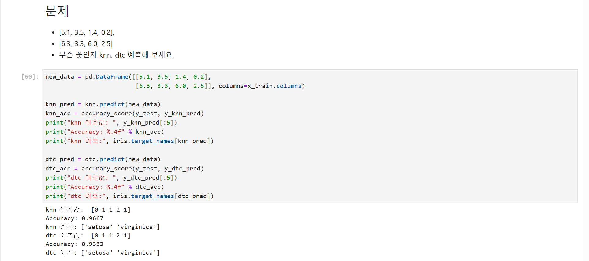

# 67일차

## 붓꽃 데이터 탐색(EDA)과 머신러닝 분류 모델 비교

📌 학습일 : 2026.10.17

📌 학습 내용 : load_iris, DESCR, target, feature_names, target_names, EDA, describe, isnull, duplicated, drop_duplicates, corr, heatmap, hist, displot, pairplot, train_test_split, kNN, SVM, 로지스틱 회귀, predict_proba, 의사결정나무, plot_tree, accuracy_score

---

#### 1. 사이킷런 데이터셋 불러오기

```python
from sklearn import datasets

데이터셋명 = datasets.load_iris()
데이터셋명.keys()

print(데이터셋명['DESCR'])
데이터셋명['target'].shape
데이터셋명['data'][:7, :]
```

`load_iris()`로 불러온 붓꽃 데이터는 딕셔너리처럼 여러 키를 가지고 있으며, `keys()`로 어떤 정보가 들어 있는지 확인할 수 있다.

| 키 | 내용 |
| --- | --- |
| `data` | 꽃받침 길이·너비, 꽃잎 길이·너비 4개 속성 (150행 4열) |
| `target` | 정답인 꽃의 종류 (0, 1, 2) |
| `feature_names` | 속성 이름 |
| `target_names` | 종류 이름 (`setosa`, `versicolor`, `virginica`) |
| `DESCR` | 데이터셋 설명 |

#### 2. 데이터프레임으로 변환

```python
df = pd.DataFrame(데이터셋명['data'], columns=데이터셋명['feature_names'])

df.columns = ['열이름1', '열이름2', '열이름3', '열이름4']
df['Target'] = 데이터셋명['target']
```

`data`를 데이터프레임으로 바꾸고, `sepal length (cm)`처럼 길고 공백이 있는 열 이름을 `sepal_length`처럼 간결하게 바꾼다.

정답인 `target`을 `Target` 열로 추가해 속성과 정답을 한 표에서 함께 볼 수 있게 했다.

#### 3. 데이터 탐색(EDA)

```python
df.info()
df.describe()
df.isnull().sum()

df.duplicated().sum()
df.loc[df.duplicated(), :]
df = df.drop_duplicates()
```

EDA는 모델을 만들기 전에 데이터의 구조, 통계값, 결측치, 중복 데이터 등을 살펴보는 과정이다.

`isnull().sum()`으로 결측치가 없는 것을 확인했고, `duplicated()`로 중복된 행 1개(142번)를 찾아 `drop_duplicates()`로 제거했다.

`duplicated()`는 처음 나온 행은 남기고 두 번째부터 중복으로 표시하므로, 101번과 142번 중 142번만 삭제되었다.

#### 4. 상관관계 분석

```python
df.corr()

sns.heatmap(data=df.corr(), square=True, annot=True, cbar=True)
plt.show()
```

`corr()`은 변수 사이의 상관계수를 구하며, 1에 가까울수록 함께 커지고 -1에 가까울수록 반대로 움직이는 관계이다.

`heatmap()`으로 상관계수를 색으로 표현하고, `annot=True`를 지정하면 칸 안에 숫자가 표시된다.

꽃잎 길이(`petal_length`)와 꽃잎 너비(`petal_width`)가 품종(`Target`)과 높은 상관관계를 보여, 품종 분류에 중요한 변수라는 것을 알 수 있었다.

#### 5. 데이터 분포 시각화

```python
plt.hist(x='열이름', data=df)

sns.displot(x='열이름', hue='Target', kind='kde', data=df)

for col in ['열이름1', '열이름2', '열이름3']:
    sns.displot(x=col, hue='Target', kind='kde', data=df)
plt.show()

sns.pairplot(df, hue='Target', height=2.5, diag_kind='kde')
```

`displot()`에 `hue='Target'`, `kind='kde'`를 지정하면 품종별 값의 분포를 밀도 곡선으로 겹쳐 볼 수 있다.

for문으로 열 이름 목록을 돌리면 여러 속성의 분포 그래프를 한 번에 그릴 수 있다.

`pairplot()`의 `diag_kind='kde'`는 대각선 칸에 히스토그램 대신 밀도 곡선을 그린다.

#### 6. 학습용·테스트용 데이터 분리

```python
from sklearn.model_selection import train_test_split

x_data = df.loc[:, '시작열':'끝열']
y_data = df.loc[:, 'Target']

x_train, x_test, y_train, y_test = train_test_split(x_data, y_data, test_size=0.2,
                                                    shuffle=True, random_state=20)
```

`loc[:, '시작열':'끝열']`로 속성 4개를 입력(x)으로, `Target`을 정답(y)으로 나눈다.

`test_size=0.2`로 80%는 학습용, 20%는 테스트용으로 나누고, `shuffle=True`로 데이터를 섞은 뒤 나눈다.

#### 7. kNN

```python
from sklearn.neighbors import KNeighborsClassifier
from sklearn.metrics import accuracy_score

knn = KNeighborsClassifier(n_neighbors=7)
knn.fit(x_train, y_train)

y_knn_pred = knn.predict(x_test)
knn_acc = accuracy_score(y_test, y_knn_pred)
print("Accuracy: %.4f" % knn_acc)
```

`fit()`에는 반드시 학습용 데이터를 넣고, 테스트용 데이터로 예측한 값과 실제값을 `accuracy_score()`로 비교해 정확도를 구한다.

`%.4f`는 소수점 넷째 자리까지 출력하는 형식이다.

#### 8. SVM과 로지스틱 회귀

```python
from sklearn.svm import SVC
svc = SVC()
svc.fit(x_train, y_train)

from sklearn.linear_model import LogisticRegression
lrc = LogisticRegression()
lrc.fit(x_train, y_train)

lrc.predict_proba(x_test)
```

사이킷런은 모델이 달라도 `모델()` 생성 → `fit()` 학습 → `predict()` 예측의 흐름이 같아서, 모델 이름만 바꿔 여러 모델을 쉽게 비교할 수 있다.

`predict_proba()`는 각 데이터가 품종별로 속할 확률을 보여 주며, 확률이 가장 높은 품종이 예측 결과가 된다.

#### 9. 의사결정나무

```python
from sklearn.tree import DecisionTreeClassifier, plot_tree

dtc = DecisionTreeClassifier(max_depth=3, random_state=20)
dtc.fit(x_train, y_train)

plt.figure(figsize=(20, 10))
plot_tree(dtc, feature_names=x_train.columns,
          class_names=[str(name) for name in 데이터셋명.target_names],
          filled=True, rounded=True, fontsize=10)
plt.show()
```

의사결정나무는 조건에 따라 데이터를 나누어 가며 분류하는 모델이며, `max_depth`로 나무의 깊이를 제한한다.

`plot_tree()`로 나무 구조를 그리면 어떤 속성과 기준값으로 데이터를 나눴는지 직접 확인할 수 있다.

#### 10. 모델 성능 비교

| 모델 | 테스트 정확도 |
| --- | --- |
| kNN (k=7) | 0.9667 |
| SVM | 1.0000 |
| 로지스틱 회귀 | 1.0000 |
| 의사결정나무 (max_depth=3) | 0.9333 |

이번 데이터에서는 SVM과 로지스틱 회귀가 가장 높은 정확도를 보였다.

다만 `random_state`나 데이터를 나누는 방법이 달라지면 결과도 달라질 수 있으므로, 한 번의 결과만으로 어떤 모델이 항상 가장 좋다고 결론 내리면 안 된다.

#### 11. 새로운 꽃 예측 퀴즈

```python
new_data = pd.DataFrame([[값1, 값2, 값3, 값4],
                         [값1, 값2, 값3, 값4]], columns=x_train.columns)

knn_pred = knn.predict(new_data)
dtc_pred = dtc.predict(new_data)

print("knn 예측:", 데이터셋명.target_names[knn_pred])
print("dtc 예측:", 데이터셋명.target_names[dtc_pred])
```

새 데이터도 학습할 때와 같은 열 이름과 순서로 만들기 위해 `columns=x_train.columns`를 지정했다.

모델은 0, 1, 2 같은 숫자로 예측하므로 `target_names[예측값]`으로 꽃 이름으로 바꿔 출력했다.

#### 핵심 정리

- 사이킷런 내장 데이터셋은 `keys()`로 `data`, `target`, `feature_names`, `target_names` 등의 정보를 확인할 수 있다.
- EDA로 결측치와 중복 데이터를 확인하고, `drop_duplicates()`로 중복 행을 제거한다.
- `corr()`와 `heatmap()`으로 품종 분류에 중요한 변수를 찾을 수 있다.
- `displot()`, `pairplot()`에 `hue`를 지정하면 품종별 분포를 비교할 수 있다.
- `train_test_split()`으로 학습용과 테스트용 데이터를 나누고, 학습에는 반드시 학습용 데이터를 사용한다.
- 사이킷런 모델은 생성 → `fit()` → `predict()`의 같은 흐름으로 사용한다.
- `accuracy_score()`로 테스트 데이터의 실제값과 예측값을 비교해 정확도를 구한다.
- 모델 성능은 데이터 분할 방법에 따라 달라질 수 있으므로 한 번의 결과로 단정하면 안 된다.
- 예측 결과 숫자는 `target_names`로 실제 이름으로 바꿔 확인할 수 있다.

---

<p align="center">
  
</p>

새 데이터를 리스트로만 넣지 않고 `columns=x_train.columns`로 학습할 때와 같은 열 이름을 붙여 데이터프레임으로 만들었는데, 어제 펭귄 퀴즈에서 모델은 학습한 열과 같은 형태로 데이터를 받아야 한다는 것을 배운 덕분에 바로 적용할 수 있었다.
</br>모델은 예측 결과를 0, 1, 2 같은 숫자로 돌려주는데, `iris.target_names[knn_pred]`처럼 숫자를 인덱스로 넣으면 `setosa`, `virginica` 같은 꽃 이름으로 바로 바꿀 수 있다는 점이 편리했다.
</br>결과는 knn과 dtc 모두 첫 번째 꽃은 setosa, 두 번째 꽃은 virginica로 같게 나왔다.
</br>이름이 비슷한 `knn_pred`와 `y_knn_pred`가 서로 다른 데이터를 예측한 값이라는 것을 구분하면서, 변수 이름을 정확히 보고 써야 한다는 것을 느꼈다.
</br>정확도는 knn이 0.9667, dtc가 0.9333으로 차이가 있었지만 두 꽃의 예측 결과는 같았고 정확도가 조금 낮은 모델도 특징이 뚜렷한 데이터는 똑같이 잘 맞힐 수 있다는 것을 알게 되었고, 여러 모델을 비교해 보며 결과를 해석하는 과정이 재미있었다.
