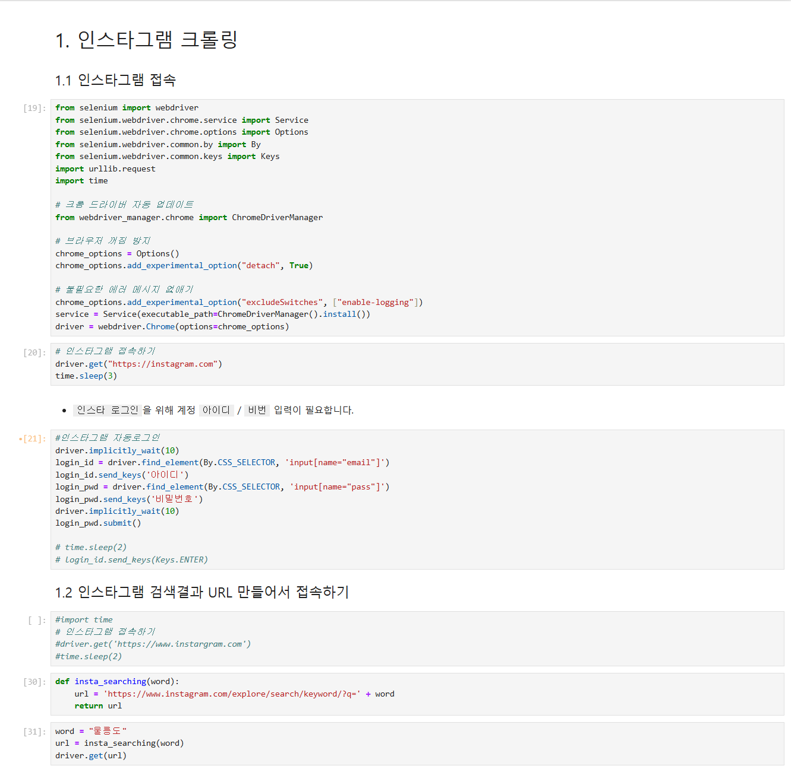
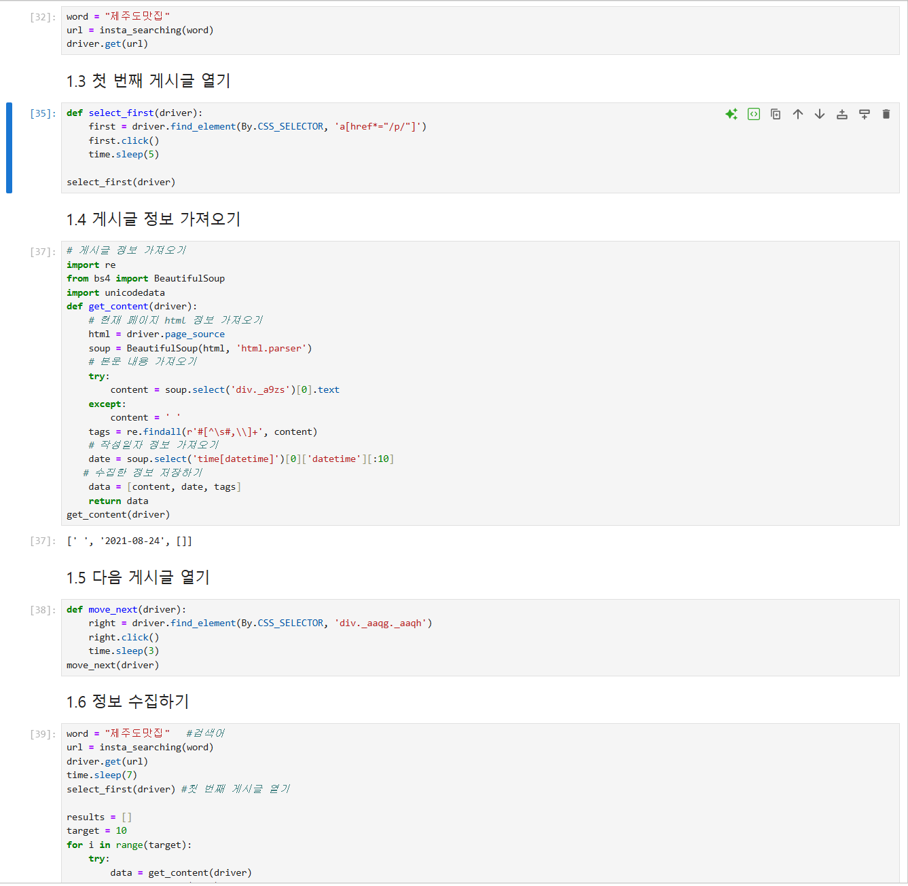
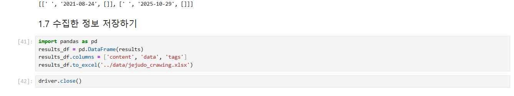

# 68일차

## Plotly·금융 데이터 시각화와 웹 크롤링(requests, BeautifulSoup, Selenium)

📌 학습일 : 2026.10.19

📌 학습 내용 : Plotly Express, line, bar, area, facet_col, rangeslider, FinanceDataReader, StockListing, DataReader, shift, pct_change, diff, requests, get, post, params, BeautifulSoup, find, select, select_one, Selenium, webdriver, Options, Service, ChromeDriverManager, find_element, send_keys, Crawling

---

#### 1. Plotly Express 기본 그래프

```python
import plotly.express as px

df = px.data.stocks()

px.line(df, x="x축열", y="y축열")
```

Plotly는 웹 친화적인 인터랙티브 그래프를 만드는 라이브러리이며, Plotly Express는 seaborn과 비슷하게 간단한 문법으로 그래프를 그릴 수 있다.

`px.data.stocks()`는 날짜(`date`)와 6개 기업(GOOG, AAPL, AMZN, FB, NFLX, MSFT)의 주가 수익률이 담긴 내장 데이터이다.

그래프 오른쪽 위의 도구로 확대(Zoom), 이동(Pan), 영역 선택(Box/Lasso Select), 자동 축 조정(Autoscale), 초기화(Reset Axes)를 할 수 있다.

#### 2. 막대·영역 그래프와 서브플롯

```python
df_1 = df.set_index("date") - 1

px.bar(df_1, x=df_1.index, y="열이름")

df_1.columns.name = "company"
px.area(df_1, facet_col="company", facet_col_wrap=2)

fig = px.line(df, x="date", y="열이름", title="제목")
fig.update_xaxes(rangeslider_visible=True)
```

`set_index("date") - 1`로 날짜를 인덱스로 바꾸고 1을 빼서, 기준일 대비 수익률이 0부터 시작하도록 만들었다.

`facet_col`에 열 이름을 지정하면 기업별로 서브플롯이 나뉘고, `facet_col_wrap=2`로 한 줄에 2개씩 그린다.

`update_xaxes(rangeslider_visible=True)`를 쓰면 그래프 아래에 기간을 조절하는 슬라이더가 생긴다.

#### 3. FinanceDataReader로 주식 데이터 수집

```python
import FinanceDataReader as fdr

종목목록 = fdr.StockListing("KRX")

df = fdr.DataReader("종목코드", "시작연도", "끝연도")
```

FinanceDataReader는 국내외 주식 가격, 지수, 환율 등 금융 데이터를 수집하는 라이브러리이며, `pip install -U finance-datareader`로 설치하고 `FinanceDataReader`로 불러온다.

`StockListing("KRX")`는 한국거래소 상장 종목 전체를, `DataReader("005930", "2020", "2021")`은 삼성전자의 일별 시세(Open, High, Low, Close, Volume, Change)를 가져온다.

함수 이름 뒤에 `?`를 붙이면 도움말을 볼 수 있다.

#### 4. shift, pct_change, diff로 수익률 구하기

```python
df["새열이름1"] = df["Close"] / df["Close"].shift(1) - 1
df["새열이름2"] = df["Close"].pct_change()
df["새열이름3"] = df["Close"].diff()

df[["열이름1", "열이름2"]].plot(figsize=(10, 4))
plt.axhline(0, c="k", lw=1)
```

`shift(1)`은 값을 한 칸씩 아래로 밀어 전일 종가를 만들며, `종가 / 전일 종가 - 1`로 전일 대비 수익률을 직접 구할 수 있다.

`pct_change()`는 같은 수익률을 한 번에 계산하고, `diff()`는 전일과의 가격 차이를 구한다.

직접 구한 값과 데이터의 `Change` 값이 같은 것을 확인했고, 첫 행은 전일 값이 없어 `NaN`이 된다.

#### 5. requests로 HTML 가져오기

```python
import requests

res = requests.get("URL")
res.status_code
res.text

parameters = {"키": "값"}
res = requests.get("URL", params=parameters)
res.url

res = requests.post("URL")
```

`requests.get()`으로 웹 페이지의 HTML 소스를 가져오고, `status_code`가 200이면 정상적으로 응답한 것이다.

`params`에 딕셔너리를 전달하면 `?code=005930`처럼 주소 뒤에 파라미터가 붙고, `res.url`로 실제 요청한 주소를 확인할 수 있다.

`get`은 주소에 값을 붙여 요청하고, `post`는 값을 요청 본문에 담아 보내는 방식이다.

#### 6. BeautifulSoup으로 HTML 분석

```python
from bs4 import BeautifulSoup

soup = BeautifulSoup(html_txt, "html.parser")

tag = soup.find("태그명")
tag.name
tag.attrs
tag.attrs["class"]
tag.text
```

`BeautifulSoup()`은 HTML 문자열을 분석할 수 있는 형태로 변환(파싱)한다.

`find()`는 조건에 맞는 첫 번째 태그를 찾고, `name`은 태그 이름, `attrs`는 속성 딕셔너리, `text`는 태그 안의 글자를 돌려준다.

#### 7. CSS 선택자로 태그 추출

```python
soup.select_one("태그명").text

for tag in soup.select("태그명"):
    print(tag.text)
```

| 선택자 | 의미 |
| --- | --- |
| `h1` | 태그 이름으로 찾기 |
| `.footage_cls` | class로 찾기 |
| `#addr` | id로 찾기 |
| `body p > a` | `<body>` 안 `<p>` 바로 아래의 `<a>` 찾기 |
| `a[href]` | `href` 속성이 있는 `<a>` 찾기 |

`select_one()`은 첫 번째 태그 1개를, `select()`는 조건에 맞는 모든 태그를 리스트로 돌려주므로 for문으로 하나씩 꺼내 쓴다.

#### 8. Selenium 기본 사용법

```python
from selenium import webdriver
from selenium.webdriver.common.by import By

driver = webdriver.Chrome()
driver.get("URL")

input_tag = driver.find_element(By.CSS_SELECTOR, "선택자")
input_tag.send_keys("검색어")
input_tag.send_keys("\n")
driver.implicitly_wait(3)
```

Selenium은 코드로 크롬 브라우저를 직접 조작하는 도구로, 검색어 입력이나 클릭처럼 사람이 하는 동작을 자동으로 수행할 수 있다.

selenium 4.6 이상은 크롬 드라이버를 자동으로 찾아 주므로 `webdriver.Chrome()`처럼 괄호를 비워 두면 되고, 예전 방식인 `webdriver.Chrome("chromedriver")`는 오류가 난다.

`implicitly_wait(3)`은 요소가 나타날 때까지 최대 3초를 기다린다.

#### 9. Selenium 기본 설정

```python
from selenium.webdriver.chrome.service import Service
from selenium.webdriver.chrome.options import Options
from webdriver_manager.chrome import ChromeDriverManager

chrome_options = Options()
chrome_options.add_experimental_option("detach", True)
chrome_options.add_experimental_option("excludeSwitches", ["enable-logging"])

service = Service(ChromeDriverManager().install())
driver = webdriver.Chrome(service=service, options=chrome_options)

driver.save_screenshot('파일명.png')
driver.close()
driver.quit()
```

`detach=True`는 코드 실행이 끝나도 브라우저를 닫지 않고 유지하며, `excludeSwitches`는 불필요한 로그 메시지를 줄인다.

`ChromeDriverManager().install()`은 크롬 버전에 맞는 드라이버를 자동으로 설치한다.

`close()`는 현재 창 하나만 닫고, `quit()`은 Selenium이 실행한 브라우저 전체와 세션을 종료한다.

#### 10. 오피넷 지역 목록 자동 선택

```python
목록요소 = driver.find_element(By.ID, "아이디")
옵션목록 = 목록요소.find_elements(By.TAG_NAME, "option")
값목록 = [option.get_attribute("value") for option in 옵션목록]

for 값 in tqdm_notebook(값목록):
    element = driver.find_element(By.ID, "아이디")
    element.send_keys(값)
    time.sleep(3)
    driver.find_element(By.CLASS_NAME, "버튼클래스").click()
    time.sleep(3)
```

드롭다운의 `<option>` 태그를 `find_elements()`로 모두 가져와 시·도와 구 이름 목록을 만들었다.

`find_element()`는 요소 1개, `find_elements()`는 여러 요소를 리스트로 돌려준다.

for문으로 구 이름을 하나씩 선택하고 저장 버튼을 클릭해 구별 주유소 데이터를 자동으로 내려받았으며, `tqdm_notebook()`으로 진행 상황을 막대로 확인할 수 있다.

#### 11. 인스타그램 크롤링

```python
login_id = driver.find_element(By.CSS_SELECTOR, 'input[name="email"]')
login_id.send_keys('아이디')
login_pwd = driver.find_element(By.CSS_SELECTOR, 'input[name="pass"]')
login_pwd.send_keys('비밀번호')
login_pwd.submit()

def insta_searching(word):
    url = 'https://www.instagram.com/explore/search/keyword/?q=' + word
    return url

def select_first(driver):
    first = driver.find_element(By.CSS_SELECTOR, 'a[href*="/p/"]')
    first.click()
    time.sleep(5)
```

```python
def get_content(driver):
    html = driver.page_source
    soup = BeautifulSoup(html, 'html.parser')
    try:
        content = soup.select('본문선택자')[0].text
    except:
        content = ' '
    tags = re.findall(r'#[^\s#,\\]+', content)
    date = soup.select('time[datetime]')[0]['datetime'][:10]
    return [content, date, tags]
```

로그인 → 검색 → 첫 번째 게시글 열기 → 본문·날짜·태그 수집 → 다음 게시글 이동을 반복해 정보를 모으고 `to_excel()`로 저장한다.

`driver.page_source`로 Selenium이 연 페이지의 HTML을 가져와 BeautifulSoup으로 분석하고, `re.findall()`로 본문에서 `#`으로 시작하는 해시태그만 추출한다.

인스타그램은 화면 구조가 자주 바뀌어 강의 코드의 `_aabd`, `_aaqe` 같은 클래스 이름으로는 요소를 찾을 수 없었고, `a[href*="/p/"]`, `time[datetime]`처럼 잘 바뀌지 않는 속성으로 선택자를 바꿨다.

#### 12. 유튜브 크롤링과 조회수 전처리

```python
driver.find_element(By.CSS_SELECTOR, "body").send_keys(Keys.END)

html = driver.page_source
soup = BeautifulSoup(html, 'html.parser')
infos = soup.select("div.text-wrapper")

for i, info in enumerate(infos, 1):
    title = info.select_one("a#video-title").text
    views = info.select_one("div#metadata-line > span:nth-of-type(1)").text
```

```python
def text_to_num(text):
    text = text.replace("조회수", "").replace("회", "").strip()
    if "만" in text:
        num = float(text.replace("만", "")) * 10000
    elif "천" in text:
        num = float(text.replace("천", "")) * 1000
    else:
        num = int(text)
    return num
```

`Keys.END`로 페이지 맨 아래까지 스크롤해야 아래쪽 영상 목록까지 불러와진다.

Selenium으로 페이지를 움직이고, 데이터 추출은 속도가 빠른 BeautifulSoup으로 하는 방식으로 함께 사용했다.

`nth-child`는 몇 번째 자식인지로, `nth-of-type`은 같은 태그 중 몇 번째인지로 선택한다.

`조회수 15만회`처럼 문자로 된 조회수는 `replace()`로 글자를 지우고 단위에 맞게 곱해 숫자로 바꾼다.

#### 핵심 정리

- Plotly Express는 `px.line()`, `px.bar()`, `px.area()`로 인터랙티브 그래프를 간단히 그릴 수 있다.
- `facet_col`로 서브플롯을 나누고, `rangeslider_visible=True`로 기간 슬라이더를 추가한다.
- FinanceDataReader의 `StockListing()`, `DataReader()`로 종목 목록과 일별 시세를 가져온다.
- `shift()`, `pct_change()`, `diff()`로 전일 대비 수익률과 가격 차이를 구할 수 있다.
- `requests.get()`으로 HTML을 가져오고, `params`로 주소에 파라미터를 붙인다.
- BeautifulSoup의 `select_one()`은 태그 1개, `select()`는 모든 태그를 리스트로 돌려준다.
- CSS 선택자는 태그명, `.클래스`, `#아이디`, `[속성]`으로 원하는 태그를 찾는다.
- Selenium은 `find_element()`와 `send_keys()`, `click()`으로 브라우저를 자동 조작한다.
- `detach` 옵션은 브라우저를 유지하고, `close()`는 창 하나, `quit()`은 전체를 종료한다.
- 동적인 사이트는 Selenium으로 페이지를 열고 `page_source`를 BeautifulSoup으로 분석한다.
- 웹사이트 구조는 자주 바뀌므로 클래스 이름보다 잘 바뀌지 않는 속성으로 선택자를 만드는 것이 안전하다.

---

<p align="center">
  
</p>

인스타그램 크롤링은 Selenium으로 크롬을 띄워 인스타그램에 접속하고 자동으로 로그인하는 것부터 시작했다.
</br>강의 코드대로 `input[name="username"]`으로 아이디 입력창을 찾으니 `NoSuchElementException`이 났는데, 실제 로그인 페이지를 확인해 보니 입력창 이름이 `email`, `pass`로 바뀌어 있었다.
</br>로그인 후에는 `submit()`으로 화면이 넘어가면서 아이디 입력창이 사라졌는데, 그 입력창에 다시 Enter를 보내는 코드 때문에 `StaleElementReferenceException`이 났다. 화면이 바뀌면 이전에 찾아 둔 요소는 더 이상 쓸 수 없다는 것을 알게 되어 해당 줄을 주석 처리했다.
</br>검색 주소도 예전의 `explore/tags/검색어` 형식이 아니라 `explore/search/keyword/?q=검색어` 형식으로 바뀌어 있어 `insta_searching()` 함수를 수정했다.

<p align="center">
  
</p>

첫 번째 게시글을 여는 `div._aabd`와 작성일을 가져오는 `time._aaqe`도 찾을 수 없어서, 게시글 링크 주소에 항상 들어가는 `/p/`를 이용한 `a[href*="/p/"]`와 `datetime` 속성을 이용한 `time[datetime]`으로 바꿨다.
</br>`_aabd` 같은 클래스 이름은 사이트가 바뀔 때마다 달라지지만, 링크 주소나 태그 속성은 잘 바뀌지 않기 때문에 선택자를 만들 때 무엇을 기준으로 잡을지가 중요하다는 것을 배웠다.
</br>작성일은 `2021-08-24`처럼 정상적으로 가져왔지만, 본문은 `try-except`로 감싸져 있어 오류 없이 빈칸(`' '`)이 들어갔고 해시태그도 빈 리스트로 나왔다.

<p align="center">
  
</p>

수집한 10개 게시글을 `to_excel()`로 저장하고 `driver.close()`로 브라우저를 닫는 것까지 진행했지만, 결과를 보니 날짜만 저장되고 본문과 태그는 모두 비어 있었다.
</br>코드가 오류 없이 끝났다고 해서 원하는 데이터가 제대로 수집된 것은 아니라는 것을 느꼈고, 크롤링 결과는 반드시 직접 열어 확인해야 한다는 것을 알게 되었다.
</br>또 `try-except`는 오류를 막아 주지만 문제를 숨길 수도 있어서, 빈 값이 나왔을 때 어디서 실패했는지 확인하는 습관이 필요하다고 느꼈다.
</br>강의 자료와 실제 사이트가 달라 오류가 계속 났지만, 오류 메시지와 실제 페이지 구조를 비교하며 하나씩 고쳐 나가는 과정에서 웹 크롤링이 사이트 구조 변화에 얼마나 민감한지 직접 경험할 수 있었다.
