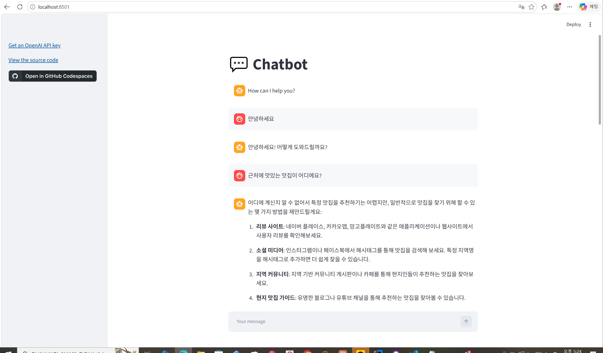
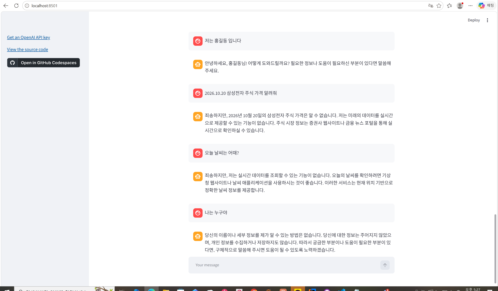

# 69일차

## OpenAI API로 GPT 호출하기와 프롬프트 기법, Streamlit 챗봇

📌 학습일 : 2026.10.20

📌 학습 내용 : OpenAI API, chat.completions.create, model, temperature, messages, role(system, user, assistant), python-dotenv, .env, 가상환경(venv), 페르소나 설정, no-shot, one-shot, few-shot, 싱글턴, 멀티턴, Streamlit, session_state, chat_input, chat_message

---

#### 1. OpenAI API 기본 호출

```python
from openai import OpenAI

client = OpenAI(api_key=api_key)

response = client.chat.completions.create(
    model="모델이름",
    temperature=0.1,
    messages=[
        {"role": "system", "content": "역할 설정"},
        {"role": "user", "content": "질문"}
    ]
)

print(response.choices[0].message.content)
```

`OpenAI()`에 API 키를 넣어 클라이언트를 만들고, `chat.completions.create()`로 GPT 모델에 질문을 보낸다.

`response` 전체를 출력하면 모델 정보, 사용 토큰 수 등 많은 정보가 함께 나오므로, 답변 내용만 보려면 `response.choices[0].message.content`를 출력한다.

| role | 의미 |
| --- | --- |
| `system` | GPT의 역할과 답변 방식 설정 |
| `user` | 사용자가 보내는 질문 |
| `assistant` | 언어모델이 제공한 답변 |

#### 2. .env 파일로 API 키 관리

```python
from dotenv import load_dotenv
import os

load_dotenv()
api_key = os.getenv('OPENAI_API_KEY')
```

```
# .env
OPENAI_API_KEY=발급받은키
```

API 키를 코드에 직접 쓰면 코드가 공유될 때 키가 그대로 노출되므로, `.env` 파일에 따로 저장하고 `load_dotenv()`로 불러온다.

설치할 때 이름은 `python-dotenv`이고, 코드에서는 `from dotenv import load_dotenv`로 불러온다.

`os.getenv()`에 적는 이름과 `.env` 파일의 키 이름이 정확히 같아야 하며, 다르면 `None`이 들어가 `api_key` 오류가 발생한다.

`.env` 파일은 깃허브에 올라가지 않도록 `.gitignore`에 추가해야 한다.

#### 3. 가상환경에서 실행

```bash
python -m venv venv
venv\Scripts\activate
pip install openai python-dotenv
python 파일명.py
```

프로젝트마다 가상환경(venv)을 만들면 필요한 패키지를 따로 관리할 수 있고, 명령 프롬프트 앞에 `(venv)`가 보이면 가상환경이 켜진 상태이다.

#### 4. temperature와 페르소나 설정

```python
response = client.chat.completions.create(
    model="모델이름",
    temperature=0.9,
    messages=[
        {"role": "system", "content": "너는 ○○야. ○○의 캐릭터에 맞게 답변해줘."},
        {"role": "user", "content": "질문"}
    ]
)
```

`temperature`는 0~1 사이 값으로, 0에 가까울수록 일관되고 정확한 답변을, 1에 가까울수록 다양하고 창의적인 답변을 만든다.

같은 질문 "세상에서 누가 제일 아름답니?"도 `system`에 백설공주의 마법 거울, 배트맨의 조커처럼 역할을 다르게 주면 캐릭터에 맞는 전혀 다른 답변이 나왔다.

#### 5. no-shot, one-shot, few-shot 프롬프트

```python
messages=[
    {"role": "system", "content": "역할 설정"},
    {"role": "user", "content": "예시 질문1"},
    {"role": "assistant", "content": "예시 답변1"},
    {"role": "user", "content": "예시 질문2"},
    {"role": "assistant", "content": "예시 답변2"},
    {"role": "user", "content": "실제 질문"}
]
```

| 기법 | 방법 |
| --- | --- |
| no-shot | 예시 없이 바로 질문 |
| one-shot | 예시 1개(참새 → 짹짹)를 보여 준 뒤 질문 |
| few-shot | 예시 여러 개(참새 → 짹짹, 말 → 히이잉, 개구리 → 개굴개굴)를 보여 준 뒤 질문 |

`user`와 `assistant` 대화를 예시로 넣어 주면 GPT가 예시의 형식을 따라 "호랑이"에도 울음소리로 답하는 것처럼, 원하는 답변 형식을 유도할 수 있다.

#### 6. 싱글턴과 멀티턴 대화

```python
while True:
    user_input = input("사용자: ")
    if user_input == "exit":
        break

    messages.append({"role": "user", "content": user_input})
    ai_response = get_ai_response(messages)
    messages.append({"role": "assistant", "content": ai_response})

    print("AI : ", ai_response)
```

싱글턴은 매번 질문 하나만 보내기 때문에 GPT가 앞의 대화를 기억하지 못한다.

멀티턴은 `messages` 리스트에 사용자 질문과 AI 답변을 계속 `append()`해서 함께 보내기 때문에, 앞의 대화 내용을 이어서 답할 수 있다.

GPT는 대화를 스스로 기억하는 것이 아니라, 매번 보내는 `messages`에 대화 기록이 들어 있어야 이전 내용을 알 수 있다.

#### 7. Streamlit 챗봇

```python
import streamlit as st

st.title("제목")

if "messages" not in st.session_state:
    st.session_state["messages"] = [{"role": "assistant", "content": "첫 인사"}]

for msg in st.session_state.messages:
    st.chat_message(msg["role"]).write(msg["content"])

if prompt := st.chat_input():
    st.session_state.messages.append({"role": "user", "content": prompt})
    st.chat_message("user").write(prompt)
    response = client.chat.completions.create(model="모델이름", messages=st.session_state.messages)
    msg = response.choices[0].message.content
    st.session_state.messages.append({"role": "assistant", "content": msg})
    st.chat_message("assistant").write(msg)
```

```bash
streamlit run 파일명.py
```

Streamlit은 파이썬 코드만으로 웹 화면을 만들 수 있는 라이브러리이며, `streamlit run`으로 실행하면 `localhost:8501`에서 챗봇 화면을 볼 수 있다.

Streamlit은 입력이 있을 때마다 코드를 처음부터 다시 실행하므로, 대화 기록은 `st.session_state`에 저장해야 사라지지 않는다.

`st.chat_input()`은 입력창, `st.chat_message()`는 말풍선을 만들고, `st.sidebar`로 왼쪽 사이드바에 링크나 입력창을 넣을 수 있다.

`if prompt := st.chat_input():`의 `:=`는 값을 변수에 저장하면서 동시에 조건을 검사하는 문법이다.

#### 핵심 정리

- OpenAI API는 `chat.completions.create()`에 모델, `temperature`, `messages`를 전달해 호출한다.
- `messages`의 `role`은 `system`(역할 설정), `user`(질문), `assistant`(답변)로 나뉜다.
- API 키는 `.env` 파일에 저장해 `load_dotenv()`와 `os.getenv()`로 불러오고, 깃허브에 올리지 않는다.
- `temperature`가 낮으면 일관된 답변, 높으면 다양한 답변이 나온다.
- `system`에 페르소나를 설정하면 같은 질문에도 캐릭터에 맞는 답변을 받을 수 있다.
- one-shot, few-shot처럼 예시 대화를 넣으면 원하는 답변 형식을 유도할 수 있다.
- 멀티턴 대화는 `messages`에 대화 기록을 계속 쌓아서 보내야 이전 내용을 이어서 답한다.
- Streamlit은 `session_state`로 대화 기록을 유지하고, `chat_input()`, `chat_message()`로 챗봇 화면을 만든다.

---

<p align="center">
  
</p>

Streamlit으로 만든 챗봇을 `streamlit run`으로 실행하니 `localhost:8501`에서 채팅 화면이 열렸고, 파이썬 코드 몇 줄만으로 웹 챗봇 화면을 만들 수 있다는 점이 신기했다.
</br>"안녕하세요"라고 입력하자 인사로 답했고, "근처에 맛있는 맛집이 어디에요?"라고 묻자 위치를 알 수 없어 특정 맛집을 추천하기 어렵다고 하면서 리뷰 사이트, 소셜 미디어 같은 방법을 정리해서 알려 주었다.
</br>GPT는 사용자의 위치 같은 정보를 알지 못하기 때문에, 원하는 답변을 받으려면 질문에 필요한 정보를 함께 넣어 줘야 한다는 것을 알게 되었다.

<p align="center">
  
</p>

"2026.10.20 삼성전자 주식 가격 알려줘", "오늘 날씨는 어때?"처럼 실시간 정보를 묻는 질문에는 실시간 데이터를 조회할 수 없다고 답했다.
</br>GPT는 학습한 데이터를 바탕으로 답변하기 때문에 최신 주가나 날씨는 알 수 없고, 이런 정보가 필요하면 지난주에 배운 FinanceDataReader나 크롤링처럼 외부 데이터를 가져와 함께 넘겨 줘야 한다는 것을 느꼈다.
</br>또 처음에 "저는 홍길동 입니다"라고 소개했는데, 마지막에 "나는 누구야"라고 물었을 때는 이름을 알 수 없다고 답했다.
</br>Streamlit 코드는 `session_state`에 쌓인 대화 기록을 모두 함께 보내고 있었는데도 이름을 활용하지 못한 답변이 나와서, 대화 기록을 보내는 것만으로는 항상 원하는 답이 나오지 않을 수 있고 `system` 역할 설정 같은 프롬프트도 함께 다듬어야 한다는 것을 알게 되었다.
</br>오늘은 GPT를 코드로 직접 호출하고 화면까지 만들어 보면서, 앞으로 배울 AI 에이전트가 이런 API 호출과 대화 기록 관리를 바탕으로 만들어진다는 것을 느낄 수 있었다.
