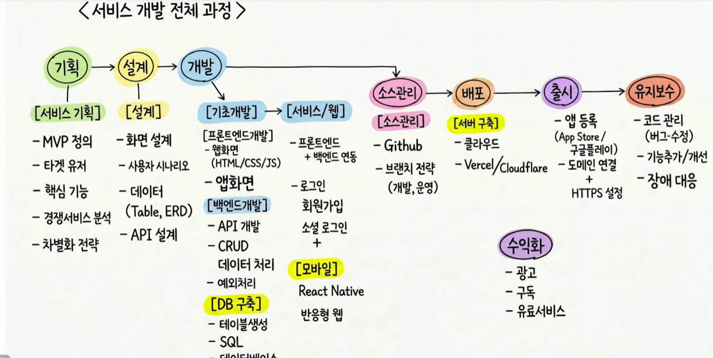
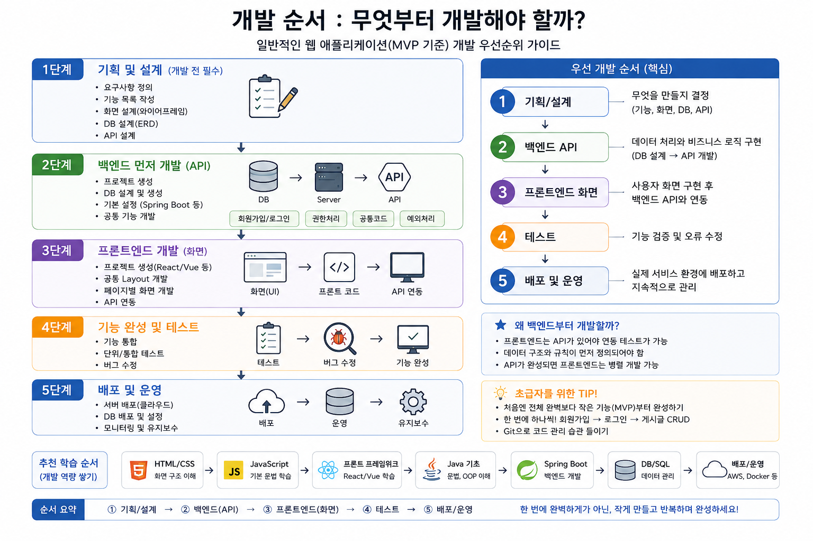

# 71일차

## 서비스 개발 과정과 비기능 요구사항, AI 활용 프로세스와 SQL 복습

📌 학습일 : 2026.10.22

📌 학습 내용 : 서비스 개발 전체 과정, MVP, 개발 우선순위, 비기능 요구사항, 성능, 보안, 인증, 안정성, 동시성, 데이터 검증, 로그, AI 활용 프로세스, 수치화, 가설 검증, 재측정, SELECT, ORDER BY, NVL, GROUP BY, ROUND, AVG, 조인, 셀프 조인

---

#### 1. 서비스 개발 전체 과정

<p align="center">
  
</p>

| 단계 | 주요 내용 |
| --- | --- |
| 기획 | MVP 정의, 타깃 유저, 핵심 기능, 경쟁 서비스 분석, 차별화 전략 |
| 설계 | 화면 설계, 사용자 시나리오, 데이터(Table, ERD), API 설계 |
| 개발 | 프론트엔드·백엔드 개발, DB 구축, 로그인·회원가입 등 서비스 연동 |
| 소스 관리 | GitHub, 브랜치 전략(개발, 운영) |
| 배포·출시 | 클라우드 서버 구축, 도메인 연결과 HTTPS 설정, 앱 등록 |
| 유지보수 | 버그 수정, 기능 추가·개선, 장애 대응 |

서비스는 개발만으로 끝나는 것이 아니라 기획부터 배포, 출시, 유지보수까지 이어지는 전체 과정으로 만들어진다.

MVP(Minimum Viable Product)는 핵심 기능만 담은 최소한의 제품으로, 처음부터 완벽하게 만들기보다 작게 만들고 반복하며 완성한다.

#### 2. 개발 순서: 무엇부터 개발해야 할까?

<p align="center">
  
</p>

| 순서 | 단계 | 내용 |
| --- | --- | --- |
| 1 | 기획/설계 | 요구사항 정의, 기능 목록, 화면 설계, DB 설계(ERD), API 설계 |
| 2 | 백엔드 API | 프로젝트 생성, DB 생성, 회원가입·로그인, 권한 처리, 예외 처리 |
| 3 | 프론트엔드 화면 | 공통 Layout, 페이지별 화면 개발, API 연동 |
| 4 | 테스트 | 기능 통합, 단위·통합 테스트, 버그 수정 |
| 5 | 배포 및 운영 | 서버·DB 배포, 모니터링, 유지보수 |

백엔드를 먼저 개발하는 이유는 프론트엔드가 API가 있어야 연동 테스트를 할 수 있고, 데이터 구조와 규칙이 먼저 정의되어야 하기 때문이다.

API가 완성되면 프론트엔드는 병렬로 개발할 수 있으며, 처음에는 회원가입 → 로그인 → 게시글 CRUD처럼 작은 기능부터 하나씩 완성하는 것이 좋다.

#### 3. 비기능 요구사항

| 영역 | 발견해야 할 문제 | 실제 해결 예 |
| --- | --- | --- |
| 성능 | 게시글이 많아지면 느려짐 | 페이징, 인덱스, 쿼리 개선 |
| 보안 | 다른 사용자의 글 수정 가능 | 서버 권한 검증 |
| 인증 | 로그인 상태를 어떻게 유지할지 | Session / JWT |
| 안정성 | DB 오류가 나면? | 예외 처리, Transaction |
| 동시성 | 동시에 같은 데이터를 수정하면? | Optimistic Lock 등 |
| 사용성 | 서버 오류가 그대로 표시됨 | 사용자용 오류 메시지 |
| 데이터 | 잘못된 값이 저장됨 | @Valid, DB 제약조건 |
| 운영 | 장애 원인을 찾을 수 없음 | 요청·오류 로그 |
| 확장성 | 사용자가 10배 증가하면? | Cache, Scale-out 검토 |
| 복구 | 서버가 죽으면 데이터는? | 백업·복구 정책 |

기능 요구사항이 "무엇을 하는가"라면, 비기능 요구사항은 "얼마나 빠르고 안전하고 안정적으로 동작하는가"이다.

초급자 프로젝트에서는 모든 영역을 다루기보다 성능, 보안, 안정성, 데이터 검증, 로그·운영 5개 영역을 필수로 잡는 것이 적절하다.

#### 4. AI를 활용한 비기능 요구사항 해결 순서

```
1단계  문제를 수치화       게시글 10만 건일 때 목록 조회 3초 → 목표 1초 이내
2단계  AI에게 원인 후보 요청  DB, Backend, Network 관점으로 나누어 질문
3단계  개발자가 증거 확인    SQL 실행시간 → 실행계획 → 애플리케이션 로그 → 응답시간
4단계  AI에게 해결 대안 비교  방법 3가지와 장점, 단점, 난이도, 검증 방법 요청
5단계  해결 후 재측정       10만 건 기준 3.1초 → 인덱스 적용 후 0.4초
```

"게시판 성능을 좋게 만들어줘"처럼 막연하게 묻기보다, 현재 상태와 목표를 숫자로 정해야 비기능 요구사항이 된다.

AI가 제시한 Full Table Scan, 인덱스 부족, `SELECT *`, N+1 조회 같은 원인은 가설일 뿐이므로 바로 적용하지 않고, 실행계획이나 로그로 실제 원인인지 확인한 뒤 적용해야 한다.

AI의 첫 번째 답을 정답으로 받아들이지 않도록 해결 방법을 여러 개 비교하게 하고, 적용 후에는 같은 조건에서 다시 측정해 개선 효과를 숫자로 확인한다.

#### 5. 보안 요구사항 검증 예시

```
PUT /api/posts/100
Authorization: User-B
```

```
로그인 사용자
     ↓
게시글 작성자 확인
     ↓
   일치?
 ┌───┴────┐
YES       NO
 ↓         ↓
수정      403
```

"회원은 자신의 게시글을 수정할 수 있다"는 기능에 대해 AI에게 보안 문제를 찾게 하면, 다른 사용자의 게시글 ID로 수정 요청을 보내는 상황을 제시할 수 있다.

User-A가 작성한 100번 글을 User-B가 수정할 수 있다면 문제가 확인된 것이며, 서버에서 로그인 사용자와 작성자가 같은지 다시 확인하고 다르면 403을 반환해야 한다.

화면에서 수정 버튼을 숨기는 것만으로는 막을 수 없고, 요청을 직접 보내면 우회되기 때문에 반드시 서버에서 권한을 검증해야 한다.

#### 6. 초급자의 AI 활용 7단계 프로세스

```
기능 구현
→ AI에게 위험·문제점 발견 요청
→ 비기능 요구사항 수치화
→ AI에게 원인 가설 요청
→ 개발자가 로그·SQL·테스트로 검증
→ AI에게 해결 대안 비교 요청
→ 구현 후 재측정
```

| 단순한 발표 | 근거가 있는 발표 |
| --- | --- |
| "Redis를 사용했습니다." | 문제: 조회 요청 증가로 DB 부하 발생 |
| | 측정: 동일 데이터 반복 조회가 전체의 70% |
| | AI 활용: 캐시, 인덱스, 쿼리 개선 3가지 대안 분석 |
| | 판단: 반복 조회 특성을 고려해 캐시 선택 |
| | 구현: Redis + TTL 적용 |
| | 검증: 적용 전·후 응답시간과 DB 조회 횟수 비교 |

Redis, Kafka 같은 해결책을 먼저 찾기보다 문제 → 원인 → 증거 → 해결책 순서로 접근하는 것이 중요하다.

#### 7. SQL 복습

```sql
-- 조건 검색과 정렬
SELECT 열1, 열2 FROM 테이블 WHERE 조건 ORDER BY 열 DESC;

-- NULL 처리
SELECT sal * 12 + NVL(comm, 0) AS 별칭 FROM emp;

-- 그룹 함수
SELECT deptno, COUNT(*), ROUND(AVG(sal)) FROM emp GROUP BY deptno ORDER BY deptno;

-- 조인
SELECT e.ename, d.dname FROM emp e, dept d WHERE e.deptno = d.deptno;

-- 셀프 조인
SELECT e.ename, m.ename FROM emp e, emp m WHERE e.mgr = m.empno;
```

| 문법 | 설명 |
| --- | --- |
| `NVL(값, 대체값)` | 값이 NULL이면 대체값으로 바꿈. NULL과 계산하면 결과도 NULL이 됨 |
| `ROUND(AVG(sal))` | 안쪽 `AVG()`로 평균을 구한 뒤 바깥쪽 `ROUND()`로 반올림 |
| `GROUP BY` | 같은 값끼리 묶어 `COUNT()`, `AVG()` 같은 그룹 함수를 적용 |
| 조인 | 두 테이블의 같은 열(`deptno`)을 연결 조건으로 묶어 조회 |
| 셀프 조인 | 한 테이블을 별칭 두 개로 나눠, 사원의 `mgr`과 매니저의 `empno`를 연결 |

#### 핵심 정리

- 서비스는 기획 → 설계 → 개발 → 소스 관리 → 배포 → 출시 → 유지보수의 전체 과정으로 만들어진다.
- 개발은 기획/설계 → 백엔드 API → 프론트엔드 → 테스트 → 배포 순서로 진행하고, MVP부터 작게 완성한다.
- 비기능 요구사항은 성능, 보안, 안정성, 데이터 검증, 로그·운영처럼 "얼마나 잘 동작하는가"에 대한 요구사항이다.
- 비기능 요구사항은 "현재 3초 → 목표 1초 이내"처럼 수치화해야 검증할 수 있다.
- AI가 제시한 원인은 가설이므로 실행계획, 로그, 테스트로 직접 증거를 확인한 뒤 적용한다.
- 해결 방법은 여러 개를 비교하고, 적용 후에는 같은 조건에서 재측정해 개선 효과를 증명한다.
- 권한 검증은 화면이 아니라 반드시 서버에서 해야 한다.
- `NVL()`로 NULL을 처리하고, `ROUND(AVG())`처럼 함수 안에 함수를 넣을 수 있으며, 셀프 조인은 `e.mgr = m.empno`로 연결한다.

---

```sql
//급여(SAL)가 2000 이상인 사원의 사원번호, 이름, 직업, 급여를 조회하세요. 급여가 높은 순으로 정렬하세요.
select deptno, ename, job, sal 
from emp
WHERE sal >= 2000
order by sal DESC;

//30번 부서 사원의 이름, 급여, 커미션, 연봉을 조회하세요. 연봉은 급여 × 12 + 커미션이고, 
//커미션이 NULL이면 0으로 계산하세요. 연봉 열 이름은 연봉으로 표시하세요.
SELECT ename, sal, comm, sal*12 + nvl(comm, 0) "연봉"
from emp
where deptno=30;

//부서번호별 사원 수와 평균 급여를 조회하세요.
//평균 급여는 소수점 첫째 자리에서 반올림하고, 부서번호 순으로 정렬하세요.
SELECT deptno, COUNT(*) "사원수", round(avg(sal)) "평균"
from emp
GROUP by deptno
ORDER by deptno;

//근무지(LOC)가 DALLAS인 사원의 이름, 부서명, 근무지를 조회하세요. EMP와 DEPT를 조인해야 해요.
SELECT e.ename, d.dname, d.loc
from emp e, dept d
where e.deptno=d.deptno
and d.loc='DALLAS';

//사원 이름과 그 사원의 매니저 이름을 함께 조회하세요. 
//열 이름은 사원, 매니저로 표시하세요. EMP 테이블을 두 번 사용해야 해요.
SELECT e.ename "사원이름", m.ename "매니저"
FROM emp e, emp m
where e.deptno=m.deptno
and e.mgr=m.empno;
```

오늘은 그동안 배운 SQL을 다시 떠올리기 위해 EMP, DEPT 테이블로 조회, NULL 처리, 그룹 함수, 조인, 셀프 조인 문제 5개를 풀어 보았다.
</br>처음 풀 때는 커미션이 NULL인 사원의 연봉 계산, 평균 급여 반올림, 셀프 조인의 연결 조건에서 막혔는데, NULL은 0이 아니라 "값이 없음"이라 계산하면 결과도 NULL이 되기 때문에 `NVL(comm, 0)`으로 바꿔야 한다는 것을 다시 정리할 수 있었다.
</br>`ROUND(AVG(sal))`처럼 함수 안에 함수를 넣으면 안쪽 함수부터 실행된다는 점과, 셀프 조인은 "내가 가진 매니저 번호(`e.mgr`)를 상대의 사원번호(`m.empno`)에서 찾는다"고 생각하면 연결 조건이 헷갈리지 않는다는 것도 알게 되었다.
</br>다시 풀고 나서 결과를 비교해 보니 아직 놓친 부분이 있었다. 1번 문제는 사원번호(`empno`)를 조회해야 하는데 부서번호(`deptno`)를 조회했고, 5번 문제는 `e.deptno=m.deptno` 조건을 추가하는 바람에 결과가 13행이 아니라 11행이 나왔다.
</br>JONES와 BLAKE의 매니저인 KING은 10번 부서인데 두 사람은 각각 20번, 30번 부서라서, "같은 부서" 조건 때문에 결과에서 빠진 것이었다. 조건을 하나 더 넣는 것만으로도 결과가 달라질 수 있다는 것을 알게 되었고, 문제에 없는 조건은 넣지 말고 결과 행 수를 꼭 확인해야 한다는 것을 느꼈다.
</br>오늘 배운 비기능 요구사항의 "결과를 측정하고 검증한다"는 내용처럼, SQL도 쿼리가 실행되었다고 끝내지 않고 예상 결과와 비교해 검증하는 습관이 중요하다는 것을 느꼈다.
