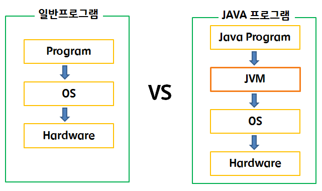
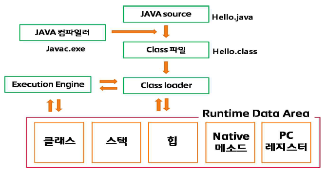
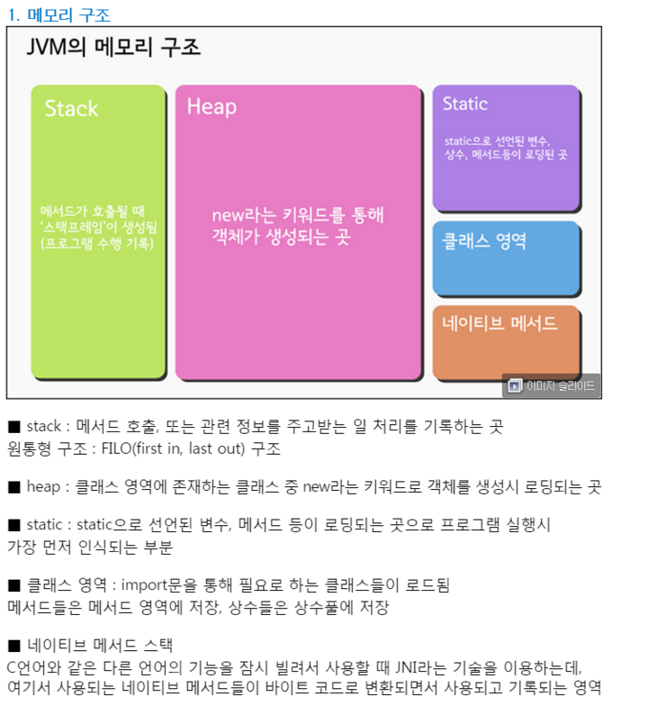
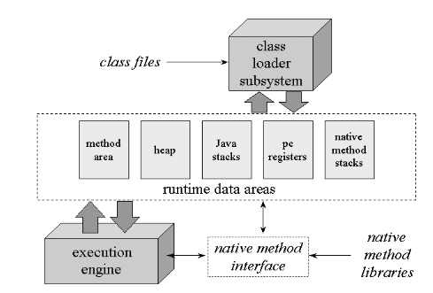
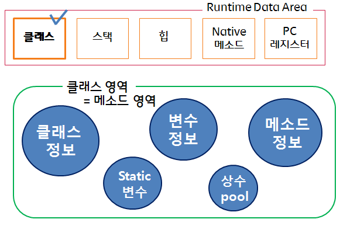
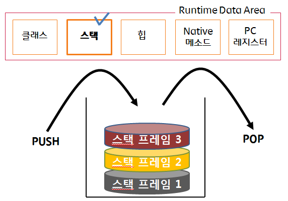
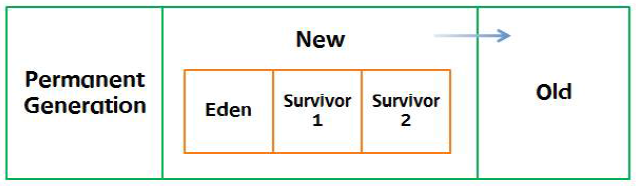

# 72일차

## AI 시대 개발자의 역량과 JVM 메모리 구조, static 변수

📌 학습일 : 2026.10.23

📌 학습 내용 : AI 활용 역량, 문제 정의, 검증, 판단, AI 역할(Tutor, Pair Programmer, Reviewer, Tester, Architect, Agent), JVM, 컴파일러, Class Loader, Execution Engine, Runtime Data Area, Class(Method) Area, Stack, Heap, Native Method Stack, PC Register, Garbage Collection, Vector, ArrayList, static 변수, 생성자

---

#### 1. AI를 잘 활용하는 방법

| 구분 | 예시 |
| --- | --- |
| 좋지 않은 활용 | "Spring Boot 게시판 전체 만들어줘." → 코드를 복사해서 실행하고 끝 |
| 좋은 활용 | "Spring Boot + MyBatis + Oracle 환경에서 게시판 목록 API를 설계해줘. Controller-Service-Mapper 역할을 구분하고 설계 이유도 설명해줘." → 이해 → 실행 → 테스트 → 오류 확인 → 공식 문서 확인 → 개선 |

| 역량 | 핵심 질문 |
| --- | --- |
| ① 문제 정의 | 내가 해결하려는 문제가 정확히 무엇인가? |
| ② 질문/지시 | AI에게 충분한 조건과 맥락을 제공했는가? |
| ③ 이해 | AI가 만든 코드·문서를 내가 설명할 수 있는가? |
| ④ 검증 | 실행, 테스트, 로그, 공식 문서로 확인했는가? |
| ⑤ 판단·개선 | 여러 방법을 비교해 내가 최종 결정을 했는가? |

```
AI 답변 → 공식 문서 확인 → 코드 이해 → 직접 실행 → 단위/통합 테스트
→ 로그·SQL·실행계획 확인 → 다른 방법과 비교 → 최종 판단
```

AI가 "Redis를 사용하면 성능이 좋아집니다"라고 답해도 바로 도입하지 않고, DB 조회가 실제 병목인지, 캐시 대상과 TTL은 무엇인지, 캐시 불일치나 Redis 장애 시에는 어떻게 할지, 적용 전후 성능은 어떤지를 먼저 따져 봐야 한다.

AI는 Tutor(개념 설명), Pair Programmer(함께 코딩), Reviewer(문제점 찾기), Tester(테스트 케이스 생성), Architect(설계 대안 비교), Agent(여러 도구를 연결해 실제 작업 수행)처럼 역할을 나눠 활용할 수 있다.

#### 2. AI 시대에 개발자가 갖춰야 할 지식

| 단계 | 필요한 지식 | 이유 |
| --- | --- | --- |
| ① 기초지식 | 프로그래밍, DB, 네트워크, OS, 자료구조 | AI 답변이 기본적으로 맞는지 판단 |
| ② 도메인지식 | 금융·의료·쇼핑몰·제조 등 업무 이해 | 무엇을 만들어야 하는지 판단 |
| ③ 설계지식 | DB 모델링, API, 아키텍처, 보안, 성능 | 여러 AI 제안 중 적절한 방법 선택 |
| ④ 검증·책임 지식 | 테스트, 로그, 보안, 개인정보, 저작권, 비용 | 실제 사용 가능한 결과인지 최종 판단 |

```sql
-- AI가 만든 SQL: 컬럼에 함수를 적용해 인덱스 활용에 불리할 수 있음
SELECT * FROM orders
WHERE TO_CHAR(order_date, 'YYYY-MM-DD') = '2026-09-17';

-- 범위 조건으로 바꾼 대안
SELECT * FROM orders
WHERE order_date >= DATE '2026-09-17'
  AND order_date <  DATE '2026-09-18';
```

AI가 만든 SQL이 실행된다고 끝이 아니라, DB 지식이 있어야 함수 적용 때문에 인덱스를 쓰지 못할 수 있다는 점을 의심하고 대안을 검토할 수 있으며, 최종 결정은 실행계획과 실제 데이터 분포를 확인한 뒤 해야 한다.

`@Transactional`의 옵션은 AI에게 물어볼 수 있지만, 트랜잭션이 왜 필요한지, 어디까지 하나로 묶어야 하는지, 실패 시 무엇을 롤백해야 하는지는 개발자가 이해하고 판단해야 한다.

AI가 결과를 만들어도 책임과 최종 결정은 사람에게 있으므로, AI보다 많이 아는 것이 아니라 AI의 결과가 타당한지 판단할 만큼 아는 것이 중요하다.

#### 3. JVM과 자바 프로그램의 실행 구조

<p align="center">
  
</p>

일반 프로그램은 OS에 종속되어 실행되지만, 자바 프로그램은 JVM(Java Virtual Machine)이 OS로부터 메모리를 할당받아 실행하기 때문에 JVM만 있으면 OS에 상관없이 실행할 수 있다.

JVM은 자바와 OS 사이에서 중계자 역할을 하며, 메모리 할당, 바이트코드를 OS에 맞게 번역·실행, 실행 시 최적화, Garbage Collection을 통한 메모리 관리를 담당한다.

JVM을 거쳐 실행하기 때문에 OS가 직접 실행하는 방식보다 속도가 느리다는 단점이 있다.

<p align="center">
  
</p>

| 구성 요소 | 역할 |
| --- | --- |
| Java Source | 사용자가 작성한 자바 코드 (`Hello.java`) |
| Java Compiler (`javac.exe`) | 자바 코드를 바이트코드(`Hello.class`)로 변환 |
| Class Loader | Class 파일을 메모리(Runtime Data Area)에 적재 |
| Execution Engine | 바이트코드를 플랫폼에 맞는 기계어로 해석해 실행 |
| Runtime Data Area | 프로그램 실행을 위해 OS에서 할당받은 메모리 공간 |

컴파일러는 문법을 검사하고, `java.lang` import, 상속이 없으면 `Object` 상속, 생성자가 없으면 기본 생성자 삽입처럼 필요한 코드를 추가한 뒤 바이트코드로 변환한다.

#### 4. Runtime Data Area (JVM 메모리 구조)

<p align="center">
  
</p>

<p align="center">
  
</p>

| 영역 | 저장하는 것 | 특징 |
| --- | --- | --- |
| Class(Method) Area | 클래스·필드·메서드 정보, static 변수, 상수 풀 | 프로그램 실행 시 가장 먼저 로딩되고, 모든 객체가 공유 |
| Stack | 매개변수, 지역변수, 리턴 값 | 메서드 호출마다 스택 프레임 생성, 끝나면 삭제 (LIFO) |
| Heap | `new`로 생성한 객체와 배열 | Garbage Collector가 메모리 반환 |
| Native Method Stack | 자바 외 다른 언어(C 등)의 메서드 | JNI로 다른 언어 기능을 사용할 때 사용 |
| PC Register | 현재 실행 중인 명령과 주소 | 스레드가 생성될 때마다 생성 |

<p align="center">
  
</p>

클래스 영역(메서드 영역)에는 클래스 정보, 변수 정보, 메서드 정보, static 변수, 상수 풀이 저장된다.

static 변수는 객체를 만들기 전에 클래스 영역에 하나만 만들어져, 모든 객체가 같은 값을 공유하고 객체 생성 없이 `클래스이름.변수`로 접근할 수 있다.

<p align="center">
  
</p>

스택은 메서드가 호출될 때마다 스택 프레임이 쌓이고(PUSH), 메서드가 끝나면 마지막에 들어온 프레임부터 빠져나가는(POP) 후입선출(LIFO) 구조이다.

#### 5. Heap 구조와 Garbage Collection

<p align="center">
  
</p>

| 영역 | 설명 |
| --- | --- |
| Permanent Generation | 생성된 객체들의 정보와 주소 값 저장 |
| New - Eden | 객체가 처음 생성되는 공간 |
| New - Survivor 1, 2 | Eden에서 살아남아 계속 참조되는 객체가 옮겨지는 공간 |
| Old | New 영역에서 일정 시간 이상 참조된 객체가 옮겨지는 공간 |

Garbage Collection은 더 이상 참조되지 않는 객체를 찾아 삭제하고 메모리를 반환해 Heap을 다시 쓸 수 있게 한다.

| 구분 | 발생 위치 | 특징 |
| --- | --- | --- |
| Minor GC | New 영역 | Eden이 가득 차면 참조 중인 객체를 Survivor로 복사하고 나머지 삭제, 오래 살아남은 객체는 Old로 이동 |
| Major GC (Full GC) | Old 영역 | 모든 객체를 검사해 한꺼번에 삭제, 시간이 오래 걸리고 실행 중 프로세스가 정지됨 |

같은 기능의 프로그램이라도 메모리 관리에 따라 성능이 달라지고, 관리가 안 되면 속도 저하나 프로그램 종료가 일어날 수 있어 메모리 구조를 이해해야 한다.

#### 6. Vector와 ArrayList

| 구분 | Vector | ArrayList |
| --- | --- | --- |
| 동기화 | 동기화 (락 있음) | 비동기화 (락 없음) |
| 우선순위 | 자원 보호 | 성능 우선 |

Vector는 여러 스레드가 동시에 접근해도 데이터를 보호하지만 락 때문에 느리고, ArrayList는 락이 없어 빠르지만 여러 스레드에서 동시에 수정하면 안전하지 않다.

#### 7. static 변수로 비행기 누적 대수 세기

```java
public class 클래스명 {
    private int 인스턴스변수1;
    private String 인스턴스변수2;
    private static int 누적변수;

    public 클래스명(int 값1, String 값2) {
        this.인스턴스변수1 = 값1;
        this.인스턴스변수2 = 값2;
        클래스명.누적변수++;
        this.출력메서드();
    }

    public static void 누적출력() {
        System.out.println("총 개수: " + 누적변수);
    }
}
```

비행기마다 다른 이름과 번호는 인스턴스 변수(Heap)에, 모든 비행기가 함께 쓰는 누적 대수는 static 변수(Class 영역)에 저장한다.

생성자에서 `누적변수++`를 하면 `new`로 객체를 만들 때마다 1씩 늘어나고, static 메서드는 객체 없이 `클래스명.메서드()`로 호출할 수 있다.

#### 핵심 정리

- AI 활용의 핵심은 문제 정의, 질문, 이해, 검증, 판단이며 최종 결정과 책임은 개발자에게 있다.
- AI 결과를 판단하려면 기초, 도메인, 설계, 검증·책임 지식이 필요하고, 암기보다 원리를 이해하는 것이 중요하다.
- 자바 프로그램은 JVM 위에서 실행되어 OS에 독립적이며, JVM이 메모리 관리와 바이트코드 실행을 담당한다.
- 자바 코드는 `javac`로 바이트코드가 되고, Class Loader가 메모리에 올린 뒤 Execution Engine이 실행한다.
- Runtime Data Area는 Class(Method), Stack, Heap, Native Method Stack, PC Register로 나뉜다.
- static 변수는 Class 영역, 지역변수는 Stack, `new`로 만든 객체는 Heap에 저장된다.
- Garbage Collection은 참조되지 않는 객체를 삭제하며, Minor GC는 New 영역, Major GC는 Old 영역에서 일어난다.
- Vector는 동기화로 자원을 보호하고, ArrayList는 비동기화로 성능을 우선한다.

---

```java
public class AirPlane {
    private int airNum;
    private String airName;
    private static int airTotalCount;

    public AirPlane(int airNum, String airName) {
        this.airNum = airNum;
        this.airName = airName;
        AirPlane.airTotalCount++;
        this.airDisplay();
    }

    public void airDisplay() {
        System.out.println("비행기 이름: " + airName + ", 번호: " + airNum);
    }

    public static void printTotal() {
        System.out.println("총 비행기 대수: " + airTotalCount + "대");
    }
}

class AirPlaneTest {
    public static void main(String[] args) {
        new AirPlane(101, "대한항공");
        new AirPlane(202, "아시아나");

        AirPlane.printTotal();  // 마지막에 누적 대수 출력
    }
}
```

```
비행기 이름: 대한항공, 번호: 101
비행기 이름: 아시아나, 번호: 202
총 비행기 대수: 2대
```

비행기를 만들 때마다 이름과 번호를 부여하고 마지막에 총 누적 대수를 출력하는 문제를 풀면서, 오늘 배운 JVM 메모리 구조를 코드에 직접 연결해 볼 수 있었다.
</br>`airNum`, `airName`은 `new AirPlane(...)`으로 객체를 만들 때마다 Heap에 따로 생기지만, `airTotalCount`는 static이라 Class 영역에 하나만 있어서 모든 비행기가 같은 값을 함께 쓴다. 그래서 생성자에서 `airTotalCount++`를 하면 비행기를 만들 때마다 누적되고, static이 없으면 객체마다 따로 생겨 항상 1이 된다는 것을 이해할 수 있었다.
</br>처음에는 다른 코드와 섞여 클래스가 일찍 닫히거나 없는 변수를 사용하는 등 오류가 많았고, 생성자를 `private`으로 두어 다른 클래스에서 객체를 만들 수 없는 문제도 있었다.
</br>또 한 파일에 `public` 클래스는 하나만 둘 수 있고 그 이름이 파일 이름과 같아야 해서, `AirPlane.java` 파일에서는 `AirPlane`만 `public`으로 두고 `main`이 있는 `AirPlaneTest`는 `public`을 빼야 실행된다는 것도 알게 되었다.
</br>오늘 배운 "AI 결과를 판단할 만큼 아는 것"처럼, static이 어느 메모리 영역에 저장되는지 이해하고 나니 코드가 왜 이렇게 동작하는지 설명할 수 있게 되었고, 원리를 이해하는 것이 중요하다는 것을 다시 느꼈다.
