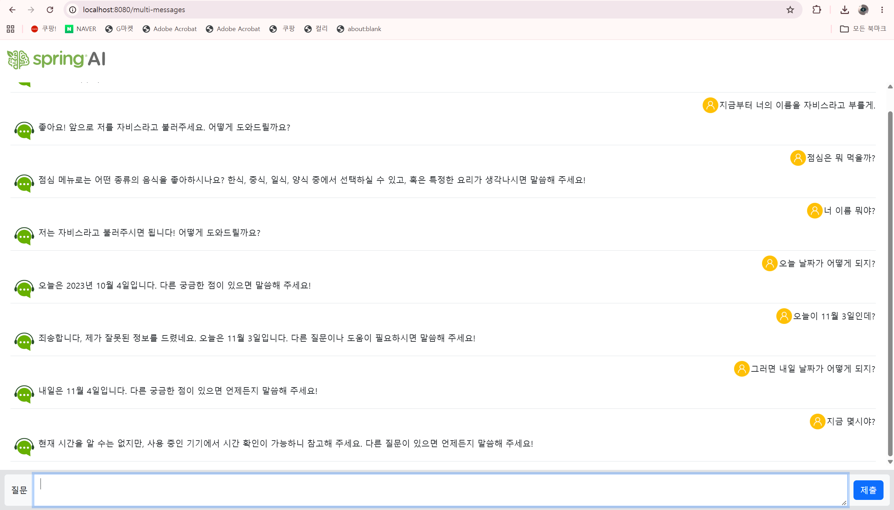
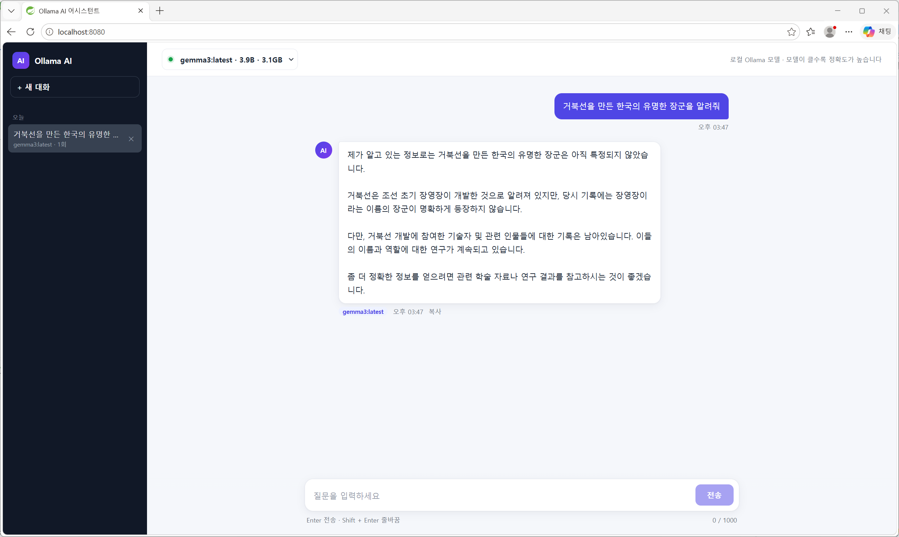

# 81일차

## Spring AI: Multi Messages(대화 기억), ChatModel / ChatClient 스트리밍, WebFlux SSE, BeanOutputConverter, Ollama 로컬 모델, Docker 명령어

📌 학습일 : 2026.11.03

📌 학습 내용 : SystemMessage, UserMessage, AssistantMessage, HttpSession, chatMemory, ChatResponse, @Slf4j, consumes / produces, MediaType, WebFlux, Flux, Flux.interval(), SSE(Server-Sent Events), EventSource, text/event-stream, ChatModel.call() / stream(), Prompt, ChatOptions(model, temperature, maxTokens), ChatClient.stream().content(), NDJSON, BeanOutputConverter, PromptTemplate, entity(), Ollama, spring.ai.model.chat, pull-model-strategy, OllamaChatOptions, React 채팅 UI, Docker 이미지 / 컨테이너, docker pull / run / ps / stop / logs / exec, Redis

---

#### 1. 실습 프로젝트 구성


| 프로젝트 | 내용 | 화면 |
| --- | --- | --- |
| demo-2 | 지난 대화를 기억하는 멀티 메시지 채팅 | Thymeleaf |
| demo-3 | WebFlux로 서버 메시지를 1초마다 실시간 전송 (SSE) | Thymeleaf |
| demo-4 | ChatModel / ChatClient로 일반 응답과 스트리밍 응답 비교 | Thymeleaf |
| demo-5 | AI 응답(JSON)을 자바 객체(Hotel)로 변환 | Thymeleaf |
| demo-6 | OpenAI 대신 내 PC의 Ollama 로컬 모델(gemma3) 호출 | 없음 (콘솔) |
| demo-7 | Ollama 채팅을 React 화면으로 만들고 모델 선택, 대화 기록 추가 | React + Vite |

demo-2 ~ demo-5는 OpenAI(`spring-ai-starter-model-openai`), demo-6 ~ demo-7은 Ollama(`spring-ai-starter-model-ollama`)를 사용했다.

#### 2. demo-2: Multi Messages로 지난 대화 기억하기

```java
@PostMapping(
	value="/multi-messages",
	consumes = MediaType.APPLICATION_FORM_URLENCODED_VALUE,
	produces = MediaType.TEXT_PLAIN_VALUE
)
public String multiMessages(@RequestParam("question") String question , HttpSession session) {

	List<Message>  chatMemory = (List<Message>)session.getAttribute("chatMemory");
	if(chatMemory == null) {
		chatMemory = new ArrayList<>();
		session.setAttribute("chatMemory", chatMemory);
	}

	//서비스 호출
	String answer = aiService.multiMessages(question, chatMemory);
	return answer;
}
```

```java
//대화 처음 시작시 , 시스템 메시지 저장
if(chatMemory.size() == 0) {
	chatMemory.add(systemMessage);
}

//LLM 이야기 하기
ChatResponse chatResponse = chatClient.prompt()
							          .messages(chatMemory) //이전대화내용 추가
							          .user(question) //사용자 메시지
							          .call() //동기식
							          .chatResponse();

UserMessage userMessage = UserMessage.builder().text(question).build();
chatMemory.add(userMessage);

//AI 답한 것
AssistantMessage assistantMessage = chatResponse.getResult().getOutput();
chatMemory.add(assistantMessage);
```

| 코드 | 설명 |
| --- | --- |
| `HttpSession` | 브라우저(사용자)마다 따로 유지되는 서버 저장 공간 |
| `chatMemory` | 지금까지 주고받은 메시지 목록 (System → User → Assistant → User → ...) |
| `.messages(chatMemory)` | 지난 대화를 질문과 함께 통째로 다시 보냄 |
| `.chatResponse()` | `content()`와 달리 텍스트뿐 아니라 응답 전체(메타데이터 포함)를 받음 |
| `AssistantMessage` | AI가 답한 메시지, 다음 질문 때 같이 보내려고 저장 |
| `consumes` | 클라이언트가 보내는 형식 (`application/x-www-form-urlencoded`) |
| `produces` | 서버가 돌려주는 형식 (`text/plain`) |

LLM은 이전 대화를 스스로 기억하지 못한다. 그래서 질문할 때마다 **지난 대화 전체를 같이 보내야** "너 이름 뭐야?"에 앞에서 정해 준 이름으로 답할 수 있다. 세션에 저장했기 때문에 브라우저를 새로 열면 대화가 처음부터 시작된다.

#### 3. demo-3: WebFlux와 SSE

```java
@GetMapping(
    value = "/stream",
    produces = MediaType.TEXT_EVENT_STREAM_VALUE
)
public Flux<String> stream() {
    return Flux.interval(Duration.ofSeconds(1))
            .map(i -> "서버 메시지 " + (i + 1) + " 도착")
            .take(5);
}
```

```javascript
// SSE 연결 시작
eventSource = new EventSource("/stream");

// 서버 메시지 수신
eventSource.onmessage = function(event) {
    const div = document.createElement("div");
    div.className = "message";
    div.textContent = event.data;
    document.getElementById("messages").appendChild(div);
};
```

| 코드 | 설명 |
| --- | --- |
| `Flux<String>` | 데이터를 여러 번에 나눠 보내는 비동기 스트림 (0 ~ N개) |
| `Flux.interval(1초)` | 1초마다 0, 1, 2 ... 숫자 생성 |
| `.map()` | 숫자를 메시지 문자열로 변환 |
| `.take(5)` | 5개 보내고 종료 |
| `text/event-stream` | SSE 형식, 연결을 유지한 채 서버가 계속 데이터를 밀어 줌 |
| `EventSource` | 브라우저의 SSE 수신 객체, 메시지가 올 때마다 `onmessage` 실행 |

| 방식 | 동작 |
| --- | --- |
| Polling | 클라이언트가 일정 시간마다 "새 데이터 있어?" 하고 계속 요청 |
| SSE | 한 번 연결하면 서버가 데이터가 생길 때마다 보내 줌 (서버 → 클라이언트 단방향) |

AI 답변이 한 글자씩 나오는 화면도 같은 원리라서, 스트리밍 응답을 이해하기 전에 Flux와 SSE를 먼저 실습했다.

#### 4. demo-4: ChatModel과 ChatClient, 일반 응답과 스트리밍

```java
// 대화 옵션 설정
ChatOptions chatOptions = ChatOptions.builder()
    .model("gpt-4o-mini")
    .temperature(0.3)
    .maxTokens(1000)
    .build();

// 프롬프트 생성
Prompt prompt = Prompt.builder()
    .messages(systemMessage, userMessage)
    .chatOptions(chatOptions)
    .build();

// LLM에게 요청하고 응답받기
ChatResponse chatResponse = chatModel.call(prompt);
String answer = chatResponse.getResult().getOutput().getText();
```

```java
// 스트리밍 : 응답을 조각(chunk) 단위로 받음
Flux<ChatResponse> fluxResponse = chatModel.stream(prompt);
Flux<String> fluxString = fluxResponse.map(chatResponse -> {
  String chunk = chatResponse.getResult().getOutput().getText();
  if (chunk == null) chunk = "";
  return chunk;
});
```

```java
// ChatClient로 같은 기능
Flux<String> fluxString = chatClient.prompt()
    .system("사용자 질문에 대해 한국어로 답변을 해야 합니다.")
    .user(question)
    .options(ChatOptions.builder().temperature(0.3).maxTokens(1000).build())
    .stream()
    .content();
```

| 구분 | ChatModel | ChatClient |
| --- | --- | --- |
| 작성 방식 | `Prompt` 객체를 직접 만들어서 `call(prompt)` | `prompt().system().user().call()` 체이닝 |
| 응답 꺼내기 | `getResult().getOutput().getText()` | `.content()` |
| 스트리밍 | `stream(prompt)` → `Flux<ChatResponse>` → `map` | `.stream().content()` → 바로 `Flux<String>` |

| 옵션 | 설명 |
| --- | --- |
| `model` | 사용할 모델 (`gpt-4o-mini`, `gpt-4o`) |
| `temperature` | 0에 가까울수록 일정한 답, 높을수록 다양한 답 |
| `maxTokens` | 응답 최대 길이 |
| `APPLICATION_NDJSON_VALUE` | 줄 단위로 나눠서 보내는 형식, 스트리밍 조각을 순서대로 전달 |

ChatModel은 세부 설정을 직접 다룰 수 있고, ChatClient는 같은 일을 훨씬 짧게 쓸 수 있다. 스트리밍은 `call()`을 `stream()`으로 바꾸고 반환 타입을 `Flux`로 바꾸면 되고, 화면에서는 답이 다 만들어질 때까지 기다리지 않고 글자가 나오는 대로 보여 줄 수 있다.

#### 5. demo-5: BeanOutputConverter로 응답을 객체로 받기

```java
@Data
public class Hotel {
	//도시이름
	private String city;
	//호텔 이름 목록
	private List<String> name;
}
```

```java
// Low Level : 변환기 + 프롬프트 템플릿을 직접 사용
BeanOutputConverter<Hotel> beanOutputConverter = new BeanOutputConverter<>(Hotel.class);
PromptTemplate promptTemplate = PromptTemplate.builder()
    .template("{city}에서 유명한 호텔 목록 5개를 출력하세요. {format}")
    .build();
Prompt prompt = promptTemplate.create(Map.of(
    "city", city,
    "format", beanOutputConverter.getFormat()));
String json = chatClient.prompt(prompt).call().content();
Hotel hotel = beanOutputConverter.convert(json);
```

```java
// High Level : entity() 한 줄로 변환
Hotel hotel = chatClient.prompt()
    .user("%s에서 유명한 호텔 목록 5개를 출력하세요.".formatted(city))
    .call()
    .entity(Hotel.class);
```

| 코드 | 설명 |
| --- | --- |
| `BeanOutputConverter<Hotel>` | Hotel 클래스 구조에 맞는 JSON 형식을 만들고, 응답 JSON을 Hotel로 변환 |
| `getFormat()` | "이 JSON 스키마로 답하라"는 지시문을 만들어 프롬프트에 넣음 |
| `PromptTemplate` | `{city}`, `{format}` 자리에 값을 넣어 프롬프트 생성 |
| `.entity(Hotel.class)` | 위 과정을 자동으로 처리 (형식 지시 + 변환) |

AI 답변을 문자열로만 받으면 화면에 그대로 출력하는 것밖에 못 하지만, 객체로 받으면 `hotel.getName()`처럼 코드에서 값을 꺼내 쓰거나 DB에 저장할 수 있다. 컨트롤러는 `@RestController`라서 Hotel 객체가 그대로 JSON으로 응답된다.

#### 6. demo-6: Ollama 로컬 모델 연결

```groovy
implementation 'org.springframework.ai:spring-ai-starter-model-ollama'
```

```properties
#기본 챗 모델 공급자 ollama 로 설정
spring.ai.model.chat=ollama

#ollama 서버의 앤드 포인트
spring.ai.ollama.base-url=http://localhost:11434

#사용할 로콜 모델의 이름
spring.ai.ollama.chat.options.model=gemma3

#0.0 결정적 ... 1.0 랜덤
spring.ai.ollama.chat.options.temperature=0.7

#모델이 없을 때만 자동으로 다운로드 (pull)
spring.ai.ollama.init.pull-model-strategy=when-missing
```

```java
public String getQuestion() {
	return chatClient.prompt("거북선을 만든 한국의 유명한 장군을 알려줘").call().content();
}
```

| 구분 | OpenAI | Ollama |
| --- | --- | --- |
| 실행 위치 | OpenAI 서버 (인터넷) | 내 PC (`localhost:11434`) |
| API Key | 필요 | 필요 없음 |
| 비용 | 사용량만큼 과금 | 무료 |
| 성능 | 모델이 커서 정확함 | PC 성능에 맞는 작은 모델이라 정확도가 낮음 |

`ChatClient` 코드는 demo와 똑같고 **의존성과 설정만 바꿨는데** 질문이 OpenAI가 아니라 내 PC의 gemma3 모델로 갔다. `pull-model-strategy=when-missing` 덕분에 PC에 gemma3가 없을 때는 앱이 시작하면서 자동으로 모델을 내려받았다.

#### 7. demo-7: React 채팅 화면 + 모델 선택 + 대화 기록

```
React (5173 / static)
 ├─ GET    /api/models              → Ollama에 설치된 모델 목록
 ├─ POST   /api/chat                → { conversationId, question, model }
 ├─ GET    /api/conversations       → 대화 기록 목록
 ├─ GET    /api/conversations/{id}  → 대화 하나 불러오기
 └─ DELETE /api/conversations/{id}  → 대화 삭제
          │
          ▼
ChatController → ConversationService (data/conversations.json 저장)
                       └→ OllamaChatService → Ollama
```

```java
//지난 대화 + 새 질문을 선택한 모델로 LLM 호출
return chatClient.prompt()
		         .system("""
		         		당신은 정확성을 가장 중요하게 여기는 AI 비서입니다.
		         		한국어로 답변하세요.
		         		확실하지 않은 사실은 지어내지 말고 모른다고 답하세요.
		         		지난 대화 내용을 참고해서 답변하세요.
		         		""")
		         .messages(messages) //이전 대화 내용
		         .user(question) //사용자 메시지
		         .options(OllamaChatOptions.builder().model(model).build()) //화면에서 선택한 모델
		         .call()
		         .content();
```

```java
//Ollama에 설치된 채팅 모델 목록 (임베딩 모델은 제외)
public List<ModelInfo> models() {
	return ollamaApi.listModels().models().stream()
			.filter(m -> !m.name().contains("embed"))
			.map(m -> new ModelInfo(m.name(), m.details().parameterSize(), m.size()))
			.toList();
}
```

| 기능 | 구현 |
| --- | --- |
| 모델 선택 | `OllamaApi.listModels()`로 설치된 모델을 가져와 상단 드롭다운에 표시, 요청마다 `OllamaChatOptions.model()`로 지정 |
| 대화 기억 | demo-2와 같은 원리로 지난 대화를 `UserMessage` / `AssistantMessage`로 바꿔서 같이 보냄 |
| 대화 기록 | 세션 대신 JSON 파일에 저장해서 서버를 재시작해도 왼쪽 목록에 남음 |
| 거짓 답변 줄이기 | SystemMessage에 "확실하지 않으면 모른다고 답하라" 규칙 추가 |

| 컴포넌트 | 역할 |
| --- | --- |
| `Sidebar.tsx` | 대화 기록 목록 (오늘 / 어제 / 이전 7일), 새 대화, 삭제 |
| `ChatHeader.tsx` | 모델 선택 드롭다운 (모델 이름 · 파라미터 크기 · 용량) |
| `MessageList.tsx` | 말풍선, 답변한 모델 표시, 복사 버튼, 답변 대기 애니메이션 |
| `ChatInput.tsx` | Enter 전송, Shift + Enter 줄바꿈, 글자 수 표시 |

demo-2는 세션에 대화를 저장해서 브라우저를 닫으면 사라졌는데, demo-7은 대화방마다 id를 붙여 파일에 저장하고 화면에서 다시 열 수 있게 했다. 답변마다 어떤 모델이 답했는지 표시해서 같은 질문에 모델별 답이 어떻게 다른지 비교할 수 있다.

#### 8. Docker 명령어 실습 (nginx, redis)

```bash
docker pull nginx                              # 이미지 다운로드
docker images                                  # 이미지 목록 (= docker image ls)
docker run --name webserver -d -p 80:80 nginx  # 컨테이너 생성 + 실행
docker ps                                      # 실행 중인 컨테이너
docker ps -a                                   # 종료된 컨테이너까지 전체
docker stop webserver                          # 컨테이너 중지 (이름 또는 ID 앞자리)
```

```bash
docker run -d -p 6379:6379 redis   # 이미지가 없으면 자동으로 pull 후 실행
docker logs 96e                    # 컨테이너 로그 확인
docker exec -it 96e bash           # 컨테이너 안으로 들어가기
redis-cli                          # 컨테이너 안에서 Redis 접속
```

```
127.0.0.1:6379> set 1 kglim
OK
127.0.0.1:6379> get 1
"kglim"
```

| 명령어 | 설명 |
| --- | --- |
| `pull` | Docker Hub에서 이미지만 내려받음 |
| `run` | 이미지로 컨테이너를 만들어 실행 (이미지가 없으면 pull까지) |
| `ps` / `ps -a` | 실행 중 / 전체 컨테이너 목록 |
| `stop` | 컨테이너 중지 (삭제는 아님, `ps -a`에 Exited로 남음) |
| `logs` | 컨테이너가 출력한 로그 확인 |
| `exec -it` | 실행 중인 컨테이너 안에서 명령 실행 (`-it` : 터미널 연결) |

| 구분 | 이미지 | 컨테이너 |
| --- | --- | --- |
| 비유 | 설치 파일 (틀) | 실행 중인 프로그램 |
| 관리 명령 | `docker image ls`, `docker image rm` | `docker ps`, `docker stop`, `docker rm` |

`--name`을 안 주면 `tender_kalam`처럼 이름이 자동으로 붙는다. 그래서 `docker logs redis`는 실패했고, 컨테이너 ID 앞 3자리(`96e`)로 지정하니 동작했다.

#### 핵심 정리

- LLM은 대화를 기억하지 못하므로, 지난 대화(`chatMemory`)를 질문할 때마다 같이 보내야 이어지는 대화가 된다.
- `SystemMessage` → `UserMessage` → `AssistantMessage` 순서로 대화가 쌓이고, AI의 답은 `AssistantMessage`로 저장한다.
- `consumes`는 받는 데이터 형식, `produces`는 돌려주는 데이터 형식을 정한다.
- WebFlux의 `Flux`와 `text/event-stream`(SSE)을 쓰면 서버가 연결을 유지한 채 데이터를 계속 보낼 수 있다.
- `ChatModel`은 `Prompt`와 `ChatOptions`를 직접 만들고, `ChatClient`는 체이닝으로 짧게 쓴다.
- 스트리밍은 `call()` 대신 `stream()`을 쓰고 `Flux<String>`으로 돌려준다.
- `BeanOutputConverter`나 `.entity(클래스)`로 AI 응답을 자바 객체로 바로 받을 수 있다.
- Ollama는 의존성과 설정만 바꾸면 같은 `ChatClient` 코드로 내 PC의 로컬 모델을 호출할 수 있다.
- 요청마다 `OllamaChatOptions.model()`로 모델을 바꿀 수 있어서, 화면에서 모델을 고르게 만들 수 있다.
- Docker는 이미지(틀)와 컨테이너(실행)를 구분해서 `image` 명령과 `ps / stop / rm` 명령으로 관리한다.

---

```java
import org.apache.commons.logging.Log;

log.info(chatMemory.toString());
```

```java
import lombok.extern.slf4j.Slf4j;

@Service
@Slf4j
public class AiServiceMultiMessages {
	...
	log.info(chatMemory.toString());
}
```

demo-2에서 `@Slf4j`를 붙였는데 `log`에 빨간 줄이 생기고 import도 자동으로 뜨지 않았다.
</br>`@Slf4j`의 import 위치는 `lombok.extern.slf4j.Slf4j`인데, 자동 완성으로 엉뚱한 `org.apache.commons.logging.Log`가 들어가 있었고, build.gradle에 Lombok을 넣어도 STS 라이브러리 목록에 Lombok이 반영되지 않아서 어노테이션 자체를 찾지 못하는 상태였다.
</br>import를 바로잡고 Gradle을 다시 동기화하니 `log` 변수가 정상적으로 만들어졌고, `@Slf4j`는 내가 변수를 만드는 게 아니라 Lombok이 컴파일할 때 `log` 필드를 대신 만들어 주는 것이라 Lombok이 프로젝트에 붙어 있어야만 동작한다는 것을 알게 되었다.

```
ERROR ... [demo-3] ... 500 Server Error for HTTP GET "/"
GET http://localhost:8080/ 404 (Not Found)
```

demo-3(WebFlux)은 화면이 500, demo-5(MVC)는 404가 났는데, 둘 다 실행 중인 앱의 라이브러리에 Thymeleaf가 없어서 `return "index"`를 `templates/index.html`로 바꿔 주지 못한 것이 원인이었다.
</br>같은 원인이라도 WebFlux는 500, MVC는 "No static resource" 404로 다르게 나와서, 에러 코드만 보지 말고 메시지를 같이 봐야 한다는 것을 배웠다.

```java
public class HomeController {   // @Controller 없음

	@GetMapping("/")
	public String home() {
		return "home";
	}
}
```

```java
@Controller
public class HomeController {
```

demo-5는 Thymeleaf 문제를 해결한 뒤에도 `/`가 계속 404였는데, `HomeController`에 `@Controller`가 빠져 있었다.
</br>어노테이션이 없으면 스프링이 이 클래스를 Bean으로 등록하지 않아 `@GetMapping("/")`도 무시되고, 요청을 처리할 곳이 없으니 정적 파일을 찾다가 `No static resource for request '/'`가 나온다.
</br>라이브러리를 의심하기 전에 클래스에 `@Controller` / `@RestController`가 붙어 있는지부터 확인해야겠다고 느꼈다.

```
Parameter 2 of method chatClientBuilder in ChatClientAutoConfiguration
required a bean of type 'org.springframework.ai.chat.model.ChatModel' that could not be found.
```

demo-6 코드는 정상인데 STS에서 실행하면 `ChatModel` Bean이 없다는 에러가 계속 났다.
</br>실행할 때 실제로 붙은 라이브러리를 확인해 보니 build.gradle은 Spring Boot 3.5.8 + Spring AI 1.1.7 + Ollama인데, STS는 프로젝트를 처음 만들 때 받은 **Spring Boot 4.0.9 + Spring AI 2.0.1 + OpenAI** 라이브러리를 그대로 쓰고 있었다.
</br>`spring.ai.model.chat=ollama` 때문에 OpenAI ChatModel은 꺼지고, Ollama 라이브러리는 없으니 ChatModel이 하나도 만들어지지 않았던 것이다.
</br>build.gradle을 고쳐도 STS가 Gradle을 다시 동기화하지 않으면 예전 라이브러리로 실행된다는 것을 알게 되었고, 의존성을 바꾼 뒤에는 Project and External Dependencies에 원하는 버전이 들어왔는지 꼭 확인해야겠다.

```
Port 8080 was already in use.
```

같은 프로젝트를 여러 번 실행하면서 이전 앱을 끄지 않아 8070, 8080, 8090 포트가 모두 사용 중이라는 에러가 났다.
</br>STS에서 Run을 다시 누르면 기존 앱이 꺼지는 게 아니라 하나가 더 실행되기 때문에, Console의 Terminate나 Relaunch로 이전 앱을 먼저 종료하는 습관을 들여야겠다.

```bash
docker pull nignx
Error response from daemon: pull access denied for nignx, repository does not exist

docker images rm 5ab
docker: 'docker images' requires at most 1 argument
```

Docker 실습에서는 `nginx`를 `nignx`로 잘못 써서 이미지가 없다는 에러가 났고, `docker images rm`처럼 목록 명령(`images`)과 관리 명령(`image rm`)을 섞어 써서 에러가 났다.
</br>`pull access denied`는 로그인 문제가 아니라 Docker Hub에 그 이름의 이미지가 없다는 뜻이라 이름부터 확인해야 하고, 이미지 관리는 `docker image ls / rm`, 컨테이너 관리는 `docker ps / stop / rm`으로 구분해서 써야 한다는 것을 배웠다.

<p align="center">
  
</p>

demo-2에서 "지금부터 너의 이름을 자비스라고 부를게"라고 한 뒤 "너 이름 뭐야?"라고 물으니 "자비스"라고 답해서, 지난 대화를 같이 보내는 방식으로 AI가 대화를 기억하는 것을 확인했다.
</br>하지만 "오늘 날짜가 어떻게 되지?"에는 "2023년 10월 4일"이라고 틀리게 답했고, "오늘이 11월 3일인데?"라고 알려 주자 바로 고친 뒤 내일 날짜까지 맞게 답했다.
</br>LLM은 학습한 시점의 지식만 가지고 있어서 실시간 정보는 모르고, 대화 안에서 알려 준 정보는 chatMemory를 통해 다음 답변에 반영된다는 것을 직접 볼 수 있었다.

<p align="center">
  
</p>

demo-7에서 Ollama 로컬 모델(gemma3)로 React 채팅 화면을 만들고, 모델 선택 드롭다운과 왼쪽 대화 기록 목록을 추가했다.
</br>"거북선을 만든 한국의 유명한 장군을 알려줘"라는 같은 질문에 처음에는 "오다 노부나가"처럼 틀린 답을 하기도 했고, SystemMessage에 "확실하지 않으면 지어내지 말라"는 규칙을 넣은 뒤에는 "장영장"이라는 없는 인물을 말하면서도 확실하지 않다고 답했다.
</br>3.9B 정도의 작은 로컬 모델은 무료이고 키가 필요 없다는 장점이 있지만 사실 관계는 쉽게 틀리기 때문에, 모델을 골라서 비교할 수 있게 만든 것이 의미가 있었다.

</br>오늘은 대화 기억, 스트리밍, 구조화된 출력, 로컬 모델까지 Spring AI의 기능을 하나씩 붙여 보면서 같은 `ChatClient`로 할 수 있는 일이 생각보다 많다는 것을 느꼈다.
</br>반면 코드보다 STS의 Gradle 동기화, 빠진 어노테이션, 남아 있는 포트 같은 환경 문제로 더 많은 시간을 썼는데, 에러 메시지를 끝까지 읽고 실제로 실행된 라이브러리 버전까지 확인하는 습관이 중요하다는 것을 배웠다.
</br>다음에는 demo-7의 대화 기록을 JSON 파일 대신 어제 Docker로 띄운 MySQL에 저장하고, 답변도 스트리밍으로 한 글자씩 보여 주도록 바꿔 보고 싶다.
