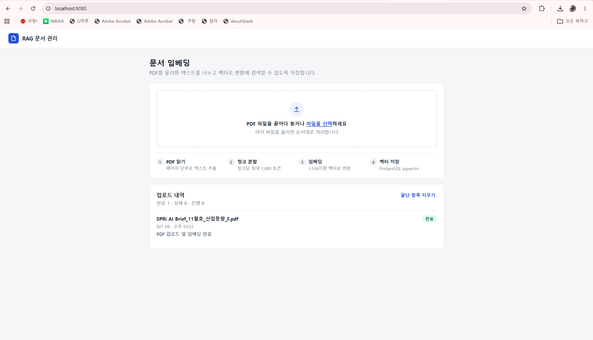
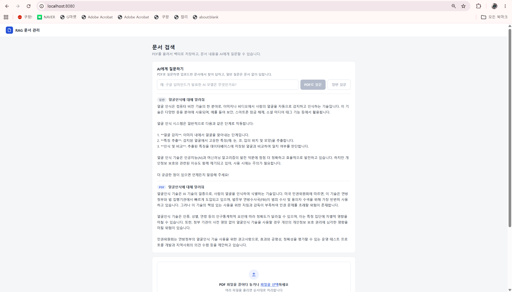

# 83일차

## Spring AI: JPA로 대화 이력 저장하는 고객 지원 챗봇, RAG(PDF 임베딩, pgvector, 유사도 검색), React 연동

📌 학습일 : 2026.11.05

📌 학습 내용 : JPA, H2, ChatMessage Entity, JpaRepository, findByUserIdOrderByCreatedAtAsc, SystemPromptTemplate, @Transactional, @RequestBody, DTO, CORS(WebMvcConfigurer), React useState / useEffect / useRef, fetch, Bootstrap, RAG, 임베딩, 벡터 DB, PostgreSQL, pgvector, CREATE EXTENSION, PagePdfDocumentReader, PdfDocumentReaderConfig, TokenTextSplitter, VectorStore, vector_store, HNSW, COSINE_DISTANCE, SearchRequest, topK, similaritySearch, PromptTemplate, XMLHttpRequest 업로드 진행률

---

#### 1. 실습 프로젝트 구성


| 프로젝트 | 내용 | 화면 |
| --- | --- | --- |
| demo-10 | 대화 이력을 H2 DB에 저장하는 E-커머스 고객 지원 챗봇 API | springai-chatbot-ui |
| springai-chatbot-ui | demo-10의 `/chat`을 호출하는 채팅 화면 | React + Vite + Bootstrap |
| demo-11 | PDF를 벡터 DB에 저장하고 문서 내용으로 답변하는 RAG | React + Vite + TypeScript |

demo-10과 demo-11 모두 Spring Boot 3.5.7, Spring AI 1.1.0을 사용했다.

#### 2. demo-10: 대화 이력을 DB에 저장하는 챗봇

```java
@Entity
@Getter
@Setter
@NoArgsConstructor
@AllArgsConstructor
public class ChatMessage {

	@Id
	@GeneratedValue(strategy = GenerationType.IDENTITY)
	private Long id;
	private String userId; //사용자 ID
	private String content; // 메시지
	private boolean isUser; // true 사용자 메시지, false 챗봇 메시지
	@Column(name = "created_at")
	private LocalDateTime createdAt; // 생성일
	...
}
```

```java
public interface ChatMessageRepository extends JpaRepository<ChatMessage, Long>{

	List<ChatMessage> findByUserIdOrderByCreatedAtAsc(String userId);

}
```

```java
@Transactional
public ChatResponseDto getChatResponse(String userId, String userMessage) {
	List<ChatMessage> previousMessages =
			chatMessageRepository.findByUserIdOrderByCreatedAtAsc(userId);

	//이전 대화 이력을 스트림(Stream)으로 변환한다
	List<Message> history = previousMessages.stream()
			.map(cm -> cm.isUser()
					? new UserMessage(cm.getContent())
					: new AssistantMessage(cm.getContent()))
			.collect(Collectors.toList());

	//시스템 메시지와 사용자 메시지를 포함 전체 대화 생성
	List<Message> conversion = new ArrayList<Message>();
	conversion.add(new SystemPromptTemplate(systemPrompt).createMessage());
	conversion.addAll(history);
	conversion.add(new UserMessage(userMessage));

	//AI모델에 요청
	Prompt prompt = new Prompt(conversion);
	ChatResponse response = chatClient.prompt(prompt).call().chatResponse();
	String aiResponseMessage = response.getResult().getOutput().getText();

	//현재 질문과 답변을 DB 저장
	chatMessageRepository.save(new ChatMessage(userId, userMessage,true));
	chatMessageRepository.save(new ChatMessage(userId, aiResponseMessage,false));
	...
}
```

| 코드 | 설명 |
| --- | --- |
| `@Entity` | 클래스를 DB 테이블과 연결 |
| `JpaRepository` | 저장, 조회 같은 기본 기능을 메서드만 선언해서 사용 |
| `findByUserIdOrderByCreatedAtAsc` | 메서드 이름으로 "사용자 ID로 찾아 시간순 정렬" 쿼리를 자동 생성 |
| `SystemPromptTemplate` | 챗봇의 역할과 상품 정보를 담은 시스템 메시지 생성 |
| `@Transactional` | 메서드 안의 DB 작업을 하나의 작업으로 묶음 |
| `@RequestBody` | 화면이 보낸 JSON을 `ChatRequestDto`로 변환 |

| 구분 | 어제까지 (demo-2) | 오늘 (demo-10) |
| --- | --- | --- |
| 저장 위치 | `HttpSession`의 `chatMemory` | DB 테이블 `ChatMessage` |
| 사용자 구분 | 브라우저 세션 | `userId` |
| 대화 복원 | 세션의 Message 목록을 그대로 사용 | DB 행을 `UserMessage` / `AssistantMessage`로 변환 |

시스템 프롬프트에 상품명, 가격, 재고를 적어 두면 챗봇이 그 정보를 기준으로 답한다. 지금은 H2 메모리 DB(`jdbc:h2:mem:testdb`)라서 서버를 끄면 대화 이력이 사라진다.

#### 3. springai-chatbot-ui: React 채팅 화면

```jsx
const handleSendMessage = async () =>{
  if(newMessage.trim()){
    const userMessage = { userId, message: newMessage};
    setNewMessage('');
    setIsLoading(true);

    try {
      const response = await fetch('http://localhost:8080/chat',{
        method: 'POST',
        headers: { 'Content-Type': 'application/json'},
        body: JSON.stringify(userMessage)
      })

      if(response.ok){
        const data = await response.json();
        setMessages(data.messages);
      }else{
        setMessages(prev => [...prev, {text:'챗봇 응답에 실패 했습니다,', sender:'bot'}])
      }

    } catch {
      setMessages(prev => [...prev, {text:'챗봇 응답에 실패 했습니다,', sender:'bot'}])
    }finally{
      setIsLoading(false)
    }
  }
}
```

```java
@Configuration
public class WebConfig implements WebMvcConfigurer {

	@Override
	public void addCorsMappings(CorsRegistry registry) {
		registry.addMapping("/**")
		.allowedOrigins("http://localhost:5173")
		.allowedMethods("GET","POST","PUT","DELETE","OPTIONS")
		.allowedHeaders("*")
		.allowCredentials(true);
	}
}
```

| 코드 | 설명 |
| --- | --- |
| `useState` | 메시지 목록, 입력값, 로딩 상태 관리 |
| `useRef` + `useEffect` | 메시지가 바뀔 때마다 채팅창을 맨 아래로 스크롤 |
| `isLoading` | 응답을 기다리는 동안 로딩 화면 표시 |
| `addCorsMappings` | 포트가 다른 5173 화면이 8080 API를 호출할 수 있게 허용 |

화면(5173)과 서버(8080)는 주소가 달라서 CORS 설정이 없으면 브라우저가 응답을 막는다. 서버가 지금까지의 대화 전체(`messages`)를 돌려주기 때문에 화면은 받은 목록으로 그대로 교체한다.

#### 4. pgvector로 벡터 DB 준비

```sql
CREATE EXTENSION IF NOT EXISTS vector;

SELECT extname, extversion FROM pg_extension WHERE extname = 'vector';
```

```properties
# postgresql 과 pgvector 설정
spring.datasource.url=jdbc:postgresql://localhost:5432/vectordb
spring.datasource.username=postgres
spring.datasource.driver-class-name=org.postgresql.Driver

# PGVector 설정
spring.ai.vectorstore.pgvector.index-type=HNSW
spring.ai.vectorstore.pgvector.distance-type=COSINE_DISTANCE
spring.ai.vectorstore.pgvector.dimensions=1536
spring.ai.vectorstore.pgvector.initialize-schema=true
```

| 설정 | 설명 |
| --- | --- |
| `pgvector/pgvector:pg17` | pgvector가 포함된 PostgreSQL Docker 이미지 |
| `CREATE EXTENSION` | DB에서 벡터 기능 활성화 (DB마다 따로 실행) |
| `index-type=HNSW` | 빠른 근사 검색을 위한 인덱스 |
| `distance-type=COSINE_DISTANCE` | 벡터 간 거리 계산 방식, 값이 작을수록 유사 |
| `dimensions=1536` | 임베딩 벡터의 차원 수 |
| `initialize-schema=true` | 앱 시작 시 `vector_store` 테이블 자동 생성 |

먼저 `documents` 테이블에 `[0.9,0.1,0.2]`처럼 짧은 벡터를 직접 넣어 구조를 확인했다. 실제 PDF는 Spring AI가 만든 `vector_store` 테이블(id, content, metadata, embedding)에 저장된다.

#### 5. demo-11: PDF를 벡터 DB에 저장 (적재)

```
[① 적재 - 미리 1회]
PDF → 읽기 → 청크 분할 → 임베딩(벡터 변환) → 벡터 DB 저장

[② 검색 - 질문할 때마다]
질문 → 임베딩 → 유사한 청크 검색 → 프롬프트에 넣기 → LLM 답변
```

```java
File tmpFile = File.createTempFile("uploaded", ".pdf");
file.transferTo(tmpFile);
Resource filResource = new FileSystemResource(tmpFile);

try {
	PdfDocumentReaderConfig config = PdfDocumentReaderConfig
			.builder()
			.withPageTopMargin(0) //PDF 페이지 상단에 여백을 설정
			.withPageExtractedTextFormatter(
					ExtractedTextFormatter
					.builder()
					.withNumberOfBottomTextLinesToDelete(0)
					.build())
			.withPagesPerDocument(1) //한번에 처리하는 페이지를 지정
			.build();

	PagePdfDocumentReader pdfReader = new PagePdfDocumentReader(filResource, config);
	List<Document> documents = pdfReader.get();

	//문서를 분할 하기 위한 Token TextSplitter
	TokenTextSplitter splitter = new TokenTextSplitter(1000, 400, 10, 5000, true);
	List<Document> splitDocuments = splitter.apply(documents);

	//PGvector store 저장
	vectorStore.accept(splitDocuments);
} catch (Exception e) {
	e.printStackTrace();
	throw new RuntimeException("PDF 처리 실패", e);
} finally {
	tmpFile.delete(); //Exception 발생하던 발생하지 않던 강제로 임시 파일은 삭제
}
```

| 매개변수 | 설정값 | 의미 |
| --- | --- | --- |
| `chunkSize` | 1000 | 청크의 목표 최대 토큰 수 |
| `minChunkSizeChars` | 400 | 자연스러운 분할 지점을 찾을 때 사용하는 최소 문자 수 |
| `minChunkLengthToEmbed` | 10 | 너무 짧은 청크를 제외하기 위한 최소 길이 |
| `maxNumChunks` | 5000 | 생성할 수 있는 최대 청크 개수 |
| `keepSeparator` | true | 분할할 때 구분자를 유지할지 여부 |

`vectorStore.accept()`를 호출하면 임베딩 생성과 DB 저장을 함께 처리한다. 약 0.9MB 분량의 PDF가 `vector_store`에 45개 행으로 저장되었다.

#### 6. demo-11: RAG로 질문하기

```java
private String promptTempate = """
		다음 문서를 참고하여 질문에 대해 답변해 주세요.
		문서에서 답을 찾을 수 없다면, "관련 정보를 찾을 수 없습니다." 라고 답변해 주세요
		[문서]
		{context}

		[질문]
		{question}
		""";

@PostMapping("/rag")
public String regChat(@RequestParam("question") String question) {

	PromptTemplate template = new PromptTemplate(promptTempate);

	Map<String, Object> promptParamters = new HashMap<>();
	promptParamters.put("question", question);

	// 1. VectorStore에서 유사도 높은 문서 2개를 검색
	List<Document> similartyDocuments =
			vectorStore.similaritySearch(SearchRequest
					                                 .builder()
					                                 .query(question)
					                                 .topK(2)
					                                 .build());

	//2. 검색된 문서 내용을 하나의 문자열로 결합
	String documents = similartyDocuments
										.stream()
										.map(document -> document.getFormattedContent().toString())
										.collect(Collectors.joining("\n"));

	promptParamters.put("context", documents);
	return chatModel.call(template.create(promptParamters)).getResult().getOutput().getText();
}
```

| 코드 | 설명 |
| --- | --- |
| `similaritySearch` | 질문을 임베딩한 뒤 벡터 거리가 가까운 청크를 찾음 |
| `topK(2)` | 가장 유사한 청크 2개만 사용 |
| `{context}`, `{question}` | 검색한 문서와 질문을 넣을 자리 |
| `template.create()` | 값을 채워 `Prompt` 생성 |

| 구분 | 일반 질문 (`/simple`) | PDF 질문 (`/rag`) |
| --- | --- | --- |
| 근거 | 시스템 프롬프트와 모델이 학습한 지식 | 벡터 DB에서 찾은 PDF 내용 |
| 요청 형식 | JSON (`@RequestBody`) | 폼 파라미터 (`@RequestParam`) |
| 문서에 없는 질문 | 일반 지식으로 답할 수 있음 | "관련 정보를 찾을 수 없습니다." |

LLM은 내 문서를 모르지만, 질문과 비슷한 부분을 찾아서 프롬프트에 같이 넣어 주면 그 내용을 근거로 답할 수 있다. 이것이 RAG(Retrieval-Augmented Generation)의 핵심이다.

#### 7. demo-11: React 화면

```typescript
export async function askQuestion(question: string, mode: AskMode): Promise<string> {
  // /rag는 폼 파라미터(@RequestParam), /simple은 JSON(@RequestBody)으로 받는다
  const request: RequestInit = mode === 'rag'
    ? {
        method: 'POST',
        headers: { 'Content-Type': 'application/x-www-form-urlencoded;charset=UTF-8' },
        body: new URLSearchParams({ question }),
      }
    : {
        method: 'POST',
        headers: { 'Content-Type': 'application/json' },
        body: JSON.stringify({ question }),
      }
  ...
}
```

```typescript
export default defineConfig({
  plugins: [react()],
  server: {
    port: 5173,
    // 개발 중에는 /api 요청을 스프링부트(8080)로 전달
    proxy: { '/api': 'http://localhost:8080' }
  },
  build: {
    // 빌드 결과를 스프링부트 static 폴더에 넣어서 8080 하나로 실행
    outDir: '../src/main/resources/static',
    emptyOutDir: true
  }
})
```

| 기능 | 구현 |
| --- | --- |
| PDF 업로드 | 끌어다 놓기 또는 파일 선택, 여러 파일은 순서대로 처리 |
| 진행 상태 | 대기 / 업로드 중 / 임베딩 중 / 완료 / 실패, `XMLHttpRequest`로 업로드 진행률 표시 |
| 질문 | **PDF로 질문**과 **일반 질문** 버튼을 나누고, 답변에 `PDF` / `일반` 표시 |
| 실패 처리 | 에러 내용과 다시 시도 버튼 표시 |

#### 핵심 정리

- 대화 이력을 DB에 저장하면 세션과 달리 `userId`로 대화를 이어 갈 수 있고, 저장한 메시지는 `UserMessage` / `AssistantMessage`로 바꿔서 LLM에 보낸다.
- 메서드 이름만으로 쿼리를 만드는 `JpaRepository`를 쓰면 조회 코드를 짧게 쓸 수 있다.
- 화면과 서버의 포트가 다르면 CORS 설정이나 Vite proxy가 필요하다.
- pgvector는 `CREATE EXTENSION`으로 켜고, Spring AI는 `vector_store` 테이블에 저장한다.
- RAG는 적재(읽기 → 분할 → 임베딩 → 저장)와 검색(질문 임베딩 → 유사 검색 → 프롬프트 → 답변)으로 나뉜다.
- `TokenTextSplitter`는 긴 문서를 임베딩하기 좋은 크기로 나눈다.
- `topK`는 프롬프트에 넣을 문서 개수를 정한다.
- `@RequestParam`은 폼 파라미터, `@RequestBody`는 JSON을 받으므로 화면의 요청 형식도 맞춰야 한다.
- 예외를 `catch`에서 삼키면 실패해도 성공으로 보이므로 다시 던져서 알려야 한다.

---

```
Database driver: undefined/unknown
Autocommit mode: undefined/unknown
```

서버를 켤 때 나온 이 메시지는 오류가 아니라 Hibernate가 DB 연결 정보를 출력하는 INFO 로그였다.
</br>`undefined/unknown`은 연결 실패가 아니라 Hibernate가 Hikari에 연결을 맡겨서 세부 값을 표시하지 못한다는 뜻이고, 마지막에 `Started`가 보이면 정상이다.

```
src\App.jsx
   2:8   error  'reactLogo' is defined but never used
   3:8   error  'viteLogo' is defined but never used
  44:16  error  'error' is defined but never used
```

```jsx
} catch {
```

springai-chatbot-ui의 ESLint 오류는 안 쓰는 변수 때문이었다.
</br>안 쓰는 import를 지우고 `catch (error)`를 `catch`로 바꿔서 해결했고, 질문을 보냈을 때 응답에 실패한 것은 이와 별개로 백엔드(8080)가 꺼져 있었기 때문이었다.

```
unreported exception IOException; must be caught or declared to be thrown
```

`File.createTempFile()`과 `transferTo()`는 `IOException`이 날 수 있는데 `try` 밖에 있어서 컴파일 에러가 났다.
</br>메서드에 `throws IOException`을 붙여서 해결했다.

```java
public ResponseEntity<String> uploadPdf(@RequestParam("file") MultipartFile file){ // @PostMapping 없음

File tmpFile = File.createTempFile("uploaded", ".pdf");                            // transferTo 없음

} catch (Exception e) {
	e.printStackTrace();                                                           // 실패해도 정상 응답
}
```

업로드 기능에는 문제가 3가지 있었다.
</br>`@PostMapping`이 없어서 주소가 연결되지 않았고, `transferTo`가 없어서 빈 파일을 읽게 되었으며, `catch`에서 예외를 삼켜서 실패해도 "완료"로 응답하는 구조였다.
</br>`@PostMapping("/upload")`와 `file.transferTo(tmpFile)`를 추가하고 `catch`에서 `RuntimeException`을 다시 던져서 해결했다.

```
java.lang.Error: Unresolved compilation problems:
	Syntax error, insert "Identifier (" to complete ConstructorHeaderName
```

코드를 붙여 넣다가 `uploadPdf` 메서드 안에 `/rag`, `/simple` 메서드가 들어가서 컴파일 오류가 났고, 필요한 import도 빠져 있었다.
</br>메서드를 각각 분리하고 import를 추가해서 해결했다. 파일을 고친 뒤에도 STS 편집기에 열려 있던 예전 코드를 저장하면 수정이 덮어써지므로, 탭을 닫고 Refresh해야 한다는 것도 알게 되었다.

```sql
select * from documents;   -- 예제 4건만 나옴
select * from vector_store; -- PDF 내용 45건
```

PDF를 업로드했는데 테이블에 안 들어간 것처럼 보였다.
</br>보고 있던 `documents`는 직접 만든 예제 테이블이고, Spring AI는 `vector_store`에 저장한다. DBeaver 목록에도 보이지 않아서 Tables를 새로고침해야 나타났다.

```
질문 : 얼굴인식
답변 : 관련 정보를 찾을 수 없습니다.

질문 : 얼굴인식에 대해 알려줘
답변 : 미국 연방정부와 법 집행기관에서 ... (정상 답변)
```

PDF에 내용이 있는데 "얼굴인식"이라고만 물으니 찾을 수 없다고 답했다.
</br>실제로 프롬프트에 넘어간 내용을 확인해 보니 두 질문 모두 PDF 4쪽을 제대로 찾았고, 단어만 입력하면 무엇을 물어보는지 분명하지 않아 AI가 정해 둔 문구로 답한 것으로 보였다. 벡터 검색과 LLM 답변을 나눠서 확인해야 원인을 찾을 수 있다는 것을 배웠다.

<p align="center">
  
</p>

demo-11 PDF 업로드 화면이다. `SPRi AI Brief_11월호_산업동향_F.pdf`(927KB)를 올려서 읽기, 청크 분할, 임베딩, 벡터 저장을 거쳐 완료로 표시되었다.

<p align="center">
  
</p>

같은 질문 "얼굴인식에 대해 알려줘"를 일반과 PDF로 비교한 화면이다. 일반은 얼굴 감지, 특징 추출 같은 기술 설명을, PDF는 미국 민권위원회와 FBI 사례 등 문서 내용을 답했다.

</br>같은 질문이어도 일반 질문은 모델이 아는 일반 지식으로 답하고, PDF 질문은 업로드한 문서의 내용을 근거로 답하는 것을 직접 비교할 수 있었다.
</br>RAG는 모델을 새로 학습시키는 것이 아니라, 질문과 비슷한 문서를 찾아 프롬프트에 같이 넣어 주는 구조라는 것을 배웠다.

</br>PDF 하나를 올렸을 뿐인데 문서에 있는 기관명과 사례까지 답하는 것을 보니 회사 문서 검색 같은 곳에 왜 RAG를 쓰는지 알 것 같았다.
</br>다만 일반 답변에는 `**` 기호가 그대로 보이고, PDF 답변은 질문을 단어로만 하면 답을 못 하기도 해서, 답변 표시와 질문 처리까지 다듬어야 실제로 쓸 만한 서비스가 된다고 느꼈다.

</br>오늘은 대화 이력을 DB에 저장하는 챗봇에서 시작해서, PDF를 벡터로 저장하고 그 내용으로 답하는 RAG까지 만들어 보았다.
</br>겉으로 보이는 결과만으로는 원인을 알기 어려운 경우가 많았는데, 업로드가 안 된 줄 알았던 PDF가 다른 테이블에 저장되어 있었던 것처럼 실제 값을 끝까지 확인하는 것이 중요하다는 것을 다시 배웠다.
</br>다음에는 검색 결과의 출처 페이지를 답변과 함께 보여 주고, 업로드한 파일 이름도 원본 그대로 저장하도록 개선해 보고 싶다.
