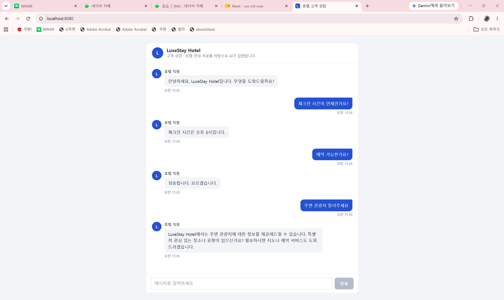

# 84일차

## Spring AI: 호텔 FAQ RAG 챗봇, Tool Calling, Docker로 Spring Boot 앱 실행

📌 학습일 : 2026.11.06

📌 학습 내용 : RAG, TextFile 임베딩, Files.lines, Document, TokenTextSplitter 기본값, JdbcClient, pgvector table-name, similarityThreshold, topK, ChatClient.builder, promptUserSpec, stream().content(), Flux, @CrossOrigin, Postman form-data, React 채팅 UI, TextDecoder 스트리밍, Tool Calling, @Tool, @ToolParam, tools(), Spring Boot 4.0, gradlew build, JAR 실행, Dockerfile, docker build, docker run, 포트 매핑, docker rm, docker rmi

---

#### 1. 실습 프로젝트 구성


| 프로젝트 | 내용 | 화면 |
| --- | --- | --- |
| demo-12 | 호텔 FAQ 텍스트를 벡터 DB에 저장하고 호텔 직원처럼 답변하는 RAG 챗봇 | React + Vite + TypeScript |
| demo-13 | LLM이 내가 만든 자바 메서드를 호출하는 Tool Calling | 없음 (Postman) |
| demo-14 | Spring Boot 앱을 JAR로 빌드해서 Docker 이미지로 실행 | 정적 페이지 |

demo-12는 Spring Boot 3.5.7 + Spring AI 1.0.1, demo-13은 Spring Boot 3.5.8 + Spring AI 1.1.0, demo-14는 Spring Boot 4.0.9를 사용했다.

#### 2. demo-12: 호텔 FAQ 텍스트를 벡터 DB에 저장

```properties
# 호텔 전용 테이블을 지정
spring.ai.vectorstore.pgvector.table-name=hotel_vector
spring.ai.vectorstore.pgvector.index-type=HNSW
spring.ai.vectorstore.pgvector.distance-type=COSINE_DISTANCE
spring.ai.vectorstore.pgvector.dimensions=1536
spring.ai.vectorstore.pgvector.initialize-schema=true
```

```java
public void processUploadText(MultipartFile file) throws IOException {
	//복사본 생성..
	File tmpFile = File.createTempFile("upload", ".text");
	file.transferTo(tmpFile);
	Resource fileResource = new FileSystemResource(tmpFile);

	//1) 테이블 데이터 확인, count 작업 : 별도의 JDBC
	Integer count = jdbcClient
			.sql("select count(*) from hotel_vector")
			.query(Integer.class)
			.single();
	try {
		if(count == 0) {
			//문서를 read Document 객체
			List<Document> documents = Files.lines(fileResource.getFile().toPath())
											.map(Document::new)
											.collect(Collectors.toList());

			//split 처리
			TokenTextSplitter splitter = new TokenTextSplitter();
			List<Document> spliDocuments = splitter.apply(documents);

			//백터 저장소 임베딩 및 저장
			vectorStore.accept(spliDocuments);
		}
	} catch (Exception e) {
		e.printStackTrace();
	}finally {
		tmpFile.delete();
	}
}
```

| 코드 | 설명 |
| --- | --- |
| `table-name=hotel_vector` | 기본 테이블 `vector_store` 대신 호텔 전용 테이블 사용 |
| `JdbcClient` | 간단한 SQL을 직접 실행하는 객체, 저장 전에 데이터가 있는지 확인 |
| `count == 0` | 테이블이 비어 있을 때만 저장해서 같은 내용의 중복 임베딩을 막음 |
| `Files.lines()` | 파일을 한 줄씩 읽음 |
| `Document::new` | 한 줄을 Document 하나로 변환, FAQ 12줄이 12개 행으로 저장됨 |
| `new TokenTextSplitter()` | 기본값 사용 (청크 800 토큰, 최소 350자, 최소 길이 5, 최대 10,000개) |

어제 PDF는 페이지 단위로 읽었고, 오늘 FAQ는 한 줄이 하나의 답변 단위라서 줄 단위로 문서를 만들었다.

#### 3. demo-12: 호텔 직원 챗봇

```java
@GetMapping(value = "/chat", produces = MediaType.TEXT_PLAIN_VALUE)
public Flux<String> hotelChatbot(@RequestParam("question") String question) {

	ChatClient chatClient = ChatClient.builder(chatModel).build();

	//유사도 검색
	List<Document> results = vectorStore.similaritySearch(SearchRequest.builder()
														.query(question)
														.similarityThreshold(0.5)
														.topK(1)
														.build());

	String template = """
			당신은 어느 호텔의 직원입니다. 문맥에 따라서 고객의 질문에 정중하게 답변해주세요.
			컨텍스트가 질문에 대답할 수 없는 경우, "죄송합니다. 모르겠습니다."라고 대답하세요.
			컨텍스트:
			{context}
			질문:
			{question}
			""";
	return chatClient.prompt()
					.user(promptUserSpec -> promptUserSpec.text(template)
						.param("context", results)
						.param("question", question))
						.stream().content();
}
```

| 코드 | 설명 |
| --- | --- |
| `similarityThreshold(0.5)` | 유사도 0.5 이상인 문서만 사용 |
| `topK(1)` | 가장 비슷한 문서 1개만 사용 |
| `.param("context", results)` | 템플릿의 `{context}` 자리에 검색 결과를 넣음 |
| `.stream().content()` | 답변을 조각 단위 `Flux<String>`으로 돌려줌 |
| `@CrossOrigin` | 개발 중인 5173 화면에서 호출할 수 있게 허용 |

#### 4. demo-12: React 채팅 화면

```typescript
const reader = response.body.getReader()
const decoder = new TextDecoder('utf-8')
while (true) {
  const { done, value } = await reader.read()
  if (done) break
  onChunk(decoder.decode(value, { stream: true }))
}
```

```tsx
// 한글 조합 중 Enter는 글자 확정용이라 전송하지 않는다
if (event.key === 'Enter' && !event.shiftKey && !event.nativeEvent.isComposing) {
  event.preventDefault()
  send(input)
}
```

| 기능 | 구현 |
| --- | --- |
| 스트리밍 표시 | `fetch`의 `reader`로 답변 조각을 받아 말풍선에 이어 붙임 |
| 대기 표시 | 첫 조각이 올 때까지 점 3개 애니메이션 표시 |
| 자주 묻는 질문 | 체크인, 취소 수수료, 반려동물, 룸 서비스 버튼 |
| 한글 입력 | `isComposing`으로 Enter 중복 전송 방지 |
| 실패 처리 | 에러 말풍선과 다시 시도 버튼 |

`vite.config.ts`의 proxy로 개발 중에는 `/api`를 8080으로 보내고, 빌드 결과는 `static` 폴더에 넣어서 8080 하나로 실행할 수 있게 했다.

#### 5. demo-13: Tool Calling

```java
@Component
public class SpringTools {

	private static final Map<String, String> dictionary = new HashMap<>();

	//static 초기자
	static {
		dictionary.put("이순신", "등산");
		dictionary.put("김유신", "축구");
		dictionary.put("유관순", "영화감상");
		dictionary.put("아무개", "독서");
	}

	//시스템 날짜를 return 하는 Tool
	@Tool
	public String getCurrentDateTime() {
		LocalDate today = LocalDate.now();
		return today.toString();
	}

	@Tool
	public String UserHobby(String name) {
		return dictionary.getOrDefault(name, "해당 직원 없음");
	}
}
```

```java
@GetMapping("/simple")
public String toolSimple() {
	return chatClient.prompt("내일은 몇일일까?")
			.call().content();
}

@GetMapping("/date")
public String toolDate() {
	return chatClient.prompt("내일은 몇일일까?")
			.tools(new SpringTools()) //도구 제시
			.call()
			.content();
}

@GetMapping("/emp")
public String toolEmp(@RequestParam("name") String name) {
	String promptText = String.format(
			"아래 도구를 사용하여 직원 '%s'의 취미를 알려줘. 만약 지원이 없으면 '해당 직원이 없습니다'라고 답변해줘\n"
					+ "도구: UserHobby(name) -  직원 이름을 넣으면 취미를 알려줌"
					, name);

	return chatClient.prompt(promptText)
			.tools(new SpringTools())
			.call()
			.content();
}
```

| 코드 | 설명 |
| --- | --- |
| `@Tool` | 메서드를 LLM이 사용할 수 있는 도구로 등록 |
| `.tools(new SpringTools())` | 이번 요청에서 쓸 수 있는 도구 목록을 전달 |
| `@ToolParam` | 매개변수의 의미를 LLM에게 설명 |

| 주소 | 도구 | 차이 |
| --- | --- | --- |
| `/tool/simple` | 없음 | LLM은 오늘 날짜를 모르므로 내일 날짜를 정확히 알 수 없음 |
| `/tool/date` | `getCurrentDateTime` | 도구로 실제 날짜를 얻은 뒤 답변 |
| `/tool/emp?name=이순신` | `UserHobby` | 자바 Map에 있는 데이터를 찾아 답변 |

81일차에 AI가 오늘 날짜를 틀렸던 문제를 도구로 해결하는 실습이다. LLM이 직접 메서드를 실행하는 것이 아니라, 어떤 도구를 쓸지 요청하면 Spring AI가 메서드를 실행하고 결과를 다시 LLM에 전달한다.

#### 6. demo-14: JAR 빌드와 Docker 이미지

```dockerfile
FROM eclipse-temurin:21-jre
WORKDIR  /app
COPY build/libs/*.jar app.jar
EXPOSE 8080
ENTRYPOINT ["java", "-jar", "app.jar"]
```

```bash
./gradlew clean build                        # JAR 빌드 (프로젝트 최상위 폴더에서 실행)
java -jar build/libs/demo-14-0.0.1-SNAPSHOT.jar   # JAR 직접 실행

docker build -t myhome .                     # 이미지 만들기
docker run -d --name myapp -p 8050:8080 myhome    # 컨테이너 실행
docker ps -a                                 # 컨테이너 상태 확인
docker rm myapp                              # 컨테이너 삭제
docker rmi myhome:latest                     # 이미지 삭제
```

| 명령어 | 설명 |
| --- | --- |
| `FROM eclipse-temurin:21-jre` | Java 21 실행 환경이 들어 있는 베이스 이미지 |
| `COPY build/libs/*.jar app.jar` | 빌드한 JAR를 이미지 안으로 복사 |
| `ENTRYPOINT` | 컨테이너가 시작할 때 실행할 명령 |
| `-p 8050:8080` | PC의 8050 포트를 컨테이너의 8080 포트에 연결 |
| `docker build -f 파일명` | 이름이 `Dockerfile`이 아닌 파일로 빌드 |

| 구분 | jdk | jre |
| --- | --- | --- |
| 포함 내용 | 컴파일러 등 개발 도구 + 실행 환경 | 실행 환경만 |
| 쓰임 | 이미지 안에서 빌드까지 할 때 | 이미 만든 JAR를 실행만 할 때 |

JAR를 PC에서 먼저 빌드하기 때문에 이미지에는 실행 환경만 있으면 된다. 이미지를 만들 때 쓰는 PC와 상관없이 같은 환경에서 앱을 실행할 수 있다.

#### 핵심 정리

- RAG 문서는 내용에 맞는 단위로 나눠야 하며, FAQ처럼 한 줄이 한 답변이면 줄 단위로 만들 수 있다.
- `table-name`으로 프로젝트별 벡터 테이블을 나눌 수 있다.
- 업로드할 때 데이터가 있는지 먼저 확인하면 중복 임베딩과 비용을 줄일 수 있다.
- `similarityThreshold`와 `topK`는 답변에 쓸 문서를 얼마나 엄격하게 고를지 결정한다.
- 파일 업로드는 Postman의 form-data Key가 `@RequestParam` 이름과 같아야 한다.
- Tool Calling을 쓰면 LLM이 모르는 실시간 정보나 내부 데이터를 내 코드로 가져올 수 있다.
- JAR는 프로젝트 최상위 폴더에서 빌드하고, Dockerfile로 JAR를 이미지에 넣어 실행한다.
- 멈춘 컨테이너도 이미지를 사용 중인 것으로 처리되므로 컨테이너를 먼저 지워야 이미지를 지울 수 있다.

---

```
Cannot find a Java installation on your machine ... matching: {languageVersion=17, ...}
```

```groovy
languageVersion = JavaLanguageVersion.of(21)
```

demo-12의 `build.gradle`이 Java 17로 되어 있는데 PC에는 Java 21만 설치되어 있어서 빌드가 실패했다.
</br>toolchain 버전을 21로 바꾸고 Gradle을 다시 동기화해서 해결했다.

```java
import org.springframework.boot.autoconfigure.web.ServerProperties.Tomcat.Resource;
```

```java
import org.springframework.core.io.Resource;
```

`Resource fileResource = new FileSystemResource(tmpFile);`에서 오류가 났는데, 자동 import로 Tomcat 설정용 `Resource`가 들어온 것이 원인이었다.
</br>같은 이름의 클래스가 여러 개 있을 때는 패키지까지 확인하고 선택해야 한다는 것을 배웠다.

```java
File tmpFile = File.createTempFile("upload", ".text") throws IOException;   // 잘못된 위치
```

```java
public void processUploadText(MultipartFile file) throws IOException {
	File tmpFile = File.createTempFile("upload", ".text");
```

`throws`는 코드 줄이 아니라 메서드 선언에 붙여야 해서, 위치를 옮기고 `import java.io.IOException;`을 추가해서 해결했다.

```
Required part 'file' is not present.
```

Postman으로 파일을 올렸는데 400 에러가 나고 `hotel_vector`가 비어 있었다.
</br>form-data의 Key가 비어 있어서 서버가 파일을 받지 못한 것이었다. 컨트롤러의 `@RequestParam("file")`과 같게 Key에 `file`을 넣어서 해결했다.

```
select * from public.hotel_vector;   -- DBeaver에 빨간 밑줄과 경고 표시, 결과는 12 row(s) fetched
```

쿼리에 경고 표시가 떴지만 결과는 12개가 정상으로 나왔다.
</br>실행 오류가 아니라 앱이 나중에 만든 테이블을 DBeaver가 아직 목록에 반영하지 못해 편집기에 표시된 경고로 보였고, 실제 결과를 보고 판단해야 한다는 것을 알게 되었다.

```
ERROR: failed to solve: failed to read dockerfile: open Dockerfile: no such file or directory
```

```bash
docker build -f Ex01.Dockerfile -t my_jdk .
```

파일 이름이 `Ex01.Dockerfile`인데 `docker build`는 기본으로 `Dockerfile`을 찾기 때문에 에러가 났다. `-f`로 파일을 지정해서 해결했다.

```
'url' attribute is not specified and no embedded datasource could be configured.
Reason: Failed to determine a suitable driver class
```

demo-14를 `gradlew clean build` 하면 `contextLoads()` 테스트가 실패했다.
</br>JPA와 pgvector 의존성이 있는데 DB 접속 정보가 없어서 테스트에서 앱을 시작하지 못한 것이었다. 이 프로젝트는 JAR와 Docker 실습이 목적이라, 의존성을 `spring-boot-starter-webmvc` 중심으로 줄여서 DB 없이 빌드되게 했다.

```
localhost:5432 에 대한 연결이 거부되었습니다.
Unable to determine Dialect without JDBC metadata
```

JAR를 실행했을 때는 PostgreSQL 컨테이너가 꺼져 있어서 연결이 거부되었다.
</br>`docker start pgvector_db`로 켜니 해결되었고, `Dialect` 메시지는 DB에 연결하지 못해서 따라 나온 에러였다. 컨테이너 안에서 실행할 때는 `localhost`가 컨테이너 자신을 가리킨다는 점도 알게 되었다.

```
./gradlew : './gradlew' 용어가 ... 인식되지 않습니다.
```

`build\libs` 폴더에서 빌드 명령을 실행해서 난 에러였다. `gradlew`는 프로젝트 최상위 폴더에 있으므로 그 폴더로 이동해서 해결했다.

```
Image myhome:latest is in use. Delete the container that's using it and try again.
```

멈춰 있는 `myapp` 컨테이너가 이미지를 사용 중이라 삭제되지 않았다. `docker rm myapp`으로 컨테이너를 지운 뒤 이미지를 삭제해야 한다.

<p align="center">
  
</p>

demo-12 호텔 챗봇 화면이다. "체크인 시간이 언제인가요?"에는 FAQ대로 오후 3시라고 답했고, "예약 가능한가요?"에는 FAQ에서 근거를 찾지 못해 "죄송합니다. 모르겠습니다."라고 답했다. "주변 관광지 알려주세요"에는 관광 정보를 안내할 수 있다고만 답하고 구체적인 장소는 말하지 않았다.

</br>검색한 문서를 근거로 답하게 하면 문서에 있는 내용은 정확히 답하고, 근거가 없는 질문은 지어내지 않고 모른다고 답하게 만들 수 있다는 것을 배웠다.
</br>답변의 품질은 모델뿐 아니라 저장한 문서의 내용에 달려 있어서, 관광지 질문처럼 FAQ에 구체적인 장소가 없으면 AI도 구체적으로 답할 수 없다는 것을 확인했다.

</br>실제 호텔 직원과 대화하는 것처럼 화면을 만드니 지금까지 배운 RAG가 서비스처럼 느껴져서 재미있었다.
</br>다만 "예약 가능한가요?"처럼 고객이 자주 물어볼 만한 질문에 모른다고만 답하면 불편할 것 같아서, 실제 서비스라면 FAQ 내용을 더 채우거나 담당자에게 연결하는 기능도 필요하다고 느꼈다.

</br>오늘은 호텔 FAQ 챗봇으로 RAG를 복습하고, Tool Calling으로 LLM이 내 코드를 사용하게 만든 뒤, 앱을 Docker 이미지로 실행하는 과정까지 해 보았다.
</br>에러가 많았지만 메시지를 끝까지 읽으면 설정, 실행 위치, 꺼진 컨테이너처럼 원인이 대부분 코드 밖에 있었고, 환경을 확인하는 습관이 중요하다는 것을 다시 느꼈다.
</br>다음에는 DB까지 포함해서 여러 컨테이너를 함께 실행하고, 챗봇이 이전 대화도 기억하도록 개선해 보고 싶다.
