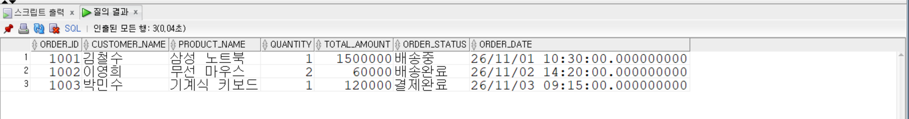
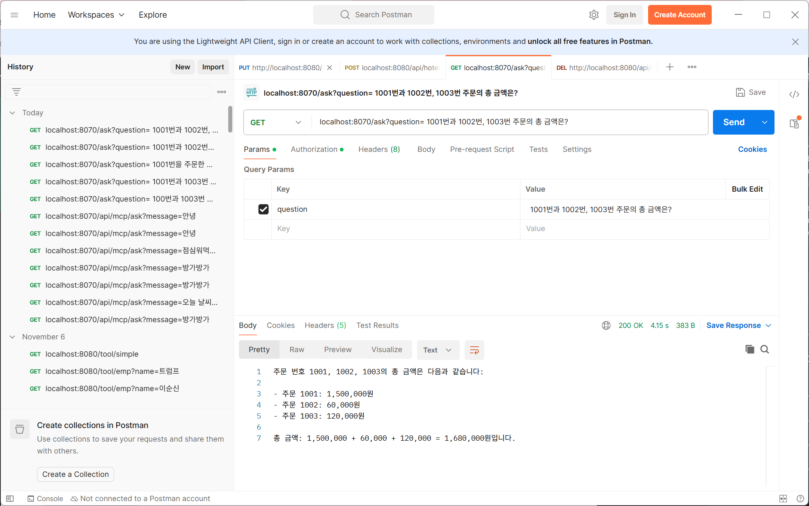
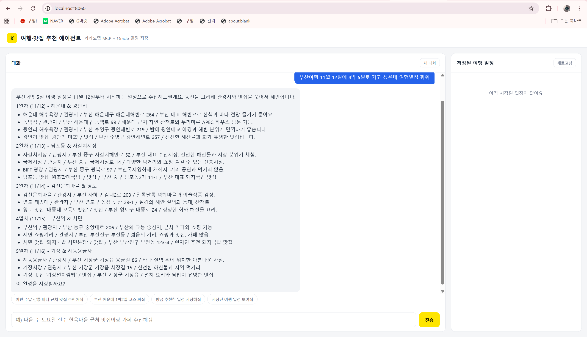
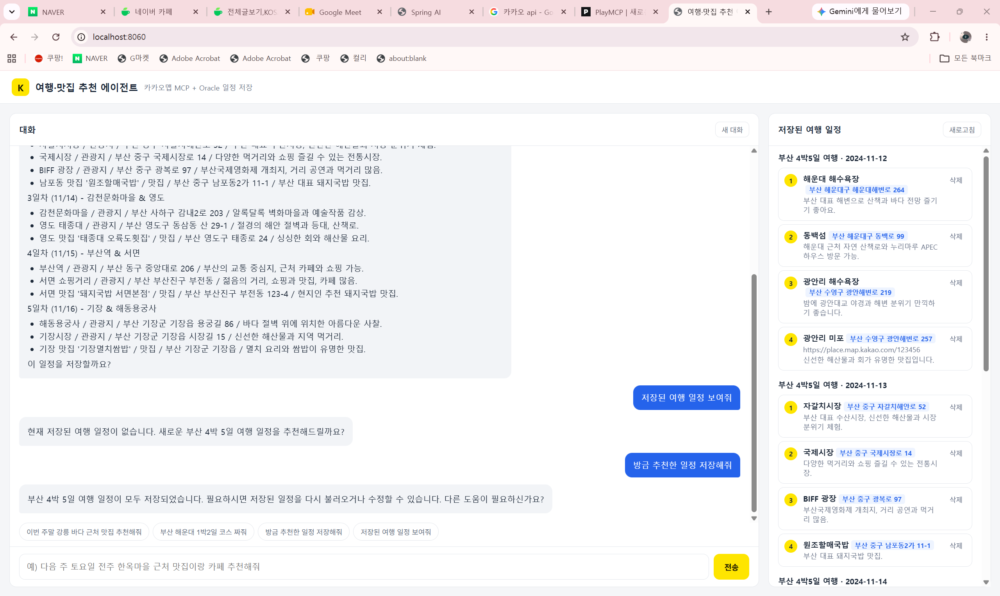
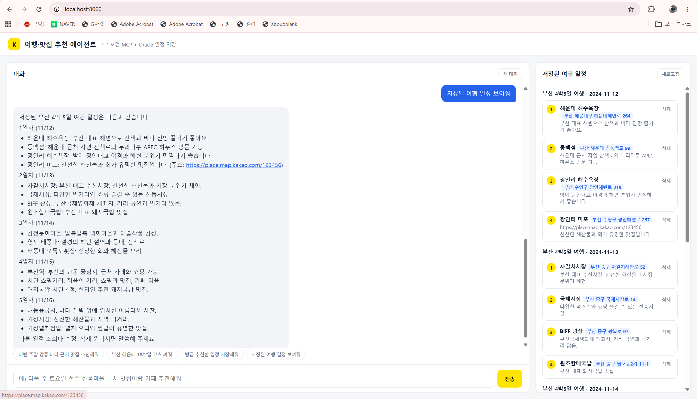

# 86일차

## Spring AI: 이미지 인식 Tool Calling(차단기), MCP 서버·클라이언트, Oracle 주문 조회 MCP, 카카오 장소 검색 여행·맛집 추천 에이전트

📌 학습일 : 2026.11.09

📌 학습 내용 : Tool Calling, @Tool, @ToolParam, Media, UserMessage, 이미지 인식, MCP(Model Context Protocol), MCP Server, MCP Client, Streamable HTTP, @McpTool, @McpToolParam, annotation-scanner, MethodToolCallbackProvider, ToolCallbackProvider, SyncMcpToolCallbackProvider, defaultToolCallbacks, MyBatis, @Mapper, @Param, Mapper XML, Oracle, record DTO, JdbcClient, ChatMemory, MessageWindowChatMemory, MessageChatMemoryAdvisor, ToolContext, ToolCallback, 카카오 로컬 API(키워드 검색), RestClient, 환경변수, React + Vite + TypeScript, Vite proxy

---

#### 1. 실습 프로젝트 구성

| 프로젝트 | 내용 | 포트 |
| --- | --- | --- |
| demo-15 | 차량 사진에서 번호판을 인식하고 등록 차량이면 차단기를 올리는 Tool Calling | 8080 |
| demo-16 | `@McpTool`로 인사 도구를 제공하는 MCP 서버 | 8090 |
| demo-16_McpClient | MCP 서버의 도구를 가져와 쓰는 MCP 클라이언트 | 8070 |
| order-mcp-server | Oracle `ORDERS` 테이블을 조회하는 주문 조회 MCP 서버 (MyBatis) | 8090 |
| order-mcp-client | 주문 조회 AI 상담원 (MCP 클라이언트) | 8070 |
| kakao-travel-agent | 카카오 장소 검색 + Oracle 일정 저장 여행·맛집 추천 에이전트 (과제) | 8060, 화면 5173 |

```
MCP 클라이언트 (8070)                         MCP 서버 (8090)
ChatClient ── SyncMcpToolCallbackProvider ──▶ /mcp ── @McpTool getOrder() ── MyBatis ── Oracle
   ▲  질문                                     (Streamable HTTP)
   └─ 사용자
```

#### 2. demo-15: 이미지로 차량 번호 인식 후 차단기 제어

```java
public String chat(String contentType, byte[] bytes) {
	Media media = Media.builder()
			.mimeType(MimeType.valueOf(contentType))
			.data(new ByteArrayResource(bytes))
			.build();

	UserMessage userMessage = UserMessage.builder()
			.text("""
				다음 단계별로 처리해 주세요.
				1단계: 이미지에서 '(숫자 2개~3개)-(한글 1자)-(숫자 4개)'로 구성된 차량 번호를 인식하세요.
				2단계: 인식된 차량 번호에서 끝에서부터 5번째 문자가 한글 완성형 음절이 아닐 경우에는 다시 1단계로 돌아가세요.
				3단계: 1단계에서 인식된 차량 번호가 등록된 차량 번호인지 도구로 확인을 하세요.
				4단계: 3단계의 결과가 "미등록번호"라면 도구로 차단기를 내리고, "등록번호"라면 도구로 차단기를 올리세요.
				최종 답변은 차단기 내림 또는 차단기 올림으로 하고 추가 설명은 하지마세요.
			""")
			.media(media)
			.build();

	return chatClient.prompt()
			.messages(userMessage)
			.tools(carCheckTools, boomBarrierTools)
			.call()
			.content();
}
```

```java
@Tool(description = "LLM이 인식된 차량 번호가 등록되어 있는지 확인합니다.")
public String checkCarNumber(@ToolParam(description = "차량 번호") String carNumber) {
	carNumber = carNumber.replaceAll("\\s+", "");   // 차량 번호에 포함된 모든 공백 제거
	boolean result = carNumbers.contains(carNumber);
	return result ? "등록번호" : "미등록번호";
}

@Tool(description = "차단기를 올립니다.")
public String boomBarrierUp() { return "차단기 올림"; }

@Tool(description = "차단기를 내립니다.")
public String boomBarrierDown() { return "차단기 내림"; }
```

| 도구 | 역할 |
| --- | --- |
| `checkCarNumber` | 인식한 번호가 등록 차량 목록에 있는지 확인 (실제로는 DB 조회 자리) |
| `boomBarrierUp` / `boomBarrierDown` | 차단기를 올리거나 내림 |

LLM은 이미지에서 번호를 읽고, 어떤 도구를 어떤 순서로 부를지 스스로 정한다. 실제 동작(등록 확인, 차단기 제어)은 내 코드인 도구가 하기 때문에 LLM은 판단만 하고 결과는 코드가 책임진다.

| 인식 결과 | 동작 |
| --- | --- |
| `152가3108`을 `152Z3108`로 인식 | 미등록번호 → 차단기 내림 |
| `157고4895`를 `157가4895`, `157나4895` 등으로 바꿔 가며 확인 | 그중 하나가 등록번호 → 차단기 올림 |

사진 속 번호판이 작으면 LLM이 한글을 영문자로 읽거나, 비슷한 번호를 추측해서 여러 번 확인하는 경우가 있었다. 인식률을 높이려면 더 좋은 비전 모델을 쓰거나 번호판 부분만 잘라서 보내고, 도구에서 `\d{2,3}[가-힣]\d{4}` 형식 검사로 잘못 읽은 번호를 걸러야 한다.

#### 3. MCP(Model Context Protocol)란

| 구분 | Tool Calling (demo-15) | MCP |
| --- | --- | --- |
| 도구 위치 | 같은 애플리케이션 안의 `@Tool` 메소드 | 별도의 MCP 서버 |
| 연결 | `.tools(객체)`로 직접 등록 | MCP 클라이언트가 서버에 접속해 도구 목록을 받아 옴 |
| 재사용 | 그 앱에서만 사용 | 여러 AI 애플리케이션이 같은 서버의 도구를 공유 |

MCP는 AI 애플리케이션이 외부 도구를 같은 방식으로 연결하기 위한 표준 프로토콜이다. 도구를 가진 쪽이 **MCP 서버**, 그 도구를 가져와 LLM에 넘기는 쪽이 **MCP 클라이언트**이다. 오늘은 HTTP로 주고받는 **Streamable HTTP** 방식을 사용했다.

#### 4. demo-16: @McpTool로 MCP 서버 만들기

```java
@Service
public class SimpleToolService {

	@McpTool(name = "HelloTool", description = "간단한 Hello 메시지를 반환합니다.")
	public String helloTool() {
		return "Hello from MCP server Tool";
	}
}
```

```properties
server.port=8090
spring.ai.mcp.server.name=mcp-server
spring.ai.mcp.server.protocol=STREAMABLE
spring.ai.mcp.server.type=SYNC
spring.ai.mcp.server.capabilities.tool=true
# @McpTool 자동 스캔
spring.ai.mcp.server.annotation-scanner.enabled=true
spring.ai.mcp.server.streamable-http.mcp-endpoint=/mcp
```

| 설정 | 설명 |
| --- | --- |
| `spring-ai-starter-mcp-server-webmvc` | MCP 서버 의존성 |
| `protocol=STREAMABLE` | HTTP 스트리밍 방식으로 통신 |
| `annotation-scanner.enabled=true` | `@McpTool`이 붙은 메소드를 찾아 도구로 자동 등록 |
| `mcp-endpoint=/mcp` | 클라이언트가 접속할 주소 (`http://localhost:8090/mcp`) |

브라우저로 `http://localhost:8090/mcp`를 열면 `Invalid Accept header` 400 에러가 나는데, 이 주소는 MCP 클라이언트가 이벤트 스트림 형식으로 접속하는 곳이라 정상이다.

#### 5. demo-16_McpClient: MCP 서버의 도구 가져오기

```properties
server.port=8070
spring.ai.mcp.client.enabled=true
spring.ai.mcp.client.type=SYNC
spring.ai.mcp.client.toolcallback.enabled=true
spring.ai.mcp.client.streamable-http.connections.local-server.url=http://localhost:8090
spring.ai.mcp.client.streamable-http.connections.local-server.endpoint=/mcp
```

```java
@Configuration
public class ChatConfig {

	@Bean
	public ChatClient chatClient(ChatModel chatModel, SyncMcpToolCallbackProvider toolCallbackProvider) {
		return ChatClient.builder(chatModel)
				.defaultToolCallbacks(toolCallbackProvider)
				.build();
	}
}
```

```java
String systemPrompt = """
		You are allowed to use the MCP tool only when the user asks for a greeting
		such as 'hello', 'hi', '안녕', or '인사해'.
		Do NOT call the tool for any other request.
		""";
```

| 코드 | 설명 |
| --- | --- |
| `spring-ai-starter-mcp-client` | MCP 클라이언트 의존성 |
| `connections.local-server.url` | 접속할 MCP 서버 주소 (서버 포트 8090) |
| `SyncMcpToolCallbackProvider` | MCP 서버에서 받아 온 도구 목록 |
| `defaultToolCallbacks(...)` | 받아 온 도구를 ChatClient에 기본 도구로 등록 |

`http://localhost:8070/api/mcp/ask?message=안녕`처럼 인사를 보내면 MCP 서버의 `HelloTool`이 호출되어 `Hello from MCP server Tool`이 나오고, 다른 질문에는 도구 없이 일반 답변이 나온다. 클라이언트에는 도구 코드가 전혀 없는데 서버의 도구를 쓸 수 있다는 점이 MCP의 핵심이다.

#### 6. 주문 조회 MCP 서버: Oracle + MyBatis

```sql
-- ORDERS 테이블 (ORDER_ID, CUSTOMER_NAME, PRODUCT_NAME, QUANTITY, TOTAL_AMOUNT, ORDER_STATUS, ORDER_DATE)
1001 김철수 삼성 노트북 1 1500000 배송중
1002 이영희 무선 마우스 2   60000 배송완료
1003 박민수 기계식 키보드 1 120000 결제완료
```

```java
public record OrderInfo(
		Long orderId,
		String customerName,
		String productName,
		Integer quantity,
		BigDecimal totalAmount,   // 화폐는 정확한 값 표기를 위해 BigDecimal
		String orderStatus,
		LocalDateTime orderDate
) {}
```

```java
@Mapper
public interface OrderMapper {
	OrderInfo findById(@Param("orderId") Long orderId);
}
```

```xml
<mapper namespace="com.example.demo.mapper.OrderMapper">
	<select id="findById" resultType="com.example.demo.dto.OrderInfo">
		SELECT ORDER_ID, CUSTOMER_NAME, PRODUCT_NAME, QUANTITY, TOTAL_AMOUNT, ORDER_STATUS, ORDER_DATE
		FROM ORDERS
		WHERE ORDER_ID = #{orderId}
	</select>
</mapper>
```

```java
@McpTool(name = "getOrder", description = "OracleDB 에서 쇼핑몰 주문번호로 주문정보와 배송상태 조회")
public String getOrder(@McpToolParam(description = "조회할 주문번호") Long orderId) {
	OrderInfo order = orderService.getOrder(orderId);
	if (order == null) {
		return "해당 주문번호의 주문이 없습니다";
	}
	return """
			주문번호: %d
			고객명: %s
			...
			""".formatted(order.orderId(), order.customerName(), ...);
}
```

| 설정·코드 | 설명 |
| --- | --- |
| `@Mapper`, `@Param` | `org.apache.ibatis.annotations` 패키지 (Swagger의 `@Parameter`와 다름) |
| `namespace` | Mapper 인터페이스의 전체 이름과 같아야 함 |
| `<select id="findById">` | 인터페이스 메소드 이름과 같아야 함 |
| `mybatis.mapper-locations=classpath:mapper/*.xml` | Mapper XML 위치 |
| `map-underscore-to-camel-case=true` | `ORDER_ID` 컬럼을 `orderId` 필드에 자동 매핑 |

주문이 없을 때 `null` 처리를 먼저 하지 않으면 `order.orderId()`에서 NullPointerException이 나기 때문에, 없는 주문은 안내 문장을 돌려주고 있을 때만 주문 정보를 돌려주도록 했다.

#### 7. @Tool과 @McpTool 등록 방식 비교

| 구분 | `@Tool` (Spring AI) | `@McpTool` (MCP 어노테이션) |
| --- | --- | --- |
| 패키지 | `org.springframework.ai.tool.annotation` | `org.springaicommunity.mcp.annotation` |
| MCP 서버 등록 | `MethodToolCallbackProvider`로 `ToolCallbackProvider` 빈을 직접 등록 | `annotation-scanner`가 자동 등록 |
| 설정 클래스 | 필요 | 필요 없음 |

```java
// @Tool 을 쓸 때만 필요한 설정 (@McpTool 을 쓸 때는 주석 처리)
@Bean
public ToolCallbackProvider orderToolProvider(OrderTools orderTools) {
	return MethodToolCallbackProvider.builder().toolObjects(orderTools).build();
}
```

두 방식 모두 MCP 서버의 도구로 쓸 수 있지만 **등록 방법이 다르기 때문에 하나만 골라야 한다.** `MethodToolCallbackProvider`는 `@Tool`이 붙은 메소드만 찾기 때문에, `@McpTool`을 쓰면서 이 설정을 켜 두면 서버가 시작하지 못한다.

#### 8. 주문 조회 MCP 클라이언트

```java
public String chat(String question) {
	return chatClient.prompt()
			.system("""
				당신은 쇼핑몰 주문 조회 AI 상담원입니다.
				주문번호가 포함된 조회 요청이면 getOrder 도구를 사용하세요.
				도구에서 반환한 정보만 답변하세요.
				없는 주문 정보는 만들지 마세요.
				주문번호가 없다면 번호를 질문하세요.
				""")
			.user(question)
			.call()
			.content();
}
```

`localhost:8070/ask?question=1001번과 1002번, 1003번 주문의 총 금액은?`을 보내면 LLM이 `getOrder`를 주문번호마다 세 번 호출하고, 받은 금액을 더해서 `1,500,000 + 60,000 + 120,000 = 1,680,000원`이라고 답했다. 질문 하나에 도구를 여러 번 부르고 결과를 계산하는 것까지 LLM이 스스로 처리했다.

#### 9. 과제: 카카오 장소 검색 여행·맛집 추천 에이전트

| 도구 | 종류 | 역할 |
| --- | --- | --- |
| `searchKakaoPlaces` | 카카오 로컬 API | 키워드로 실제 장소 검색 (장소명, 분류, 주소, 전화, 상세 페이지 URL) |
| `getToday` | 로컬 Tool | 오늘 날짜 확인 ('이번 주말', '11월 12일' 계산) |
| `saveTravelPlan` | 로컬 Tool | 추천 장소를 Oracle `TRAVEL_PLAN`에 저장 |
| `findTravelPlans` | 로컬 Tool | 저장된 일정 조회 |
| `deleteTravelPlan` | 로컬 Tool | 일정 삭제 |

```java
public List<Place> searchKeyword(String query, int size) {
	KeywordResponse response = restClient.get()
			.uri(uri -> uri.path("/v2/local/search/keyword.json")
					.queryParam("query", query)
					.queryParam("size", size)
					.build())
			.header("Authorization", "KakaoAK " + restApiKey)
			.retrieve()
			.body(KeywordResponse.class);
	return response == null || response.documents() == null ? List.of() : response.documents();
}
```

```java
@Bean
public ChatClient chatClient(ChatModel chatModel, KakaoPlaceTools kakaoPlaceTools,
		TravelPlanTools travelPlanTools, ChatMemory chatMemory) {
	return ChatClient.builder(chatModel)
			.defaultSystem(SYSTEM_PROMPT)
			.defaultTools(kakaoPlaceTools, travelPlanTools)
			.defaultAdvisors(MessageChatMemoryAdvisor.builder(chatMemory).build())
			.build();
}
```

```java
public String chat(String conversationId, String message) {
	return chatClient.prompt()
			.user(message)
			.advisors(a -> a.param(ChatMemory.CONVERSATION_ID, conversationId))
			.toolContext(Map.of("conversationId", conversationId))
			.call()
			.content();
}
```

| 코드 | 설명 |
| --- | --- |
| `Authorization: KakaoAK {키}` | 카카오 REST API 인증 헤더 |
| `place_url` | 검색 결과에 들어 있는 장소 상세 페이지 주소 |
| `defaultTools(kakaoPlaceTools, travelPlanTools)` | 검색 도구와 DB 도구를 함께 등록 |
| `MessageWindowChatMemory` | "방금 추천한 일정 저장해줘"처럼 이전 대화를 이어 가기 위해 최근 20개 메시지 기억 |
| `toolContext(...)` | 도구가 어느 대화의 요청인지 알 수 있게 대화 ID 전달 |

"11월 21일 부산 감천문화마을 근처 관광지 1곳이랑 맛집 1곳 추천해줘" → "저장해줘"를 보내면 LLM이 `getToday`, `searchKakaoPlaces`, `saveTravelPlan`을 차례로 호출해서, 실제 카카오 상세 페이지 링크(`place.map.kakao.com/숫자`)와 함께 일정이 저장되었다.

#### 10. AI가 지어낸 장소와 링크 막기

```java
// 카카오 검색 결과에 나온 장소 URL 을 대화별로 기억
public void record(String conversationId, String toolResult) { ... }

// 저장 도구: 이번 대화에서 카카오가 실제로 돌려준 URL 일 때만 저장
if (!kakaoPlaceRegistry.isVerified(conversationId, placeUrl)) {
	return "저장 거부: '%s' 의 URL은 카카오맵 검색 결과에서 확인되지 않았습니다. URL을 지어내지 마세요."
			.formatted(placeName);
}
```

| 시도 | 결과 |
| --- | --- |
| 카카오 검색 없이 LLM 기억으로 추천 | 연도를 2024년으로 추측, 분류 칸에 주소, `place.map.kakao.com/123456` 같은 가짜 링크 저장 |
| 링크 형식(`place.map.kakao.com/숫자`)만 검사 | LLM이 형식에 맞는 숫자를 지어내서 검사를 통과 |
| 카카오가 돌려준 링크 목록과 비교 | 검색 결과에 없는 링크는 저장 거부 |

프롬프트에 "지어내지 마세요"라고 써도 LLM은 그럴듯한 값을 만들어 냈다. 그래서 **검색 도구가 실제로 돌려준 값만 저장 도구에서 허용**하도록 코드로 막았다. 날짜는 항상 `getToday`를 먼저 호출해서 연도를 계산하고, 분류는 맛집 / 카페 / 관광지 / 숙소 중 한 단어만 넣도록 도구 설명(`@ToolParam`)에 적었다.

#### 11. React 화면과 실행 구조

```typescript
export default defineConfig({
  plugins: [react()],
  server: {
    port: 5173,
    // /api 요청은 스프링부트(8060)로 전달
    proxy: { '/api': 'http://localhost:8060' }
  }
})
```

| 화면 | 기능 |
| --- | --- |
| 대화 | 추천 질문 버튼, 마크다운 답변, 새 대화 (대화 ID 새로 발급) |
| 저장된 여행 일정 | 여행 이름 · 날짜별로 묶어 방문 순서대로 표시, 장소 이름을 누르면 카카오맵 상세 페이지, 삭제 |

React(5173)는 화면만, 스프링부트(8060)는 API만 담당하도록 나누고, 개발 서버의 proxy로 `/api` 요청을 8060에 넘겨서 CORS 설정 없이 연결했다.

```properties
spring.ai.openai.api-key=${OPENAI_API_KEY}
spring.datasource.password=${HR_DB_PASSWORD}
kakao.rest-api-key=${KAKAO_REST_API_KEY:}
```

API 키와 DB 비밀번호는 코드에 쓰지 않고 시스템 환경변수로 받았다. DB 계정이 여러 개라 `HR_DB_PASSWORD`처럼 **계정마다 환경변수 이름을 다르게** 만들었다.

#### 핵심 정리

- Tool Calling은 LLM이 판단하고 실제 동작은 `@Tool` 메소드가 처리하며, 이미지(`Media`)와 함께 쓰면 사진을 보고 도구를 고르게 할 수 있다.
- MCP는 도구를 별도 서버로 분리해서 여러 AI 애플리케이션이 같은 도구를 쓰게 하는 표준 프로토콜이다.
- MCP 서버는 `@McpTool` + `annotation-scanner`로 도구를 등록하고, 클라이언트는 `SyncMcpToolCallbackProvider`로 받아 `defaultToolCallbacks`에 넣는다.
- `@Tool`은 `MethodToolCallbackProvider`로, `@McpTool`은 자동 스캔으로 등록되므로 한 서버에서는 한 방식만 써야 한다.
- MyBatis는 `@Mapper`, `@Param`(ibatis 패키지)과 XML의 `namespace`, `id`가 인터페이스와 정확히 일치해야 한다.
- 도구가 여러 개면 LLM이 질문에 맞춰 검색 → 날짜 확인 → 저장처럼 여러 도구를 순서대로 호출한다.
- LLM은 프롬프트로 금지해도 값을 지어낼 수 있으므로, 중요한 값은 도구 결과와 비교하는 검증 코드로 막아야 한다.
- 비밀번호와 API 키는 환경변수로 받고, 환경변수를 바꾼 뒤에는 STS를 다시 켜야 적용된다.

---

```
The import org.apache.ibatis cannot be resolved
```

`build.gradle`에 MyBatis 의존성을 추가한 뒤 STS에서 프로젝트를 새로고침하지 않아서, 코드는 Gradle로 컴파일이 되는데 STS에서만 빨간 줄이 생겼다. 프로젝트 우클릭 → Gradle → Refresh Gradle Project로 라이브러리를 다시 받아서 해결했다.

```
No @Tool annotated methods found in com.example.demo.tool.OrderTools
```

도구를 `@McpTool`로 만들었는데 `McpToolConfig`의 `MethodToolCallbackProvider`가 `@Tool` 메소드를 찾다가 서버가 시작하지 못했다. `@McpTool`은 자동 스캔으로 등록되므로 `McpToolConfig`를 주석 처리하고 `annotation-scanner.enabled=true`만 두었다.

```
Parameter 0 of constructor in com.example.demo.controller.ChatController required a bean of type
'com.example.demo.service.ChatService' that could not be found.
```

`ChatService`에 `@Service`가 없어서 빈으로 등록되지 않았다. `@Service`를 붙이고, `ChatConfig`의 `chatClient()`에도 `@Bean`을 붙여 ChatClient가 빈으로 등록되게 했다.

```
java.net.ConnectException ... Client failed to initialize by explicit API call
```

MCP 클라이언트의 서버 주소가 클라이언트 자기 자신의 포트인 `8070`으로 되어 있어서, 시작하는 중에 자기 자신에게 연결하다 실패했다. 서버 주소를 MCP 서버 포트인 `8090`으로 바꾸고, 서버를 먼저 실행한 뒤 클라이언트를 실행했다.

```
ORA-00904: "ADDRESS": 부적합한 식별자
```

sqlplus로 테이블 생성 SQL을 실행할 때 컬럼 줄 끝에 붙인 한글 주석이 인코딩 문제로 다음 줄까지 주석으로 처리되어 `CATEGORY`, `ADDRESS` 컬럼이 만들어지지 않았다. `ALTER TABLE ... ADD`로 두 컬럼을 추가하고, SQL 파일의 주석은 컬럼 줄과 분리했다.

```
ORA-28000: 계정이 잠겼습니다.
```

`spring.datasource.password=${DB_PASSWORD}`로 바꿨는데 환경변수를 만들지 않았고, 만든 뒤에도 STS를 다시 켜지 않아서 비밀번호 없이 로그인을 반복하다가 계정이 잠겼다. STS를 끄고 `ALTER USER hr ACCOUNT UNLOCK;`으로 잠금을 푼 뒤, 환경변수를 적용하고 다시 실행했다.

<p align="center">
  
</p>

주문 조회 MCP 서버가 조회하는 Oracle `ORDERS` 테이블이다. 1001 ~ 1003번 주문의 고객명, 상품명, 수량, 총금액, 주문 상태, 주문 일자가 저장되어 있다.

<p align="center">
  
</p>

MCP 클라이언트(8070)에 "1001번과 1002번, 1003번 주문의 총 금액은?"을 보낸 결과이다. LLM이 MCP 서버의 `getOrder` 도구로 세 주문을 조회하고, 금액을 더해 1,680,000원이라고 답했다.

<p align="center">
  
</p>

카카오 검색을 연결하기 전 여행·맛집 추천 에이전트에 "부산여행 11월 12일에 4박 5일로 가고 싶은데 여행일정 짜줘"를 보낸 화면이다. 일차별로 관광지와 맛집을 묶어 추천했지만, 장소와 주소가 검색 결과가 아니라 LLM의 기억으로 만들어졌다.

<p align="center">
  
</p>

위 일정을 저장한 화면이다. 날짜가 2026년이 아니라 2024-11-12로 저장되었고, 분류 태그 자리에 주소가 들어갔으며, 광안리 미포에는 `place.map.kakao.com/123456`이라는 지어낸 링크가 저장되었다. 이 문제 때문에 날짜 확인 도구와 카카오 검색 결과 검증을 추가했다.

<p align="center">
  
</p>

"저장된 여행 일정 보여줘"를 보내자 LLM이 `findTravelPlans`로 DB에서 일정을 읽어 일차별로 정리해 답했다. 오른쪽 패널에도 같은 데이터가 여행 · 날짜별로 묶여 방문 순서대로 표시된다.

</br>MCP를 사용하면 도구를 별도 서버로 분리할 수 있어서, 클라이언트에는 도구 코드가 없어도 서버의 DB 조회 기능을 그대로 쓸 수 있다는 것을 배웠다.
</br>`@Tool`과 `@McpTool`은 둘 다 도구를 만드는 어노테이션이지만 등록 방식이 달라서, 설정 클래스와 어노테이션을 맞춰 쓰지 않으면 서버가 시작되지 않는다는 것도 알게 되었다.
</br>또 LLM에게 "지어내지 말라"고 프롬프트로만 지시하면 날짜, 링크처럼 그럴듯한 값을 만들어 내기 때문에, 중요한 값은 도구가 돌려준 실제 결과와 비교하는 코드로 검증해야 한다는 것을 직접 확인했다.

</br>주문 금액 질문 하나에 LLM이 도구를 세 번 부르고 합계까지 계산하는 것을 보면서, 도구만 잘 만들어 두면 LLM이 순서를 정해 조합해서 쓴다는 점이 신기했다.
</br>반면 여행 에이전트에서 2024년 날짜와 가짜 링크가 저장된 것을 보고, 사용자에게 보여 주는 정보는 AI가 만든 값이 아니라 실제 데이터에서 나와야 신뢰할 수 있는 서비스가 된다고 느꼈다.
</br>환경변수와 포트, 계정 잠금처럼 코드 밖의 설정 때문에 막힌 경우가 많아서, 에러가 나면 코드보다 실행 환경을 먼저 확인하는 습관이 필요하다고 느꼈다.

</br>오늘은 이미지 인식 Tool Calling에서 시작해서, 도구를 MCP 서버로 분리하고, Oracle 주문 조회 MCP와 카카오 장소 검색을 활용한 여행·맛집 추천 에이전트까지 만들어 보았다.
</br>도구 하나를 부르는 단계에서 여러 도구를 조합하고, 그 결과를 검증하는 단계까지 이어지면서 에이전트가 어떻게 동작하는지 정리할 수 있었다.
</br>다음에는 카카오 PlayMCP처럼 외부 MCP 서버를 직접 연결해 보고, 여행 일정에 날씨나 길찾기 같은 도구를 더해 보고 싶다.
