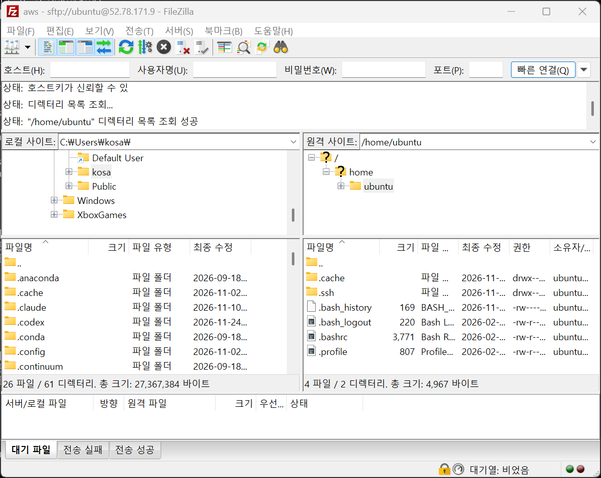

# 98일차

## SpaceLink 화면 수정과 AWS 배포 실습

📌 학습일 : 2026.11.24

📌 학습 내용 : 메인 화면 매물 TOP 5와 일정 API 연결, 매물 상세 화면 간격·글자 크기·그래프 정렬 조정, 전체 WBS 개발 순서 검토, 네이버 길찾기 방식 확인, Docker 이미지 생성과 AWS EC2 접속 실습

---

#### 1. 메인 화면에 매물 TOP 5를 연결했다

오늘은 메인 화면의 매물 TOP 5를 실제 데이터로 보여 주도록 연결했다. 처음에는 화면에 목업으로 넣어 두었던 매물들이었는데, 이제 메인 API에서 받아 온 목록을 차례로 보여 준다. 매물 이름과 지역, 종류, 층·호실 정보를 정리해 표시하고, 매물을 누르면 해당 상세 화면으로 이동하게 했다. 공지사항도 API에서 가져오도록 바꿨다.

일정 캘린더도 목업 대신 API를 연결했다. 월과 집·상가·오피스 종류, 자치구를 기준으로 일정을 불러오고, 집을 선택했을 때는 공급 유형도 필터링하도록 했다. 날짜를 선택하면 그날의 일정을 확인하고 상세 화면으로 갈 수 있다. 실제 데이터를 연결하고 나니 데이터가 없을 때 화면이 어떻게 보일지도 같이 챙겨야 했다.

#### 2. 매물 상세 화면을 보면서 간격과 크기를 다시 맞췄다

주변환경 표 옆에 있던 그래프 아래 점수 목록의 글씨가 표와 달라 보여서, 항목명과 ‘확인 필요’를 모두 13px로 맞췄다. 점수 목록을 그래프 아래에 두고 나니 그래프 높이가 부족해 버튼과 아래쪽이 맞지 않았다. 그래서 그래프 높이를 키우고 3D 주변환경 버튼도 위로 올려 주변환경 표와 정렬되게 조정했다. 불필요한 설명 문구도 삭제했다.

이번 화면 수정은 처음부터 한 번에 끝나지 않았다. 여백을 많이 잡았다가 기본정보 표와 맞지 않았고, 버튼을 옮긴 뒤 그래프가 작아 보이는 문제도 생겼다. 결국 옆에 있는 기본정보 표의 간격과 크기를 기준으로 삼아야 화면이 자연스럽게 맞는다는 걸 확인했다.

#### 3. WBS를 보고 전체 개발 순서를 다시 생각했다

WBS 파일을 열어 보니 번호가 앞선 작업이 항상 먼저 끝나는 구조는 아니었다. 개발 환경을 먼저 준비하고 데이터 출처와 DB·API 규격을 정한 뒤, 수집 파이프라인과 데이터 적재를 진행하는 편이 자연스럽다. 화면 작업은 백엔드가 끝날 때까지 기다릴 필요는 없지만, API 규격과 Mock 응답을 먼저 맞춰 놓아야 서로 병렬로 작업할 수 있다.

테스트는 마지막 주에 몰려 있고 오류 수정이 끝나기 전에 배포가 시작되는 일정이었다. 그래서 단위 테스트는 기능을 만들면서 진행하고, 전체 연동 테스트와 오류 수정을 끝낸 다음 최종 배포하는 흐름으로 정리하는 게 좋겠다고 봤다. 개발 순서를 볼 때는 WBS 번호만 볼 게 아니라 어떤 작업이 먼저 끝나야 다음 작업을 시작할 수 있는지 같이 적어야겠다고 생각했다.

#### 4. 길찾기는 네이버 기준으로 확인했다

길찾기를 우리 사이트 안에서 할 수 있는지 알아봤다. 네이버 지도 페이지를 새로 여는 방식과 사이트 화면 안에 경로를 그리는 방식은 필요한 작업이 다르다. 사이트 안에서 도보나 대중교통 경로를 보여 주려면 네이버 경로 탐색 API를 연결하고, 받은 경로를 지도에 표시하는 화면도 만들어야 한다. 기획서에는 우선 네이버 지도 페이지로 연결하는 것으로 적혀 있으니, 내부 길찾기는 제공 경로 종류와 사용량·요금 조건을 확인한 뒤 결정해야겠다. 지도 서비스 기준이 네이버인데 다른 서비스 기준으로 설명이 나와 헷갈렸던 부분도 네이버 기준으로 바로잡았다.

#### 5. AWS EC2 접속을 실습했다

로컬 Docker 이미지까지 만들고, ECR에 올린 이미지를 EC2에서 받아 컨테이너로 실행하는 흐름을 확인했다. PEM 파일은 상속 권한과 Everyone 권한을 없애고 현재 사용자에게 읽기 권한만 남겼다. 그런데 PowerShell에서는 SSH 연결이 타임아웃됐고, PuTTY에서는 주소 입력 때문에 호스트를 찾지 못하는 문제가 있었다.

타임아웃은 키 인증까지 가지 못하고 22번 포트에서 응답을 받지 못한 상태라서 키 권한만 다시 볼 게 아니었다. EC2가 켜져 있는지, 현재 퍼블릭 주소가 맞는지, 보안 그룹에 내 IP의 TCP 22번 접속이 허용됐는지, 서브넷 경로가 인터넷 게이트웨이로 연결됐는지 확인해야 한다.

FileZilla 화면에는 원격 /home/ubuntu의 디렉터리 목록 조회가 성공한 기록이 있었다. 다만 터미널에서 시도한 주소와 화면에 나온 접속 대상이 달라 보여서 같은 EC2에 접속한 것인지는 확인이 필요하다. SFTP 접속 화면은 확인했지만 EC2에서 Docker를 설치하고 실행하는 단계까지는 아직 끝내지 못했다.

#### 6. 오늘의 배포 실습 화면

#### 핵심 정리

- TOP 5와 캘린더를 실제 API에 연결할 때는 상세 이동과 데이터가 없을 때의 화면도 함께 처리해야 한다.
- 프론트엔드와 백엔드를 병렬로 개발하려면 API 규격과 Mock 응답부터 맞춰야 한다.
- WBS는 번호보다 작업 간 선행 관계와 테스트·배포 시점을 기준으로 봐야 한다.
- SSH 타임아웃은 키 권한 외에 EC2 주소, 보안 그룹, 라우팅도 확인해야 한다.
- SFTP 디렉터리 조회와 의도한 EC2의 SSH 접속·Docker 설치가 같은 단계인지는 따로 확인해야 한다.

오늘은 메인 화면과 상세 화면을 여러 번 비교하면서 작은 간격과 글자 크기도 전체 균형에 큰 영향을 준다는 걸 느꼈다. TOP 5와 일정 API를 연결하는 작업도 단순히 데이터를 가져오는 것만으로 끝나지 않고, 필터와 이동 경로, 빈 상태까지 맞춰야 실제 화면에서 자연스럽게 동작했다.

배포 실습에서는 PEM 권한을 정리했는데도 SSH가 바로 연결되지 않아 처음에는 원인을 찾기 어려웠다. 하지만 타임아웃이면 네트워크부터 확인하고, FileZilla와 터미널에서 사용한 접속 정보가 같은지 구분해야 한다는 점을 배웠다. 다음에는 현재 EC2 주소와 키를 먼저 대조하고, 22번 포트 연결부터 Docker 설치까지 한 단계씩 확인해 보려고 한다.
