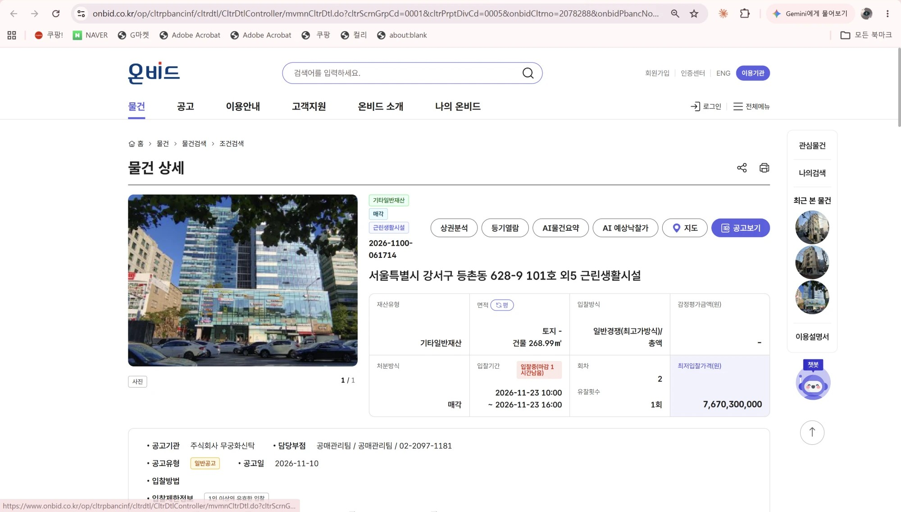
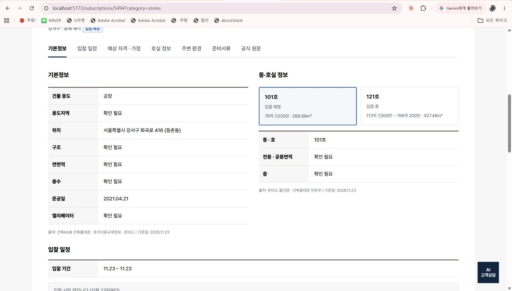

# 98일차

## 온비드 공매 데이터 관리와 매물 목록·상세 개선

📌 학습일 : 2026.11.23

📌 학습 내용 : UI-028 상가·오피스 데이터 관리 API 연동, 온비드 일괄매각 호실 수집·표시, 주소 그룹 기준 매물 목록 페이징, 로그인 상태별 추천 정렬, 상세 화면 호실 탐색 UI, API·프론트 빌드 확인

---

#### 1. UI-028 관리자 화면을 실제 데이터와 연결했다

기존 관리자 상가·오피스 화면은 목업 데이터 중심이었기 때문에, 화면에서 쓰는 데이터 흐름과 서버 기능을 함께 확인하고 API에 연결했다. 데이터 목록과 공개·숨김 상태 변경, 좌표 보정, 호실 정보 수정, 출처별 수집 상태 조회, 실패 상세 확인과 재수집 흐름을 이어 주었다.

온비드 수집에 실패한 물건은 자동으로 다시 공개하지 않고, 관리자가 오류 상태를 확인한 다음 공개하도록 처리했다. 수집 성공 여부와 실제 사용자 화면에 노출해도 되는지는 별도의 승인 기준으로 다뤄야 한다는 점을 반영했다.

#### 2. 온비드 일괄매각의 대표 정보와 호실 정보를 분리했다

온비드 물건 중 일괄매각 대상은 상세 API에서 묶음 호실 목록을 받아 저장하도록 연결했다. 목록 제목에는 대표 호실과 ‘외 n건’을 표시하고, 묶음 전체의 호실 정보는 상세 화면에서 확인할 수 있도록 데이터 구조와 화면을 맞췄다. 묶음의 총 호실 수는 목록 제목을 설명하는 값이며, 목록 페이징 단위로 사용하지 않는다.

묶음 정보가 정상적으로 확보되지 않은 경우에는 물건을 숨김 상태로 두고 수집 오류를 남겨 관리자가 확인할 수 있게 했다. 확인되지 않은 호실 정보를 임의로 공개하지 않는 기획서의 운영 기준을 반영했다.

#### 3. 매물 목록은 주소 그룹을 기준으로 10개씩 나눴다

여러 호실이나 물건이 같은 주소에 속하면 목록에서는 주소 단위로 묶어 한 항목처럼 보여 주고, 제목에 대표 물건과 ‘외 n건’을 표시한다. 페이지당 10건은 이 주소 그룹을 기준으로 계산한다. 그룹에 포함된 추가 물건 수를 페이지 건수에 더하지 않도록 목록 집계와 상세의 연관 물건 수를 분리했다.

페이징 전에 먼저 그룹을 만들어야 페이지마다 물건 수가 달라지거나 같은 주소 그룹이 여러 페이지로 쪼개지는 문제를 막을 수 있다. 실제 API에서 1·2페이지가 각각 주소 그룹 10개를 반환하고 서로 겹치지 않는지 확인했으며, 전체 632개 그룹이 64페이지로 계산되는 것도 확인했다.

#### 4. 로그인 상태에 따라 정렬 기준을 나눴다

비로그인 사용자는 별도 개인화 점수 없이 기본 정렬 기준을 이용한다. 로그인 사용자는 저장된 희망 조건에 맞는 추천순을 가장 앞에 두고, 나머지 기본 정렬 기준을 이어서 제공하도록 기준을 구분했다. 로그인하지 않은 상태에서 사용자 조건 조회가 실패하더라도 목록 화면 자체가 깨지지 않도록 인증 확인과 추천 기능의 영향을 분리했다.

#### 5. 상세 화면에서 호실을 두 개씩 탐색하게 했다

건물 상세의 호실 선택 영역은 한 화면에 카드 두 개를 보여 주고 양쪽의 이전·다음 화살표로 이동하도록 구성했다. 이 이동은 주소 그룹 목록 페이징과 구분되는 상세 안의 호실 탐색이다. 로그인 상태에서는 사용자의 희망 조건을 정렬에 활용하고, 비로그인 상태에서는 기존 순서를 유지한다.

#### 6. 오늘 확인한 화면

#### 핵심 정리

- 목록에서 세는 단위와 카드 제목에 덧붙이는 ‘외 n건’은 서로 다른 데이터다. 페이지당 10건은 주소 그룹 수를 기준으로 한다.
- 그룹화는 페이징보다 먼저 처리해야 한다. 원본 물건을 먼저 자른 뒤 화면에서 묶으면 페이지별 개수와 그룹 경계가 달라진다.
- 일괄매각은 대표 제목과 상세 호실 목록을 분리해 제공해야 한다.
- 개인화 정렬은 로그인 상태와 사용자 조건이 확인된 경우에 적용하고, 비로그인 기본 이용 흐름과 독립적으로 동작해야 한다.
- API의 페이지 결과와 상세 연관 데이터를 함께 확인해야 화면의 목록·페이징·상세 정보가 일치하는지 검증할 수 있다.

프론트엔드 빌드는 통과했고 API에서 1·2페이지의 그룹 수와 중복 여부, 대표 그룹의 상세 연관 물건 수를 확인했다. 빌드에는 기존 코드 분할 크기 경고가 남아 있었다.

화면을 빨리 고치는 것보다 먼저 기획서에서 목록의 단위, 상세의 범위, 정렬 조건을 각각 확인하는 게 중요하다는 점을 다시 배웠다. ‘외 몇 건’은 카드 제목의 요약 표현이고 페이지당 10건은 주소 그룹의 수라는 차이를 놓치면 화면 숫자와 실제 목록이 어긋날 수 있다. 앞으로도 기획서의 표시 규칙을 데이터 모델과 API 응답 기준으로 먼저 옮긴 뒤 UI를 연결해야겠다.
