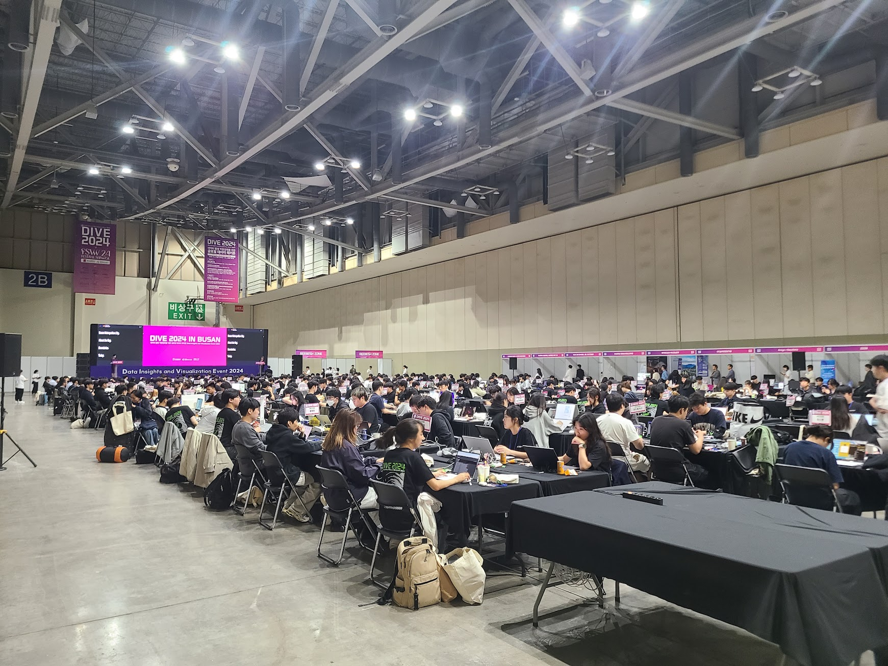
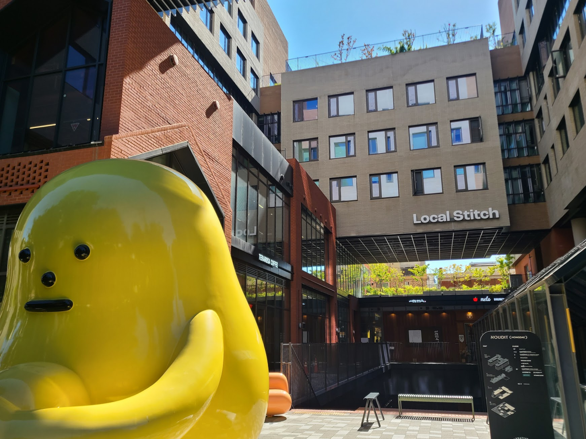
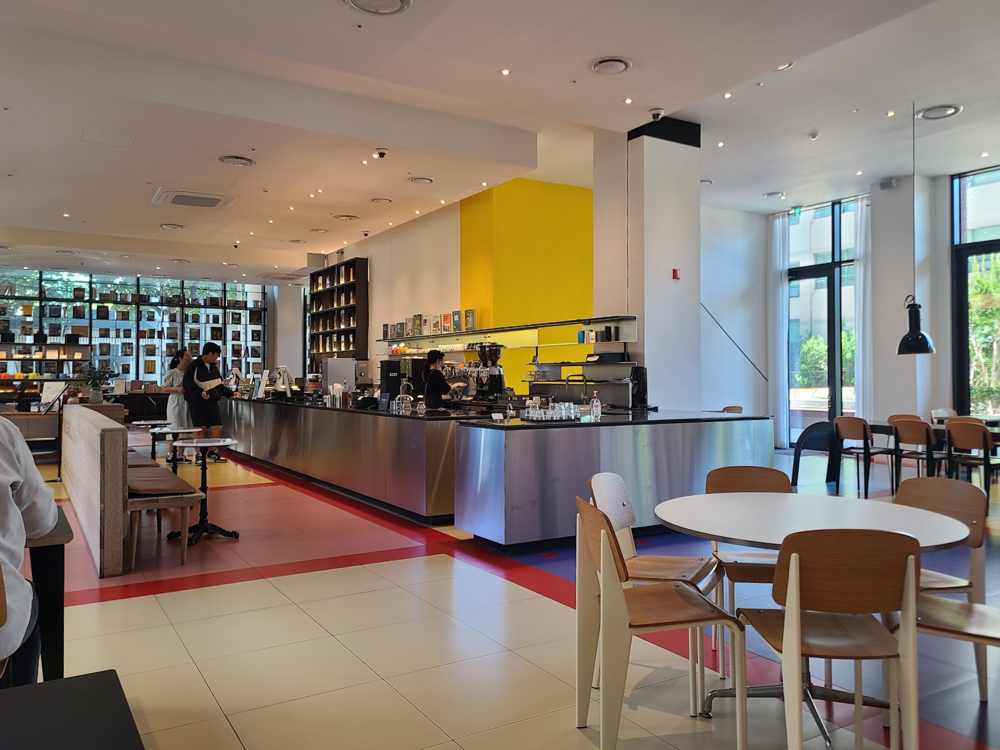
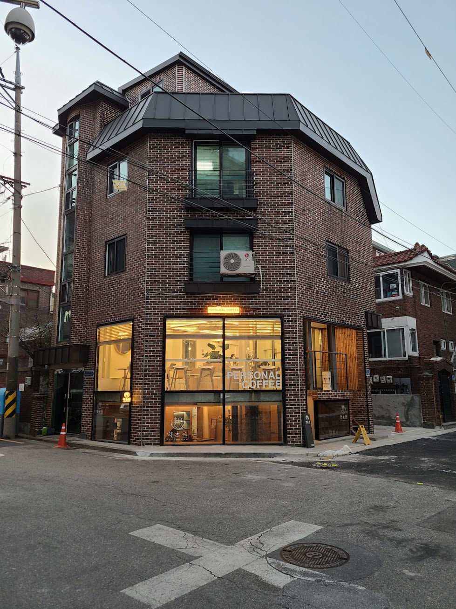
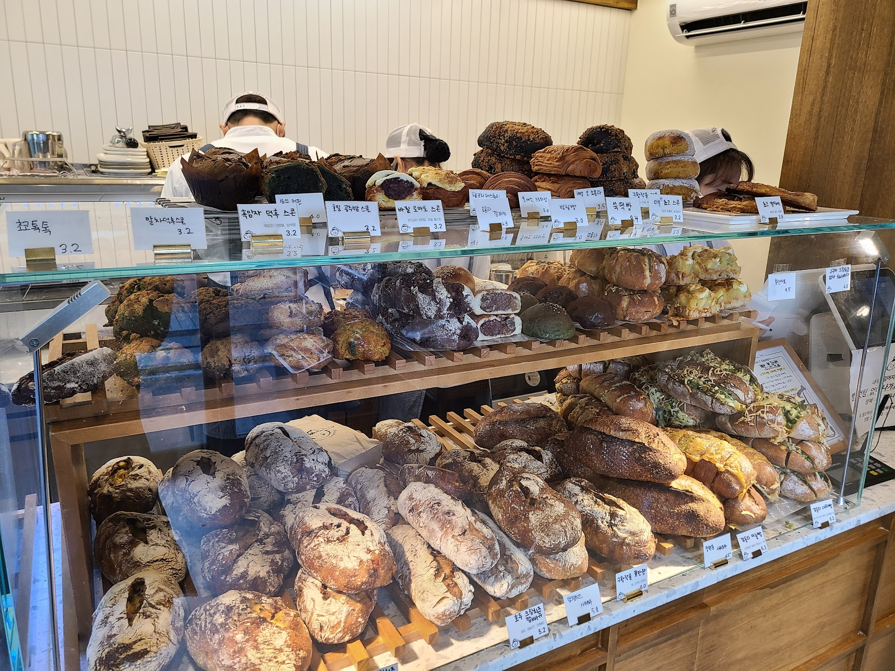
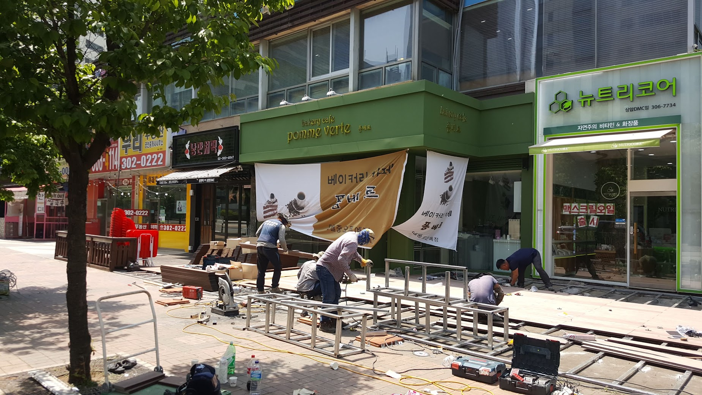
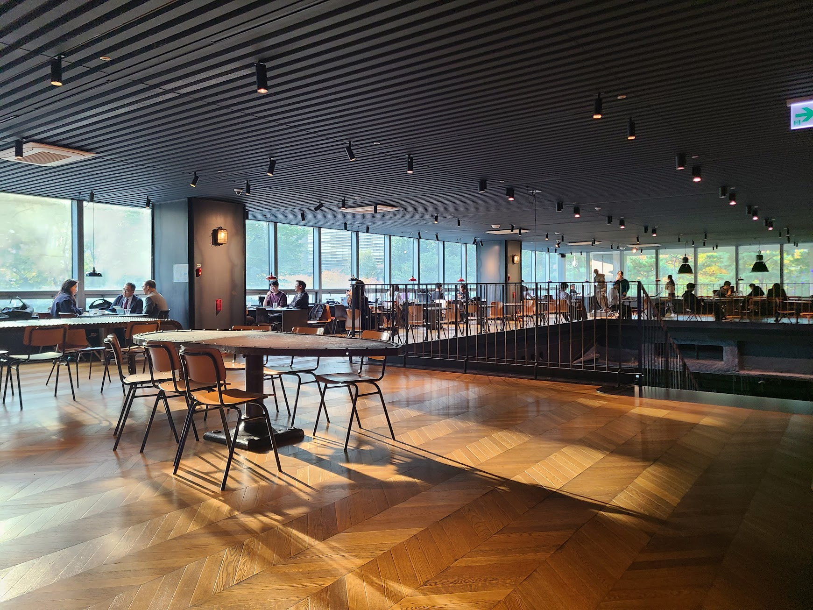
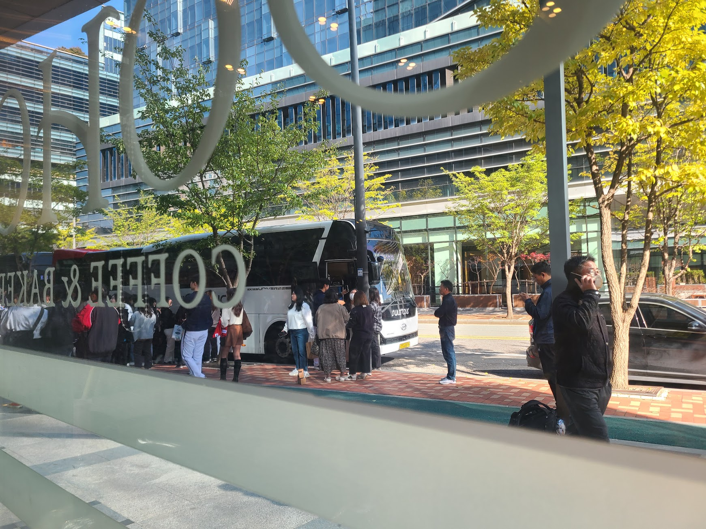

## 문제 1

Q: 다음 이미지에 대한 설명 중 옳지 않은 것은 무엇인가요?
- (1) 다수의 사람들이 큰 실내 공간에서 노트북을 사용하고 있습니다.
- (2) 행사장은 'DIVE 2024 IN BUSAN'이라는 문구가 보입니다.
- (3) 천장에 화려한 조명이 켜져 있습니다.
- (4) 실내는 주로 파란색과 초록색으로 장식되어 있습니다.

정답: (4) 실내는 주로 파란색과 초록색이 아닌, 다양한 색상으로 장식되어 있습니다.

---------------------

## 문제 2

Q: 다음 이미지에 대한 설명 중 옳지 않은 것은 무엇인가요?
- (1) 노란색 조형물이 이미지 왼쪽에 있습니다.
- (2) 건물에는 "Local Stitch"라는 글자가 보입니다.
- (3) 조형물은 사진의 중심에 위치해 있습니다.
- (4) 건물의 창문이 여러 개 보입니다.

정답: (3) 조형물은 사진의 중심이 아닌 왼쪽에 위치해 있습니다.

---------------------

## 문제 3

Q: 다음 이미지에 대한 설명 중 옳지 않은 것은 무엇인가요?
- (1) 카페 내부가 현대적인 인테리어로 꾸며져 있습니다.
- (2) 노란색 벽면이 인상적인 카운터가 있습니다.
- (3) 카페의 모든 의자가 검은색입니다.
- (4) 자연광이 들어오는 큰 창문이 보입니다.

정답: (3) 카페의 모든 의자가 검은색이 아닌 갈색과 흰색입니다.

---------------------

## 문제 4

Q: 다음 이미지에 대한 설명 중 옳지 않은 것은 무엇인가요?
- (1) 건물은 붉은 벽돌로 지어져 있습니다.
- (2) 1층 창문에는 "PERSONAL COFFEE"라는 글자가 보입니다.
- (3) 건물의 정면에 노란색 장애물 주의 표지판이 있습니다.
- (4) 건물 옥상에는 정원이 조성되어 있습니다.

정답: (4) 건물 옥상에는 정원이 조성되어 있지 않습니다.

---------------------

## 문제 5

Q: 다음 이미지에 대한 설명 중 옳지 않은 것은 무엇인가요?
- (1) 베이커리 진열대 위에 다양한 종류의 빵이 진열되어 있습니다.
- (2) 가장 위 진열대에는 크루아상과 머핀 같은 빵이 보입니다.
- (3) 모든 빵의 가격은 4.5 이상입니다.
- (4) 점원은 흰색 모자를 쓰고 있습니다.
    
정답: (3) 모든 빵의 가격이 4.5 이상인 것은 아닙니다.

---------------------

## 문제 6

Q: 다음 이미지에 대한 설명 중 옳지 않은 것은 무엇인가요?
- (1) 작업자들은 구조물을 설치하고 있습니다.
- (2) 가게 이름이 '베이커리 카페 폼베르트' 입니다.
- (3) '뉴트리코어' 가게가 공사 현장 왼쪽에 위치해 있습니다.
- (4) 나무에 잎이 무성하게 자라 있습니다.

정답: (3) '뉴트리코어' 가게는 공사 현장 오른쪽에 위치해 있습니다.

---------------------

## 문제 7

Q: 다음 이미지에 대한 설명 중 옳지 않은 것은 무엇인가요?

- (1) 이미지 속 공간은 카페처럼 보입니다.
- (2) 사람들이 테이블에 앉아 대화를 나누고 있는 모습이 보입니다.
- (3) 바닥은 나무 소재로 되어 있습니다.
- (4) 테이블 위에 꽃병이 여러 개 놓여 있습니다.

정답: (4) 테이블 위에 꽃병이 놓여 있지 않습니다.

---------------------

## 문제 8

Q: 다음 이미지에 대한 설명 중 옳지 않은 것은 무엇인가요?
- (1) 사람들이 버스 앞에 모여 있는 모습이 담겨 있습니다.
- (2) 버스 옆에는 나무들이 보입니다.
- (3) 사람들은 모두 줄을 서서 차를 기다리고 있습니다.
- (4) 사진은 실내에서 촬영된 것으로 보입니다.

정답: (3) 사람들은 모두 줄을 서서 차를 기다리고 있지 않습니다.

---------------------

